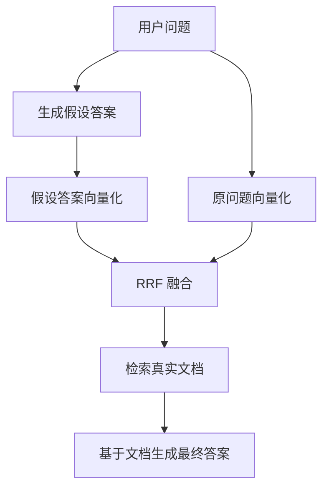

### Q1192 · HyDE:假设文档检索的概念与桩

> 难度:★★★★ | 标签:RAG, 检索

**问**:HyDE 是什么?为什么"先让模型编个答案"反而能提升检索?

**答**:HyDE(Hypothetical Document Embeddings):先用 LLM 生成一个"假设性答案"(可能是错的),把它向量化后去检索,用检回的真实文档生成最终答案。原理:答案文档与目标文档在嵌入空间更近——问题与答案的表达方式差异大,而"假设答案"和"真实答案"风格、用词、密度都接近,相似度判别更准。代价:多一次生成调用;风险:假设答案带偏检索方向,所以通常与原 query 双路并行再 RRF。适合问题短、文档长、专业领域问答。

```python
# file: code/06_Agent与LLM及系统设计/q1192_hyde.py
"""HyDE 桩:假设答案生成 -> 双路检索 -> RRF 融合,对比纯 query 检索。"""
import hashlib, math


def embed(text, dim=64):
    v = [0.0] * dim
    for tok in text.split():
        v[int(hashlib.md5(tok.encode()).hexdigest(), 16) % dim] += 1.0
    n = math.sqrt(sum(x * x for x in v)) or 1.0
    return [x / n for x in v]


def cosine(a, b):
    return sum(x * y for x, y in zip(a, b))


def fake_llm_answer(q):
    """FakeLLM 桩:生成假设答案(可能含编造细节,但用词接近文档)。"""
    return "退货 运费 由 买家 承担 七天 无理由 退货 流程 在 订单 页 发起"


class HyDERetriever:
    def __init__(self, docs):
        self.docs, self.vecs = docs, [embed(d) for d in docs]

    def _search(self, text, k=2):
        qv = embed(text)
        ranked = sorted(range(len(self.docs)),
                        key=lambda i: cosine(qv, self.vecs[i]), reverse=True)
        return [(self.docs[i], r) for r, i in enumerate(ranked[:k])]

    def search_plain(self, q, k=2):
        return self._search(q, k)

    def search_hyde(self, q, k=2):
        hypo = fake_llm_answer(q)
        rrf = {}
        for lst in (self._search(q, k), self._search(hypo, k)):
            for doc, rank in lst:
                rrf.setdefault(doc, 0.0)
                rrf[doc] += 1.0 / (60 + rank + 1)
        return sorted(rrf.items(), key=lambda x: -x[1])


if __name__ == "__main__":
    docs = ["退货 运费 由 买家 承担", "七天 无理由 退货 在 订单 页 发起", "发货 48 小时 内 顺丰 承运", "退款 3 个 工作日 到账"]
    r = HyDERetriever(docs)
    plain = [d for d, _ in r.search_plain("退货 运费 怎么算", k=2)]
    hyde = [d for d, _ in r.search_hyde("退货 运费 怎么算", k=2)]
    print("纯 query:", plain)
    print("HyDE 融合:", hyde)
    assert hyde[0] == "退货 运费 由 买家 承担"
    assert len(hyde) >= len(plain), "双路融合覆盖更多相关文档"
    print("假设答案拉近了问题与文档的向量距离,融合后召回更稳")
```

**追问**:
- 假设答案错得离谱怎么办?答:HyDE 只影响检索不影响生成,错答案只是换个检索探针;把原 query 保留一路 + RRF,错方向会被多数票稀释。
- 什么场景别用 HyDE?答:query 本身就是文档式长文本(已经接近答案分布)时收益为零,纯增加延迟;精确标识符检索也不用。


