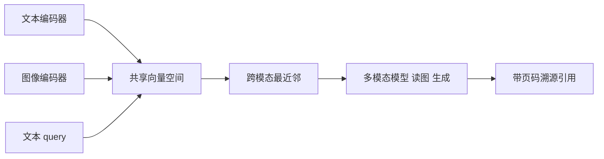

### Q1196 · 多模态 RAG:图文双塔概念

> 难度:★★★☆ | 标签:RAG, 多模态

**问**:文档里有大量图表,纯文本 RAG 丢了信息,多模态 RAG 怎么做?

**答**:主流三方案:图文双塔(图片与文本各自编码到同一向量空间,跨模态检索)、图文交替生成(用多模态模型把图转成详尽文本描述,文本入库)、页级截图 + 多模态模型直读。双塔检索时,query 文本向量与图片向量直接算相似度,命中后把原图 + 周边文本一起给多模态 LLM 生成。工程要点:图表转描述会丢数据精度(坐标、趋势),关键图表保留原图直读;描述文本要带"所属文档与页码"元数据以便溯源;向量空间对齐质量决定跨模态召回上限。

```python
# file: code/06_Agent与LLM及系统设计/q1196_multimodal_rag.py
"""多模态 RAG 概念桩:图文双塔共用向量空间,跨模态检索 + 元数据溯源。"""
import hashlib, math, re


def _tok(text):
    return re.findall(r"[a-z0-9]+|[\u4e00-\u9fff]", text.lower())


def embed_text(text, dim=32):
    v = [0.0] * dim
    for tok in _tok(text):
        v[int(hashlib.md5(tok.encode()).hexdigest(), 16) % dim] += 1.0
    n = math.sqrt(sum(x * x for x in v)) or 1.0
    return [x / n for x in v]


def embed_image_stub(image_id, dim=32):
    """桩:真实场景是视觉编码器;这里用图片 id 与描述哈希模拟同空间对齐。"""
    return embed_text(image_id.replace("_", " "), dim)


def cosine(a, b):
    return sum(x * y for x, y in zip(a, b))


class MultimodalIndex:
    def __init__(self):
        self.items = []       # {"type", "vec", "meta"}

    def add_text(self, text, meta):
        self.items.append({"type": "text", "vec": embed_text(text), "meta": meta})

    def add_image(self, image_id, caption_meta):
        self.items.append({"type": "image", "vec": embed_image_stub(image_id), "meta": caption_meta})

    def search(self, query, k=2):
        qv = embed_text(query)
        return sorted(self.items, key=lambda it: cosine(qv, it["vec"]), reverse=True)[:k]


if __name__ == "__main__":
    idx = MultimodalIndex()
    idx.add_text("季度 营收 增长 15%", {"doc": "q3报告", "page": 2})
    idx.add_image("fig_季度营收曲线", {"doc": "q3报告", "page": 3, "kind": "chart"})
    idx.add_text("风险 提示 汇率 波动", {"doc": "q3报告", "page": 9})

    hits = idx.search("营收 曲线 图")
    for h in hits:
        print(f"  [{h['type']}] page={h['meta']['page']} {h['meta']}")
    assert hits[0]["type"] == "image", "跨模态命中图片"
    assert hits[0]["meta"]["page"] == 3, "可溯源到页码"
    assert hits[1]["type"] == "text", "文本证据同时召回"
    print("双塔同空间检索:文本 query 直接命中相关图表与文本")
```

**追问**:
- 图表数据精度怎么保?答:图表元信息入库时附"数据表"(若可解析),检索命中后把数据表给 LLM 而不是只看图,模型读数总比读图准。
- 跨模态召回差怎么排查?答:用"已知图 → 找 query"构造跨模态 golden 集,分模态看命中率,通常是编码器没对齐或描述太短。


