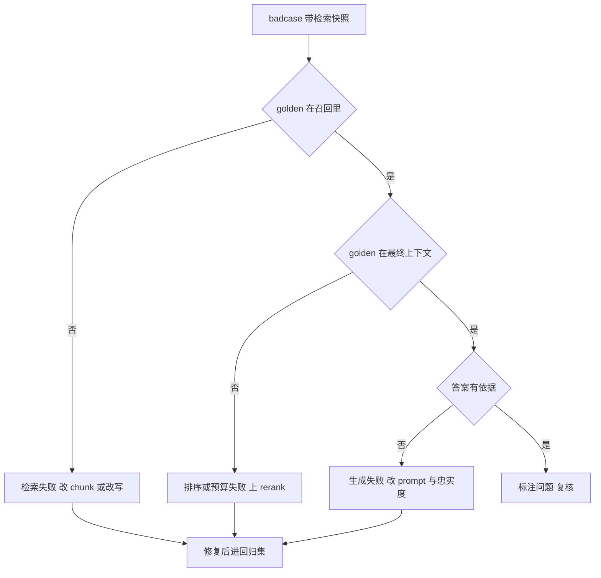

### Q1200 · badcase 归因:检索错误还是生成错误

> 难度:★★★★ | 标签:RAG, 评估

**问**:一个 RAG 答案错了,怎么系统归因?归因数据怎么驱动优化?

**答**:归因四分法:检索失败(golden chunk 没进候选)、排序失败(进了候选但排太后被截断)、上下文冲突(进了但被其他片段干扰或超预算被裁掉)、生成失败(上下文里有正确依据,答案仍错)。实现:对每个 badcase 记录检索列表与排名、最终上下文、生成答案,跑自动判定——golden 是否在候选(检索)、是否在最终上下文(排序/预算)、依据句与答案句一致性(生成)。统计分布决定优先级:哪类占比高先修哪类,避免"凭感觉改 prompt"。

```python
# file: code/06_Agent与LLM及系统设计/q1200_badcase_attribution.py
"""badcase 四分归因:检索/排序/上下文/生成,自动判定并输出修复优先级。"""


def attribute(recall_top_k, final_context_ids, gold_chunk, answer_supported):
    """gold_chunk: golden 是否存在;recall_top_k: 召回列表;final_context_ids: 最终上下文"""
    if gold_chunk not in recall_top_k:
        return "retrieval_failure"
    if gold_chunk not in final_context_ids:
        return "ranking_or_budget_failure"
    if not answer_supported:
        return "generation_failure"
    return "other_or_ok"


def audit(cases):
    stats = {}
    for c in cases:
        label = attribute(c["recall"], c["recall"][: c["context_size"]],
                          c["gold"], c["supported"])
        stats[label] = stats.get(label, 0) + 1
        c["label"] = label
    total = len(cases)
    ranked = sorted(stats.items(), key=lambda x: -x[1])
    fixes = {"retrieval_failure": "改 chunk 策略或加查询改写",
             "ranking_or_budget_failure": "上 rerank 或扩上下文预算",
             "generation_failure": "改 prompt 或加忠实度校验",
             "other_or_ok": "复核标注"}
    print("归因分布与修复动作:")
    for label, n in ranked:
        print(f"  {label:<28} {n:>2} 条 ({n/total:.0%}) -> {fixes[label]}")
    return stats


if __name__ == "__main__":
    cases = [
        {"recall": ["d9", "d1"], "context_size": 1, "gold": "d1", "supported": True},
        {"recall": ["d1", "d9"], "context_size": 1, "gold": "d1", "supported": False},
        {"recall": ["d9", "d8"], "context_size": 2, "gold": "d1", "supported": False},
    ]
    # case1: d1 召回了但截断没进上下文 -> 排序/预算
    # case2: d1 进了上下文但答案无依据 -> 生成
    # case3: d1 根本没召回 -> 检索
    stats = audit(cases)
    assert stats["ranking_or_budget_failure"] == 1
    assert stats["generation_failure"] == 1
    assert stats["retrieval_failure"] == 1
    print("每类失败都能自动定位到对应修复动作")
```

**追问**:
- 归因显示检索失败占比 60%,先改什么?答:先看查询与语料的用词差距(上查询改写),再实验 chunk 策略(Q1187 框架),最后考虑换 embedding——成本从低到高逐级试。
- supported 标记谁打?答:离线用"依据句重叠 + LLM Judge"自动初标,人工复核争议样本;标注标准固化成规范进评估集文档。


