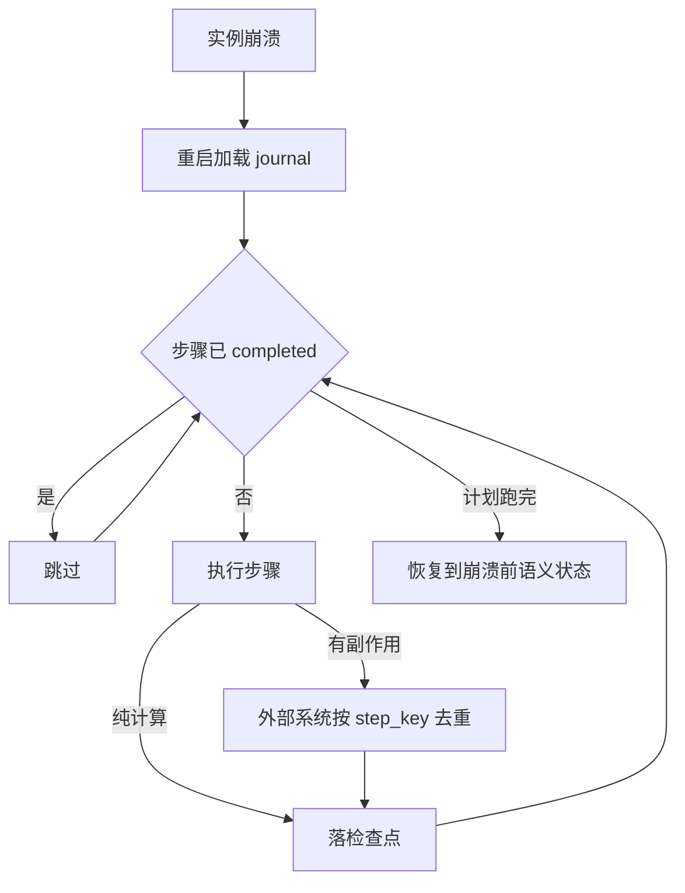

### Q1205 · Agent 工作流的幂等与重放

> 难度:★★★★ | 标签:多 Agent, 可靠性

**问**:多 Agent 工作流跑到一半实例挂了,重启后怎么续跑且不重复执行副作用?

**答**:两个机制配合:步骤级检查点(每步完成落 journal,重启跳过已完成)+ 步骤级幂等(每步带稳定的 step_key,外部副作用用 step_key 作 idempotency key,重放时服务端去重)。与 Q1147 的区别在多 Agent:还要保证"消息投递"幂等——任务消息带 run_id + step_key,工人侧按 key 去重。重放顺序要确定性:同输入产生同任务序列(规划器温度 0 或规则化),否则重放会分叉出新路径。

```python
# file: code/06_Agent与LLM及系统设计/q1205_workflow_idempotent_replay.py
"""多 Agent 工作流幂等重放:step_key 检查点 + 副作用去重 + 确定性重放。"""


class Journal:
    def __init__(self):
        self.completed = {}       # step_key -> result
        self.side_effects = set() # 幂等键

    def has(self, key):
        return key in self.completed

    def mark(self, key, result):
        self.completed[key] = result


class SideEffectBus:
    """模拟外部系统:按幂等键去重。"""

    def __init__(self):
        self.executed, self.duplicates = [], 0

    def call(self, idem_key, payload):
        if idem_key in self.executed:
            self.duplicates += 1
            return "deduped"
        self.executed.append(idem_key)
        return f"executed {payload}"


def run_workflow(journal, bus, plan):
    """确定性计划:相同输入产生相同 step_key 序列。"""
    for step_id, effect in plan:
        key = f"run-42:{step_id}"
        if journal.has(key):
            print(f"  跳过 {step_id}(检查点已有)")
            continue
        if effect:
            r = bus.call(key, step_id)
            print(f"  执行副作用 {step_id} -> {r}")
        journal.mark(key, "done")


if __name__ == "__main__":
    plan = [("s1_search", False), ("s2_write_db", True), ("s3_notify", True)]
    journal = Journal()
    bus = SideEffectBus()

    # 第一次跑到 s2 前崩溃
    run_workflow(journal, bus, plan[:1])
    print("崩溃前:", list(journal.completed))
    # 重启重放全计划
    run_workflow(journal, bus, plan)
    print("重放后:", sorted(journal.completed))
    assert set(journal.completed) == {"run-42:s1_search", "run-42:s2_write_db", "run-42:s3_notify"}
    assert bus.duplicates == 0, "重放不得重复副作用"
    assert sorted(bus.executed) == ["run-42:s2_write_db", "run-42:s3_notify"]
    # 恢复完成后误触发第三次全量重放
    run_workflow(journal, bus, plan)
    assert bus.duplicates == 0 and len(journal.completed) == 3, "检查点直接跳过,不会重复执行副作用"
    print("幂等重放闭环:检查点跳过 + 外部副作用幂等键双保险")
```

**追问**:
- step_key 怎么保证"同一步"跨重启一致?答:用语义键(run_id + 步骤语义名 + 关键输入 hash),不用自增序号——序号会因动态规划变化而错位。
- 计划本身不确定(带 LLM 规划)怎么办?答:规划结果一旦产出立即持久化为"执行计划快照",重放按快照跑,规划只发生一次。


