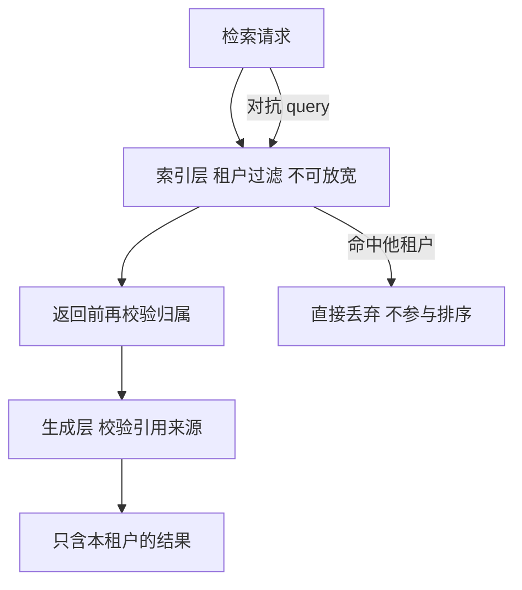

### Q1210 · 多租户 RAG 隔离

> 难度:★★★★ | 标签:RAG, 安全

**问**:多个公司共用一套 RAG,怎么保证 A 公司绝对检索不到 B 公司的文档?

**答**:三层隔离任选组合:物理隔离(每租户独立索引,最贵最稳)、逻辑隔离(共享索引 + 租户字段强制过滤)、混合(大租户独立、小租户共享)。关键纪律:租户过滤是权限级 filter,绝不允许"检索质量优化"为由放宽;索引层、检索层、生成层三处都校验租户(纵深防御,单层被绕过不泄漏);测试要包含"跨租户对抗用例"(构造诱导跨租户检索的 query)进回归。共享索引还要防侧信道:通过命中数/延迟差推断他租户文档存在,敏感场景需加噪声或独立索引。

```python
# file: code/06_Agent与LLM及系统设计/q1210_tenant_isolation.py
"""多租户 RAG:租户字段强制过滤 + 三层纵深校验 + 跨租户对抗测试。"""
import hashlib, math


def embed(text, dim=32):
    v = [0.0] * dim
    for tok in text.split():
        v[int(hashlib.md5(tok.encode()).hexdigest(), 16) % dim] += 1.0
    n = math.sqrt(sum(x * x for x in v)) or 1.0
    return [x / n for x in v]


def cosine(a, b):
    return sum(x * y for x, y in zip(a, b))


class TenantRAG:
    def __init__(self):
        self.index = []          # {"tenant", "text", "vec"}

    def add(self, tenant, text):
        self.index.append({"tenant": tenant, "text": text, "vec": embed(text)})

    def search(self, tenant, q, k=2):
        # 第 1 层:检索层强制过滤(不可放宽)
        pool = [it for it in self.index if it["tenant"] == tenant]
        assert pool is not None
        qv = embed(q)
        hits = sorted(pool, key=lambda it: cosine(qv, it["vec"]), reverse=True)[:k]
        # 第 2 层:返回前再校验(纵深防御)
        safe = [h for h in hits if h["tenant"] == tenant]
        return safe


class GenLayer:
    """第 3 层:生成层校验引用来源归属。"""

    @staticmethod
    def guard(tenant, hits):
        for h in hits:
            if h["tenant"] != tenant:
                raise PermissionError("跨租户引用被拦截")
        return "ok"


if __name__ == "__main__":
    rag = TenantRAG()
    rag.add("A公司", "A 的 薪酬 政策 薪资 带宽")
    rag.add("A公司", "A 的 采购 流程")
    rag.add("B公司", "B 的 薪酬 政策 薪资 带宽 机密")

    hits = rag.search("A公司", "薪酬 政策 薪资 带宽")
    print("A 租户检索结果:", [h["text"] for h in hits])
    assert all(h["tenant"] == "A公司" for h in hits), "B 文档绝不能出现"
    assert any("B" in h["text"] for h in []) is False

    # 对抗用例:诱导性 query 也要隔离
    adversarial = rag.search("A公司", "B公司 机密 薪资 带宽 泄露")
    assert all(h["tenant"] == "A公司" for h in adversarial)
    print("对抗 query 也无法跨租户")

    assert GenLayer.guard("A公司", hits) == "ok"
    try:
        GenLayer.guard("A公司", [{"tenant": "B公司", "text": "x"}])
    except PermissionError as e:
        print("生成层拦截:", e)
    print("三层纵深:索引过滤 + 返回校验 + 生成层归属检查")
```

**追问**:
- 租户级性能干扰(某大租户拖慢所有人)怎么办?答:检索并发按租户配额隔离(Q1162 思路),超大租户迁独立索引,容量规划按租户分桶。
- 租户删除数据要立刻不可见吗?答:要——删除先走墓碑过滤(读路径立即生效),向量物理清理异步;合同承诺的"立即删除"指不可见,不含物理擦除时限。


