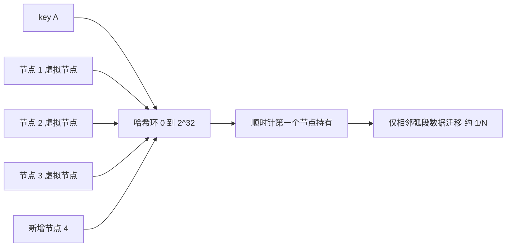

### Q1218 · 一致性哈希与虚拟节点

> 难度:★★★★ | 标签:分片, 负载均衡

**问**:手写一致性哈希。为什么需要虚拟节点?节点增减时数据迁移量是多少?

**答**:普通哈希取模在节点数变化时几乎全部重映射;一致性哈希把节点与 key 都映射到环上,key 归顺时针遇到的第一个节点,节点增减只影响相邻弧段,理想情况迁移 1/N。虚拟节点解决两个问题:节点在环上分布不均导致负载倾斜;异构机器权重不同。每个物理节点生成 100-200 个 vnode 打散在环上。手写要点:排序的环数组 + 二分查找定位;节点下线只删自己的 vnode。

```python
# file: code/06_Agent与LLM及系统设计/q1218_consistent_hash.py
"""一致性哈希:虚拟节点 + 环上二分查找,统计节点增减的迁移比例。"""
import bisect, hashlib


def h(s):
    return int(hashlib.md5(s.encode()).hexdigest(), 16)


class HashRing:
    def __init__(self, nodes, vnodes=100):
        self.ring, self.keys = {}, []
        for n in nodes:
            self.add_node(n)

    def add_node(self, node, vnodes=100):
        for i in range(vnodes):
            key = h(f"{node}#vn{i}")
            self.ring[key] = node
        self.keys = sorted(self.ring)

    def remove_node(self, node, vnodes=100):
        for i in range(vnodes):
            self.ring.pop(h(f"{node}#vn{i}"), None)
        self.keys = sorted(self.ring)

    def get(self, key):
        if not self.keys:
            return None
        idx = bisect.bisect(self.keys, h(key)) % len(self.keys)
        return self.ring[self.keys[idx]]


def movement(old_nodes, new_nodes, n_keys=3000):
    old_ring, new_ring = HashRing(old_nodes), HashRing(new_nodes)
    keys = [f"key-{i}" for i in range(n_keys)]
    moved = sum(1 for k in keys if old_ring.get(k) != new_ring.get(k))
    return moved / n_keys


if __name__ == "__main__":
    ring = HashRing(["n1", "n2", "n3"])
    dist = {}
    for i in range(3000):
        node = ring.get(f"key-{i}")
        dist[node] = dist.get(node, 0) + 1
    print("3 节点负载分布:", dist)
    assert all(v > 500 for v in dist.values()), "虚拟节点应打散负载"

    m_add = movement(["n1", "n2", "n3"], ["n1", "n2", "n3", "n4"])
    m_del = movement(["n1", "n2", "n3"], ["n1", "n2"])
    print(f"加节点迁移 {m_add:.1%},删节点迁移 {m_del:.1%}")
    assert m_add < 0.45 and m_del < 0.45, "一致性哈希迁移应接近 1/N 而非全量"
    print("对比取模哈希(全量重映射),迁移量大幅下降")
```

**追问**:
- 虚拟节点数量怎么定?答:经验 100-200 个/节点;太少分布仍倾斜,太多环表内存与查找开销涨,容量大集群用带权 vnode(权重高的节点 vnode 更多)。
- 有倾斜热点 key 怎么办?答:一致性哈希解决的是"节点分布倾斜",热点 key 要另用加盐打散(Q1235),两者正交。


