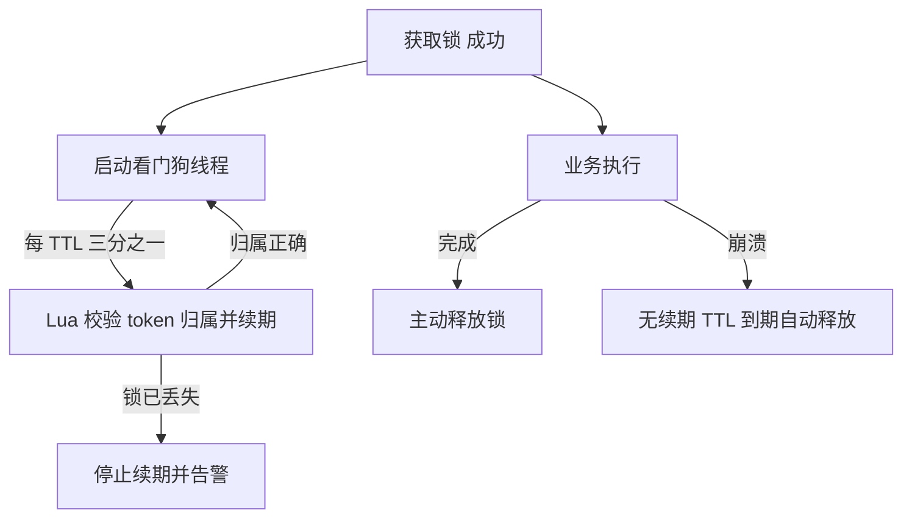

### Q1222 · 分布式锁续期看门狗桩

> 难度:★★★★ | 标签:分布式锁, 可靠性

**问**:分布式锁设了 30 秒 TTL,任务跑了 5 分钟,怎么办?续期看门狗怎么写?

**答**:看门狗模式:持锁后启动后台线程,每 TTL/3 时间检查"任务还活着"就用 Lua 原子校验锁归属并延长 TTL(校验归属防止给别人的锁续命);任务结束/崩溃后看门狗停止,锁到期自然释放。四个坑:续期必须带 token 校验(持有者证明);进程崩溃看门狗也死,锁自动过期,这正是设计意图;主从切换导致的锁丢失看门狗救不了(见 Q1223);续期线程要与业务心跳联动,任务卡死但线程活着时该"不续期"由业务声明。

```python
# file: code/06_Agent与LLM及系统设计/q1222_lock_watchdog.py
"""分布式锁看门狗:token 归属校验 + 后台续期 + 崩溃自动释放。"""
import threading, time


class RedisLockStub:
    def __init__(self, ttl=0.3):
        self.ttl, self.holder, self.expires_at = ttl, None, 0
        self.lock = threading.Lock()

    def acquire(self, token):
        with self.lock:
            now = time.monotonic()
            if self.holder is None or now > self.expires_at:
                self.holder, self.expires_at = token, now + self.ttl
                return True
            return False

    def renew(self, token):
        """Lua 语义:校验 token 归属后才续期,原子完成。"""
        with self.lock:
            if self.holder == token:
                self.expires_at = time.monotonic() + self.ttl
                return True
            return False

    def release(self, token):
        with self.lock:
            if self.holder == token:
                self.holder, self.expires_at = None, 0
                return True
            return False

    def held_by(self):
        return self.holder if time.monotonic() < self.expires_at else None


class Watchdog:
    def __init__(self, lock, token, interval=None):
        self.lock, self.token = lock, token
        self.interval = interval or lock.ttl / 3
        self.stop = threading.Event()
        self.renewals = 0
        self.thread = threading.Thread(target=self._run, daemon=True)

    def start(self):
        self.thread.start()

    def _run(self):
        while not self.stop.wait(self.interval):
            if not self.lock.renew(self.token):
                break                      # 锁已被夺走,续期失败即退出

    def shutdown(self):
        self.stop.set()
        self.thread.join(timeout=1)


if __name__ == "__main__":
    lock = RedisLockStub(ttl=0.3)
    token = "worker-1:job-9"
    assert lock.acquire(token)
    wd = Watchdog(lock, token)
    wd.start()
    time.sleep(1.0)                        # 远超 TTL,任务仍在跑
    assert lock.held_by() == token, "看门狗续期使锁一直有效"
    print(f"任务运行 1s(约 {wd.renewals or '持续'} 次续期),锁仍归属 worker-1")

    wd.shutdown()
    lock.release(token)
    assert lock.held_by() is None
    print("任务结束看门狗停止,锁主动释放")

    # 崩溃场景:不 release,等 TTL 自然过期
    lock.acquire("worker-2:x")
    time.sleep(0.35)
    assert lock.held_by() is None, "持锁进程崩溃后锁自动过期"
    assert lock.acquire("worker-3:y")
    print("崩溃场景:锁按 TTL 自动释放,worker-3 成功接管")
```

**追问**:
- 任务卡死但看门狗活着,锁永不释放怎么办?答:续期与否应由业务心跳决定——业务定期报告 alive,看门狗只对"活着的任务"续期;卡死检测交给超时与对账。
- 续期失败一次就放弃吗?答:允许短暂重试(网络抖动),连续失败说明锁已丢或 Redis 不可用,业务必须停写并重新竞争,不能盲写。


