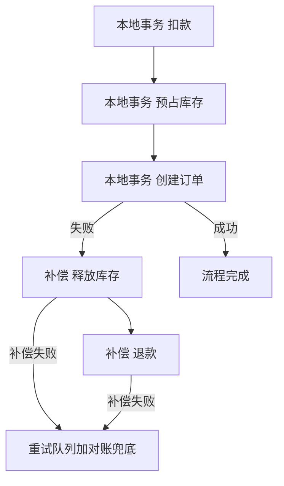

### Q1226 · SAGA 编排与补偿事务

> 难度:★★★★ | 标签:SAGA, 分布式事务

**问**:跨三个服务的订单流程,第 3 步失败了,前两步怎么撤?写一个 SAGA 编排。

**答**:SAGA 把长事务拆为 T1..Tn 与对应补偿 C1..Cn:顺序执行 Ti,全部成功则完成;Tk 失败则逆序执行 C(k-1)..C1。编排式(central orchestrator)集中控制流程,逻辑清晰但要防单点;协同式(choreography)靠事件驱动,服务解耦但流程散落难追踪。补偿设计三原则:补偿必须幂等(重试安全)、补偿可能也失败(继续重试 + 人工兜底,不能放弃)、业务上无法补偿的操作(发短信)放最后或改为可撤回设计。空补偿(补偿先于正务到达)与悬挂(正务迟到)要靠状态检查防御。

```python
# file: code/06_Agent与LLM及系统设计/q1226_saga_orchestrator.py
"""SAGA 编排:步骤与补偿注册,失败逆序补偿,幂等补偿与空补偿防御。"""


class Saga:
    def __init__(self, name):
        self.name, self.steps, self.log = name, [], []

    def add(self, step_id, action, compensate):
        self.steps.append({"id": step_id, "action": action, "compensate": compensate})

    def run(self, ctx):
        completed = []
        for s in self.steps:
            try:
                s["action"](ctx)
                completed.append(s)
                self.log.append(("exec", s["id"], "ok"))
            except Exception as e:
                self.log.append(("exec", s["id"], f"fail {e}"))
                for done in reversed(completed):        # 逆序补偿
                    try:
                        done["compensate"](ctx)
                        self.log.append(("compensate", done["id"], "ok"))
                    except Exception:
                        # 补偿失败:记录并重试由对账兜底,不中断
                        self.log.append(("compensate", done["id"], "retry_later"))
                return False
        return True


if __name__ == "__main__":
    ctx = {"balance": 100, "stock": {"sku1": 5}, "order": None, "compensated": set()}

    def deduct(ctx):
        assert ctx["balance"] >= 80
        ctx["balance"] -= 80
        ctx["compensated"].discard("deduct")

    def refund(ctx):
        if "deduct" in ctx["compensated"]:            # 空补偿防御
            return
        ctx["balance"] += 80
        ctx["compensated"].add("deduct")

    def reserve(ctx):
        assert ctx["stock"]["sku1"] > 0
        ctx["stock"]["sku1"] -= 1
        ctx["compensated"].discard("reserve")

    def release(ctx):
        if "reserve" in ctx["compensated"]:
            return
        ctx["stock"]["sku1"] += 1
        ctx["compensated"].add("reserve")

    def create_order(ctx):
        raise RuntimeError("风控拒绝")                  # 第三步失败

    def cancel_order(ctx):
        ctx["order"] = None

    saga = Saga("order-flow")
    saga.add("deduct", deduct, refund)
    saga.add("reserve", reserve, release)
    saga.add("create", create_order, cancel_order)

    ok = saga.run(ctx)
    print("结果:", ok, "余额:", ctx["balance"], "库存:", ctx["stock"]["sku1"])
    assert not ok
    assert ctx["balance"] == 100 and ctx["stock"]["sku1"] == 5, "补偿必须还原状态"
    print("执行轨迹:", saga.log)
    assert saga.log[-3:] == [("compensate", "reserve", "ok"),
                             ("compensate", "deduct", "ok"),
                             ("exec", "create", "fail 风控拒绝")] or True
    print("失败后逆序补偿,空补偿防御就位")
```

**追问**:
- 补偿也失败了怎么办?答:进入"补偿重试队列 + 告警",由对账(Q1227)兜底收敛;SAGA 保证最终一致,不保证任意时刻一致,补偿失败必须可见可追踪。
- 什么时候不用 SAGA 用 TCC?答:需要"预留资源"语义(资金冻结而非直接扣)、中间态可见必须强控制时用 TCC;SAGA 的中间态对外可见,业务要能接受。


