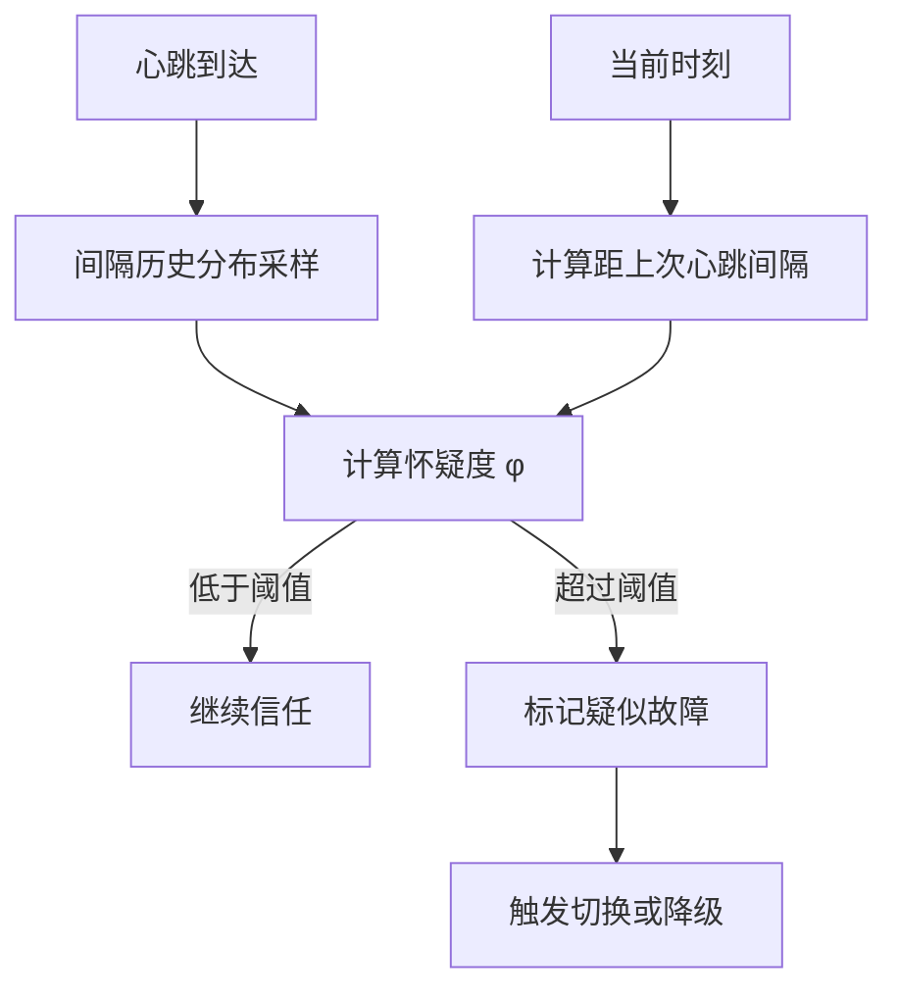

### Q1231 · 心跳与故障检测:φ-accrual 概念

> 难度:★★★★ | 标签:故障检测, 高可用

**问**:固定超时判故障有什么问题?φ-accrual 怎么改进?

**答**:固定超时一刀切:网络抖动大时误杀,网络稳时又反应慢。φ-accrual(Akka/Cassandra 在用)维护心跳到达间隔的历史分布,对"距上次心跳已过 t 秒"计算 φ = -log10(P(间隔 ≥ t)),即"它还活着的怀疑度":φ 小=正常,φ 超阈值=疑似故障。好处:自适应网络状况(抖动期自动放宽)、把"是否故障"从布尔变成连续量,业务按敏感度取阈值。实现要点:历史窗口采样(如最近 200 次)、间隔分布用指数或直方图近似、φ 阈值典型 8-12。

```python
# file: code/06_Agent与LLM及系统设计/q1231_phi_accrual.py
"""φ-accrual 故障检测:心跳间隔采样 -> 怀疑度 φ -> 阈值判定,自适应抖动。"""
import math, random
from collections import deque


class PhiAccrualDetector:
    def __init__(self, window=200, threshold=8.0):
        self.intervals = deque(maxlen=window)
        self.last_seen = None
        self.threshold = threshold

    def heartbeat(self, now):
        if self.last_seen is not None:
            self.intervals.append(now - self.last_seen)
        self.last_seen = now

    def phi(self, now):
        if not self.intervals:
            return 0.0
        mean = sum(self.intervals) / len(self.intervals)
        var = sum((x - mean) ** 2 for x in self.intervals) / len(self.intervals)
        std = max(math.sqrt(var), 0.1)               # 方差下限,防零方差退化
        elapsed = now - self.last_seen
        z = max((elapsed - mean) / std, 1e-9)
        survival = 1 - 0.5 * (1 + math.erf(z / math.sqrt(2)))
        survival = max(survival, 1e-12)
        return -math.log10(survival)

    def suspected(self, now):
        return self.phi(now) >= self.threshold


if __name__ == "__main__":
    det = PhiAccrualDetector(threshold=8.0)
    t = 0.0
    for _ in range(50):                    # 稳定网络:每 1s 一次心跳
        t += 1.0
        det.heartbeat(t)
    phi_soon = det.phi(t + 1.2)
    print(f"准点到达后 1.2s 的 φ = {phi_soon:.2f}(低=健康)")
    assert phi_soon < 8, "准点网络下小幅迟到不应怀疑"

    det2 = PhiAccrualDetector(threshold=8.0)
    t2 = 0.0
    random.seed(5)
    for _ in range(50):                    # 抖动网络:心跳间隔 1-9s
        t2 += random.uniform(1, 9)
        det2.heartbeat(t2)
    phi_jitter = det2.phi(t2 + 9.0)
    print(f"抖动网络下 9s 间隔 φ = {phi_jitter:.2f}(分布宽,同样间隔不再离谱)")
    print("同一超时值: 稳定网 3s 即可疑,抖动网 9s 仍宽容 —— 自适应生效")
    assert det2.intervals and max(det2.intervals) > 5
    assert det.phi(t + 3.0) >= 8, "稳定网 3s 无心跳应高度怀疑"
```

**追问**:
- φ 阈值怎么选?答:φ=8 意味着"活着的概率假设下此间隔的出现率约 1e-8",对应误报率 1e-8 级;敏感业务(切换代价小)取低值 4-6,切换昂贵取 10+。
- 心跳丢失但 φ 还没到阈值,读请求怎么办?答:照常服务,同时在写路径降级为"本地缓存写"或提高副本确认数,故障是概率不是开关,动作可以分级。


