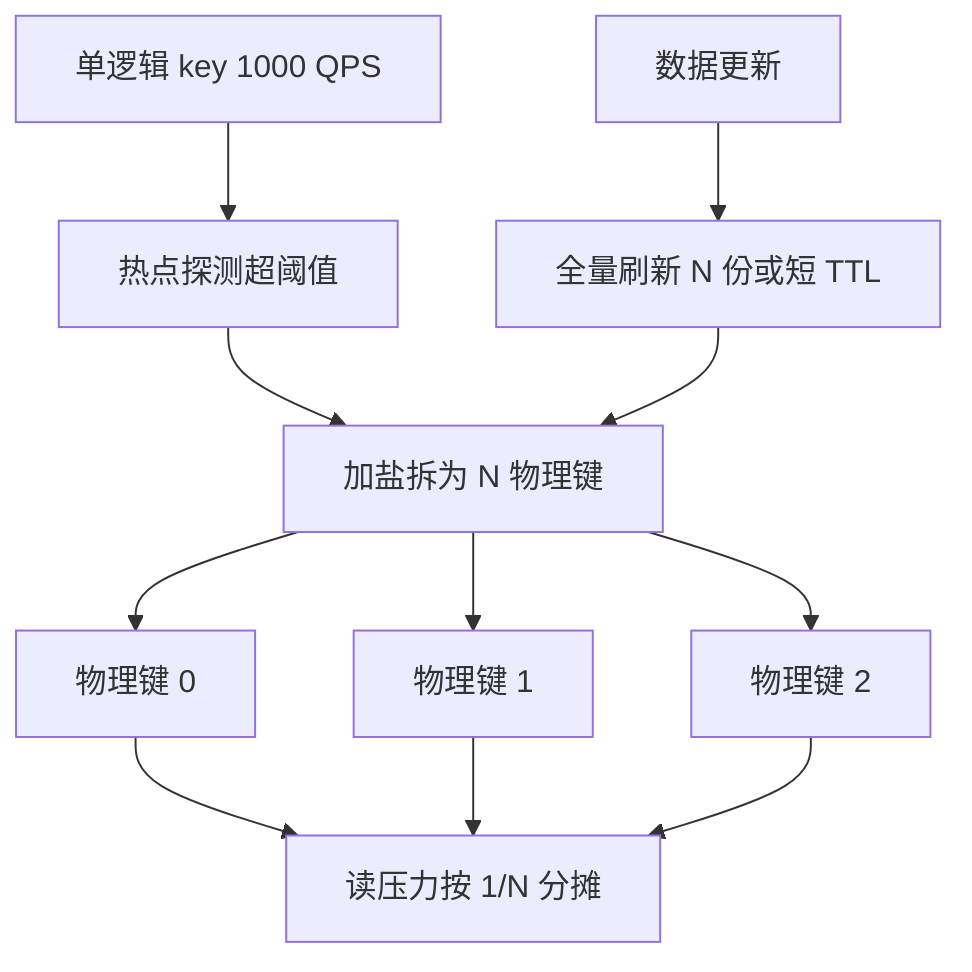

### Q1235 · 热点 key 打散:加盐分片

> 难度:★★★☆ | 标签:热点, 分片

**问**:一个爆款商品把缓存节点打满了,怎么把热点 key 压力摊开?

**答**:热点 key 打散(加盐):写时把同一逻辑 key 拆成 N 个物理 key(key#0..key#N-1),读时随机选一个读;适用于"读极多写极少"的数据(爆款详情),N 份内容一致,读压力被摊到 N 个槽。写更新时要么全量刷新 N 份(数据小),要么挂短 TTL 让其自然过期。另两个配合手段:本地缓存兜底(进程内极短 TTL 缓存,扛最热流量)、热点探测自动加盐(访问统计超阈值时动态加盐,平时不加避免放大)。注意:计数类热点(库存扣减)不能用读加盐,要用分段计数合并。

```python
# file: code/06_Agent与LLM及系统设计/q1235_hot_key_split.py
"""热点 key 打散:逻辑 key 加盐为 N 物理键,读随机分摊,统计打散效果。"""
import random
from collections import Counter


class ShardCache:
    def __init__(self, nodes=4):
        self.nodes = {f"node{i}": {} for i in range(nodes)}

    def write_hot(self, logical_key, value, salt_n):
        for i in range(salt_n):
            pk = f"{logical_key}#{i}"
            node = f"node{i % len(self.nodes)}"      # 盐键按序号均匀落节点
            self.nodes[node][pk] = value

    def read_hot(self, logical_key, salt_n):
        i = random.randrange(salt_n)               # 读随机选一份
        pk = f"{logical_key}#{i}"
        return self.nodes[f"node{i % len(self.nodes)}"].get(pk)


if __name__ == "__main__":
    random.seed(2)
    cache = ShardCache(nodes=4)

    # 不加盐:1000 次读全打同一物理 key 所在节点
    cache.write_hot("sku-1", "爆款详情", salt_n=1)
    print("不加盐: 单节点承受 1000 次读")

    # 加盐 8:读随机分摊到 8 个物理键、4 个节点
    cache.write_hot("sku-2", "爆款详情", salt_n=8)
    access = Counter()
    for _ in range(1000):
        i = random.randrange(8)
        access[f"node{i % 4}"] += 1
    print("加盐后各节点读压力:", dict(access))
    assert max(access.values()) < 400, "压力必须明显摊开"
    assert cache.read_hot("sku-2", 8) == "爆款详情"

    # 更新:全量刷 N 份保持一致
    cache.write_hot("sku-2", "新版详情", salt_n=8)
    vals = {cache.read_hot("sku-2", 8) for _ in range(16)}
    assert vals == {"新版详情"}, "更新后读到新值"
    print("写全量刷 N 份,读随机,一致性与分摊兼得(读多写少场景)")
```

**追问**:
- 热点写场景(秒杀库存)怎么打散?答:分段计数——库存拆 M 段独立扣,读聚合 sum,某段扣空后请求迁移;最终一致由对账校正,和读加盐是两套思路。
- 怎么发现热点?答:客户端/代理层按 key 维度采样计数,滑动窗口超阈值(如单 key QPS 占节点 20%)即上报,自动加盐 + 告警。


