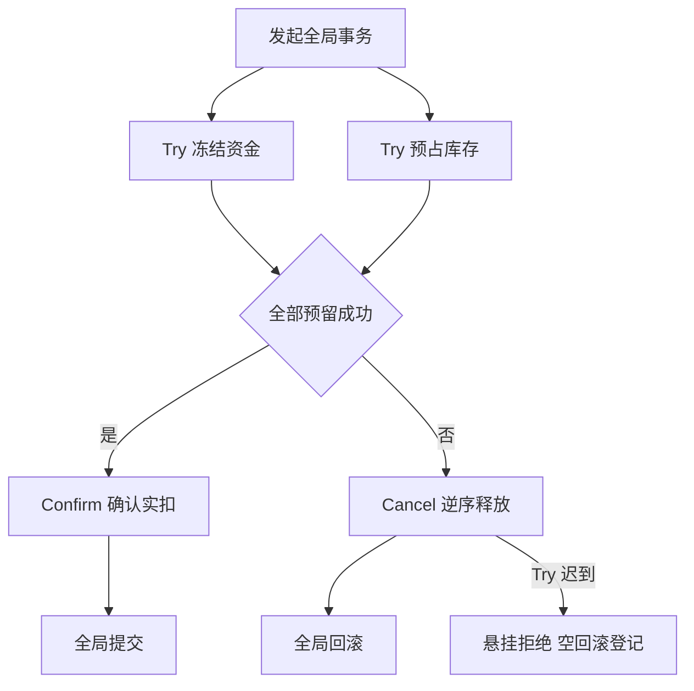

### Q1240 · TCC 与消息最终一致的取舍

> 难度:★★★★ | 标签:分布式事务, 一致性

**问**:TCC(Try-Confirm-Cancel)和消息最终一致各适合什么场景?怎么选?

**答**:TCC 两阶段业务化:Try 预留资源(冻结金额、预占库存),Confirm 确认(冻结转实扣),Cancel 释放。强控制、中间态明确,适合资金、库存这类"不能超卖不能悬空"的场景;代价是每个参与方都要实现三个接口 + 空回滚/悬挂/幂等三防。消息最终一致:正务完成后发消息,下游最终执行,实现简单、吞吐高,但中间态对外可见(下单成功但积分未到),适合"允许短暂不一致"的副链路(积分、通知、统计)。选型口诀:资金与核心库存 TCC/预占,旁路业务消息化,能不同步就不同步。

```python
# file: code/06_Agent与LLM及系统设计/q1240_tcc_pattern.py
"""TCC:Try 预留 -> Confirm/Cancel,含空回滚、悬挂、幂等三防。"""


class AccountTCC:
    def __init__(self, balance):
        self.balance, self.frozen = balance, 0
        self.tried, self.finished = {}, set()      # xid 状态簿

    def try_freeze(self, xid, amount):
        if xid in self.tried or xid in self.finished:      # 幂等
            return "dup"
        if self.balance < amount:
            raise ValueError("余额不足")
        self.balance, self.frozen = self.balance - amount, self.frozen + amount
        self.tried[xid] = amount
        return "frozen"

    def confirm(self, xid):
        amt = self.tried.pop(xid, None)
        if amt is None:
            return "no_try"                        # 未 Try 先 Confirm:拒绝
        if xid in self.finished:
            return "dup"
        self.frozen -= amt                         # 冻结转实扣
        self.finished.add(xid)
        return "confirmed"

    def cancel(self, xid):
        amt = self.tried.get(xid)
        if amt is None:
            self.finished.add(xid)                 # 空回滚登记,防悬挂:迟到的 Try 被拒
            self.tried[xid] = 0
            return "empty_cancel"
        if xid in self.finished:
            return "dup"
        self.tried.pop(xid)
        self.frozen, self.balance = self.frozen - amt, self.balance + amt
        self.finished.add(xid)
        return "cancelled"

    def try_freeze_late(self, xid, amount):
        if xid in self.finished:
            return "suspended_rejected"            # 悬挂防御:Cancel 已登记
        return self.try_freeze(xid, amount)


if __name__ == "__main__":
    acc = AccountTCC(100)
    print(acc.try_freeze("x1", 30), acc.balance, "冻结", acc.frozen)
    print(acc.confirm("x1"), "-> 余额", acc.balance, "冻结", acc.frozen)
    assert acc.balance == 70 and acc.frozen == 0

    acc2 = AccountTCC(100)
    acc2.try_freeze("x2", 20)
    print(acc2.cancel("x2"), "-> 余额", acc2.balance)
    assert acc2.balance == 100 and acc2.frozen == 0
    print(acc2.try_freeze_late("x2", 20), "(悬挂 Try 被拒)")
    assert acc2.try_freeze_late("x2", 20) == "suspended_rejected"

    acc3 = AccountTCC(50)
    print(acc3.cancel("x3"), "(空回滚)")
    assert acc3.cancel("x3") == "dup" or acc3.finished
    print("三防验证: 幂等/空回滚/悬挂 全部就位")
```

**追问**:
- TCC 的 Confirm 失败怎么办?答:无限重试直到成功(Confirm 不允许业务失败,资源已锁定必须落定),失败说明资源被外力破坏,告警人工介入;这正是 Try 阶段要"必成预留"的原因。
- 消息最终一致的场景里下游执行失败呢?答:进重试队列退避重试,多次失败进死信人工处理(见 Q1246);它承诺"最终到",不承诺"立刻到",业务方要设计中间态的可接受性。


