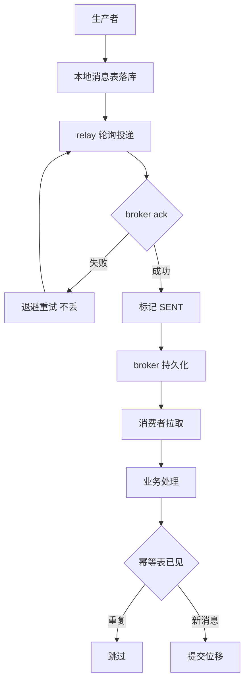

### Q1245 · 消息队列可靠投递与去重

> 难度:★★★★ | 标签:消息队列, 可靠性

**问**:at-most-once、at-least-once、exactly-once 到底什么区别?工程上怎么实现"不丢不重"?

**答**:at-most-once 可能丢;at-least-once 不丢但会重(网络重试下必然);exactly-once 是端到端效果,通常由"at-least-once + 消费端幂等"合成。不丢的组合拳:生产端 ack 确认 + 本地消息表(Q1225);broker 持久化 + 副本;消费端"处理完成后再提交位移"(先处理后 ack,崩溃重放)。去重三板斧:业务唯一键幂等表、位移/去重表记录已处理消息 id、上游带 idempotency key。"处理成功但 ack 失败"的重放场景必须靠消费幂等兜底,这是设计的核心假设。

```python
# file: code/06_Agent与LLM及系统设计/q1245_reliable_mq.py
"""可靠投递:先处理后 ack + 崩溃重放 + 消费幂等表 = 不丢不重的效果。"""
import itertools


class Broker:
    def __init__(self):
        self.log, self._ids = [], itertools.count(1)

    def publish(self, payload):
        mid = next(self._ids)
        self.log.append({"id": mid, "payload": payload})
        return mid

    def fetch(self, offset):
        return self.log[offset:]


class Consumer:
    """at-least-once:处理完成才推进位移;幂等表挡重放。"""

    def __init__(self, broker):
        self.broker, self.offset, self.seen = broker, 0, set()
        self.processed, self.duplicates = [], 0

    def run(self, crash_after=None):
        while True:
            batch = self.broker.fetch(self.offset)
            if not batch:
                break
            for msg in batch:
                if crash_after is not None and self.offset == crash_after:
                    return "crashed"               # 模拟处理完但位移未提交就崩溃
                if msg["id"] in self.seen:
                    self.duplicates += 1
                else:
                    self.seen.add(msg["id"])
                    self.processed.append(msg["payload"])
                self.offset = msg["id"]            # 处理完才推进
        return "done"


if __name__ == "__main__":
    broker = Broker()
    for i in range(5):
        broker.publish({"order": f"o{i}"})
    c = Consumer(broker)
    state = c.run(crash_after=2)
    print("第一轮:", state, "已处理:", c.processed, "位移:", c.offset)
    assert state == "crashed" and c.offset == 2

    # 重放:位移从头开始拉,幂等表(已处理消息 id)挡住前 2 条
    c2 = Consumer(broker)
    c2.seen = {m["id"] for m in broker.log[: c.offset]}
    state2 = c2.run()
    print("重放轮:", state2, "幂等挡下:", c2.duplicates, "新处理:", len(c2.processed))
    assert state2 == "done"
    assert c2.duplicates == 2, "前 2 条被幂等表去重"
    assert len(c2.processed) + len(c.processed) == 5, "消息一条不丢"
    print("at-least-once + 幂等 = 业务上的 exactly-once 效果")
```

**追问**:
- Kafka 的 exactly-once 语义是什么级别?答:事务+幂等生产者保证"分区内 read-process-write"的 EOS,跨外部系统(写 DB)仍要业务幂等,别把 broker 语义当全链路银弹。
- 位移提交间隔怎么选?答:逐条提交最安全但吞吐差,批量提交(每 N 条或 T 毫秒)平衡;重放窗口 = 提交间隔内的消息,幂等表覆盖这个窗口即可。


