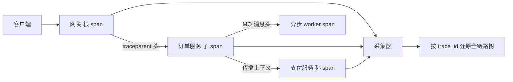

### Q1250 · 分布式追踪:trace 上下文传播桩

> 难度:★★★☆ | 标签:可观测性, tracing

**问**:一个请求穿过 5 个服务,怎么把日志串起来?trace 上下文怎么传播?

**答**:分布式追踪模型:trace 是全链路唯一 id,span 是一次操作(带 trace_id、span_id、parent_span_id、时间、属性),span 组成树。传播:上游把 trace 上下文注入请求头(W3C traceparent 格式:version-traceid-spanid-flags),下游解析后创建子 span 继续传递;跨异步(MQ)把上下文塞消息头。采样在入口决策(全链路同采同丢,head-based 或 tail-based)。有了 trace_id,跨服务日志聚合与依赖拓扑(P95 按服务边聚合)才成为可能。

```python
# file: code/06_Agent与LLM及系统设计/q1250_trace_context.py
"""分布式追踪桩:trace 上下文注入与解析 + span 树构建 + 采样决策。"""
import itertools, random


class Span:
    _ids = itertools.count(1)

    def __init__(self, trace_id, span_id, parent_id, service, name):
        self.trace_id, self.span_id, self.parent_id = trace_id, span_id, parent_id
        self.service, self.name, self.attrs = service, name, {}

    def inject(self):
        """W3C traceparent 桩:version-traceid-spanid-flags。"""
        return f"00-{self.trace_id}-{self.span_id}-01"

    @staticmethod
    def extract(header):
        try:
            _, trace_id, parent_id, flags = header.split("-")
            return trace_id, parent_id, flags == "01"
        except ValueError:
            return None, None, False


class Tracer:
    def __init__(self, sample_rate=1.0, seed=1):
        self.spans, self.sample_rate = [], sample_rate
        random.seed(seed)

    def start(self, service, name, carrier=None):
        if carrier:
            trace_id, parent_id, sampled = Span.extract(carrier)
            sampled = sampled and random.random() < self.sample_rate or (not carrier and False)
        else:
            trace_id, parent_id = f"tr{next(Span._ids):032d}", "0" * 16
            sampled = random.random() < self.sample_rate
        span = Span(trace_id, f"sp{next(Span._ids):016x}", parent_id, service, name)
        span.attrs["sampled"] = bool(sampled)
        self.spans.append(span)
        return span

    def tree(self, trace_id):
        nodes = [s for s in self.spans if s.trace_id == trace_id]
        by_parent = {}
        for s in nodes:
            by_parent.setdefault(s.parent_id, []).append(s)
        def render(pid, depth=0):
            out = []
            for s in sorted(by_parent.get(pid, []), key=lambda x: x.span_id):
                out.append("  " * depth + f"{s.service}/{s.name}")
                out += render(s.span_id, depth + 1)
            return out
        return render("0" * 16)


if __name__ == "__main__":
    tracer = Tracer(sample_rate=1.0)
    root = tracer.start("gateway", "GET /order")
    ctx = root.inject()                            # 传播给下游
    print("traceparent:", ctx)
    child = tracer.start("order-svc", "query_order", carrier=ctx)
    ctx2 = child.inject()
    grandchild = tracer.start("payment-svc", "rpc", carrier=ctx2)

    t = root.trace_id
    lines = tracer.tree(t)
    for line in lines:
        print(" ", line)
    assert len(lines) == 3, "三服务 span 构成树"
    assert child.trace_id == root.trace_id == grandchild.trace_id, "同一 trace 串联"
    assert child.parent_id == root.span_id
    # 采样决策传递:flags=00 时不采
    tid, pid, sampled = Span.extract("00-" + "t" * 32 + "-" + "s" * 16 + "-00")
    assert sampled is False
    print("采样标志随上下文传播,全链路同采同丢")
```

**追问**:
- head 采样和 tail 采样怎么选?答:head 在入口定,省资源但可能丢掉出错的慢请求;tail 看完全链路再决定(保留错误与高延迟),信息全但缓冲成本高;生产常见 head 低比例 + tail 兜底错误全采。
- 异步任务怎么接 trace?答:任务入队时把 traceparent 序列化进消息头,worker 取出后重建 span,父子关系指向"入队" span,链路跨进程不断。


