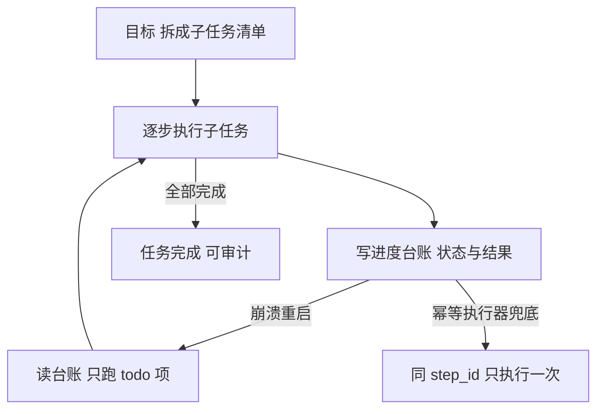

### Q1485 · 多轮任务进度台账:崩溃续跑与子任务幂等

> 难度:★★★☆ | 标签:Agent, 持久化, 恢复

**问**:一个跑几十步的 Agent 任务中途崩了,重启后怎么做到不重做已完成的步骤?

**答**:把任务组织成有序子任务清单,每执行完一步就把该步的 status 与 result 落进台账并持久化,这就是进度台账模式。恢复时新进程先读台账,只挑 status 为 todo 的子任务继续跑,done 的直接跳过,这样每个子任务的副作用天然只发生一次。两个细节决定成败:恢复对象的构造不能重置已有台账,否则等于全量重跑;快照序列化要深拷贝,续跑会继续写同一个 dict,断言必须基于崩溃时刻固化下来的值。台账还应记录失败步骤的错误信息,便于区分可重试与不可重试。

```python
# file: code/06_Agent与LLM及系统设计/q1485_progress_ledger.py
"""多轮任务进度台账与续跑:每步落盘状态,崩溃后跳过已完成子任务幂等续跑。"""
import json


class ProgressLedger:
    """任务台账:plan 为有序子任务列表,每项记录 status 与 result 快照。"""

    def __init__(self, goal, subtasks, store=None):
        self.store = store if store is not None else {}
        if "plan" not in self.store:       # 恢复场景:已有台账原样保留 绝不重置
            self.store["plan"] = [{"name": t, "status": "todo", "result": None} for t in subtasks]
        self.store.setdefault("goal", goal)

    def mark(self, index, status, result=None):
        item = self.store["plan"][index]
        assert item["status"] != "done", "已完成子任务不可被覆盖 防止重复副作用"
        item["status"], item["result"] = status, result

    def next_todo(self):
        for i, item in enumerate(self.store["plan"]):
            if item["status"] == "todo":
                return i, item["name"]
        return None, None

    def done_ratio(self):
        plan = self.store["plan"]
        return sum(1 for p in plan if p["status"] == "done") / len(plan)

    def serialize(self):
        """真实系统里这里写文件或数据库;演示中直接返回深拷贝。"""
        return json.loads(json.dumps(self.store))


class Runner:
    """执行器:逐个跑子任务;崩溃恢复时先读台账,只跑 todo 的。"""

    def __init__(self, tools):
        self.tools = tools
        self.executed = []

    def run(self, ledger, crash_after=None):
        while True:
            idx, name = ledger.next_todo()
            if idx is None:
                return True
            try:
                result = self.tools[name]()
                self.executed.append(name)
            except Exception:
                ledger.mark(idx, "failed", None)
                return False
            ledger.mark(idx, "done", result)
            if crash_after is not None and idx >= crash_after:
                raise RuntimeError("模拟进程崩溃 台账已落盘")

    def resume(self, ledger):
        """崩溃后从台账恢复:done 的直接跳过,不产生第二次副作用。"""
        before = list(self.executed)
        ok = self.run(ledger)
        return ok, list(self.executed[len(before):]) or self.executed


if __name__ == "__main__":
    calls = {}
    results = {"fetch": "10 条数据", "clean": "去重后 8 条", "report": "报表已生成"}

    def tool_for(name):
        def fn():
            calls[name] = calls.get(name, 0) + 1
            return results[name]
        return fn

    tools = {n: tool_for(n) for n in results}
    runner = Runner(tools)

    ledger = ProgressLedger("生成周报", ["fetch", "clean", "report"])
    crashed = 0
    try:
        runner.run(ledger, crash_after=1)     # 跑完 fetch、clean 后崩溃
    except RuntimeError:
        crashed = 1
    assert crashed == 1
    snap = ledger.serialize()
    assert snap["plan"][0]["status"] == "done" and snap["plan"][1]["status"] == "done"
    crash_done = [p["result"] for p in snap["plan"] if p["status"] == "done"]
    assert crash_done == ["10 条数据", "去重后 8 条"]

    recovered = ProgressLedger("生成周报", ["fetch", "clean", "report"], store=snap)
    runner2 = Runner(tools)                   # 新进程,台账即恢复上下文
    ok, trace = runner2.resume(recovered)
    assert ok and recovered.done_ratio() == 1.0
    assert calls == {"fetch": 1, "clean": 1, "report": 1}, "已完成的子任务绝不能重跑"
    assert crash_done == ["10 条数据", "去重后 8 条"], "崩溃时刻的台账只含已完成项"
    print("进度台账通过:崩溃后按台账续跑,fetch 与 clean 未被重复执行,共调用", calls)
```

**追问**:
- 台账和检查点是一回事吗? 答:不是,检查点保存完整运行时状态,成本高;台账只保存子任务粒度的状态与结果,恢复语义是重放未完成部分,两者可以叠加;
- 子任务执行一半崩了怎么办? 答:该步状态留在 todo,配合 Q1481 的 step_id 幂等执行器,重跑也不会二次扣款。


