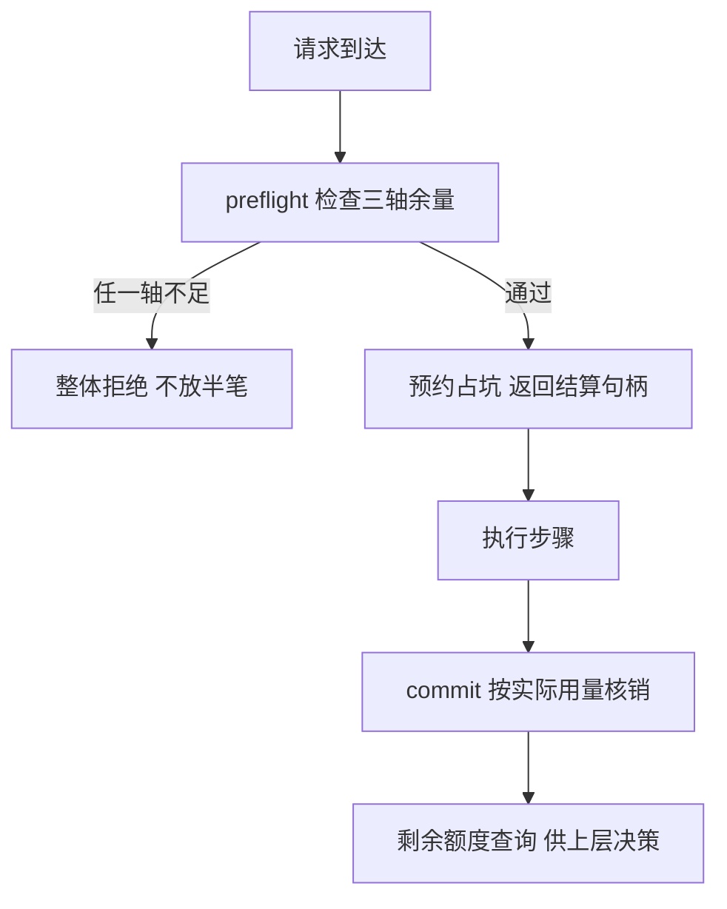

### Q1490 · 运行预算三重限制:时间 token 调用次数联合记账

> 难度:★★★★ | 标签:Agent, 预算, 限流

**问**:只限 token 或只限调用次数都有漏洞,一次 Agent 运行的预算应该怎么管?

**答**:三轴联合记账:时间轴防卡死与超时失控,token 轴防成本失控,调用次数轴防循环失控。机制上每步执行前先 preflight,检查 已消耗加已预约加本次 是否三轴全部放得下,任何一轴不足都整体拒绝,绝不放半笔;通过则预约占坑并返回结算句柄,执行后按实际用量 commit 核销。预约与消耗解耦是关键:大额预约能提前拦截注定超支的请求,实际用量核销时释放多余占位,不会产生幽灵占住预算的僵尸预约。剩余额度查询给上层做策略,比如额度紧张时切换小模型或提前收尾。

```python
# file: code/06_Agent与LLM及系统设计/q1490_budget_governor.py
"""运行预算三重限制:时间、token、工具调用数三轴统一记账,预检预约防止超发。"""


class BudgetExceeded(Exception):
    def __init__(self, axis, limit, want):
        self.axis, self.limit, self.want = axis, limit, want
        super().__init__(f"预算超限 {axis} 需要 {want} 上限 {limit}")


class BudgetGovernor:
    """三重预算:preflight 检查+预约,commit 凭句柄结算,任何一轴不足整体拒绝。"""

    def __init__(self, max_ms, max_tokens, max_calls):
        self.limits = {"time_ms": max_ms, "tokens": max_tokens, "calls": max_calls}
        self.reserved = {"time_ms": 0, "tokens": 0, "calls": 0}
        self.spent = {"time_ms": 0, "tokens": 0, "calls": 0}
        self.elapsed = 0.0

    def tick(self, ms=0.0):
        """推进模拟时钟。"""
        self.elapsed += ms
        self.spent["time_ms"] = max(self.spent["time_ms"], self.elapsed)

    def preflight(self, tokens=0, calls=1, est_ms=0.0):
        """执行前检查 已消耗+已预约+本次 三轴余量;通过则预约并返回结算句柄。"""
        self.tick(0)
        want = {"time_ms": self.spent["time_ms"] + est_ms,
                "tokens": self.spent["tokens"] + self.reserved["tokens"] + tokens,
                "calls": self.spent["calls"] + self.reserved["calls"] + calls}
        for axis, limit in self.limits.items():
            if want[axis] > limit:
                raise BudgetExceeded(axis, limit, want[axis])
        self.reserved["tokens"] += tokens
        self.reserved["calls"] += calls
        self.reserved["time_ms"] += est_ms
        return {"tokens": tokens, "calls": calls, "ms": est_ms}

    def commit(self, handle, tokens, calls=1, ms=0.0):
        """按句柄核销预约,按实际用量落账:预约与消耗解耦,不产生幽灵占位。"""
        self.tick(ms)
        self.spent["tokens"] += tokens
        self.spent["calls"] += calls
        self.spent["time_ms"] = max(self.spent["time_ms"], self.elapsed)
        self.reserved["tokens"] = max(0, self.reserved["tokens"] - handle["tokens"])
        self.reserved["calls"] = max(0, self.reserved["calls"] - handle["calls"])
        self.reserved["time_ms"] = max(0, self.reserved["time_ms"] - handle["ms"])

    def remaining(self):
        self.tick(0)
        return {k: self.limits[k] - max(self.spent[k], self.reserved[k]) for k in self.limits}


if __name__ == "__main__":
    gov = BudgetGovernor(max_ms=1000, max_tokens=500, max_calls=3)

    h1 = gov.preflight(tokens=120, est_ms=200)     # 第一步 LLM 调用
    gov.commit(h1, tokens=118, calls=1, ms=190)
    h2 = gov.preflight(tokens=60, est_ms=100)      # 第二步 工具调用
    gov.commit(h2, tokens=44, calls=1, ms=80)
    left = gov.remaining()
    assert left == {"time_ms": 1000 - 270, "tokens": 500 - 162, "calls": 1}

    h3 = gov.preflight(tokens=50, est_ms=50)
    gov.commit(h3, tokens=50, calls=1, ms=60)
    assert gov.spent["calls"] == 3

    denied = None
    try:
        gov.preflight(tokens=10)                   # 调用次数轴已满 即使 token 充裕也整体拒绝
    except BudgetExceeded as e:
        denied = e.axis
    assert denied == "calls"

    gov2 = BudgetGovernor(max_ms=300, max_tokens=10 ** 6, max_calls=100)
    gov2.tick(250)
    h = gov2.preflight(tokens=10, est_ms=40)       # 250+40=290 仍可放行
    gov2.commit(h, tokens=10, calls=1, ms=0)
    denied2 = None
    try:
        gov2.preflight(tokens=10, est_ms=60)       # 250+60=310 超时间轴
    except BudgetExceeded as e:
        denied2 = e.axis
    assert denied2 == "time_ms"

    gov3 = BudgetGovernor(max_ms=10 ** 6, max_tokens=1000, max_calls=100)
    h_a = gov3.preflight(tokens=400, est_ms=10)    # 大额预约占住坑位
    blocked = None
    try:
        gov3.preflight(tokens=700)                 # 400+700 > 1000 被预约挤占
    except BudgetExceeded as e:
        blocked = e.axis
    assert blocked == "tokens"
    gov3.commit(h_a, tokens=120, calls=1, ms=10)   # 实际只用 120,预约解除
    assert gov3.remaining()["tokens"] == 1000 - 120
    print("预算治理通过:三轴记账 调用轴拒 时间轴拒 预约挤占与核销均正确")
```

**追问**:
- 预约和消耗为什么分开? 答:预检时只能估,估多了会误拒,估少了会超发;预约占位保证并发下的预算不被挤占,commit 按实际结算保证公平;
- 三轴超限分别对应什么动作? 答:token 与调用数超限降级或收尾,时间超限通常是下游故障,应熔断并上报而非重试。


