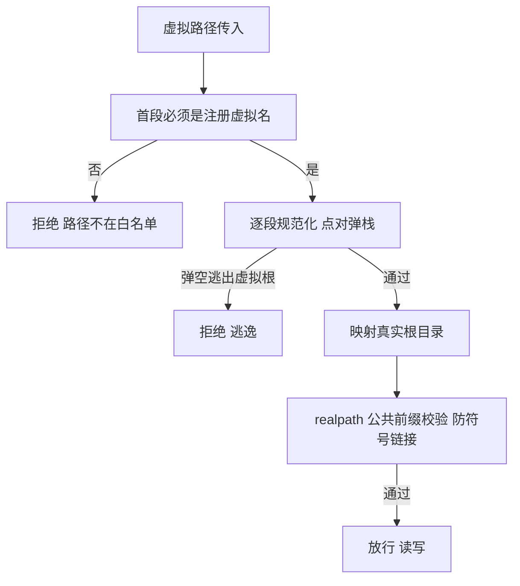

### Q1495 · 路径白名单沙箱:虚拟根与逃逸检测

> 难度:★★☆ | 标签:Agent, 安全, 文件

**问**:让 Agent 读写本地文件,路径校验怎么做才不等于裸奔?

**答**:给文件工具一个虚拟根视图:Agent 只能说 workspace 加相对路径,沙箱把它映射到真实目录,真实路径永不出现在模型上下文。解析要做三件事:首段必须是已注册虚拟名,否则直接拒绝;逐段规范化,点号过滤,点对弹栈,弹空说明逃出虚拟根,拒绝;最后用 realpath 再做一次公共前缀校验,防符号链接绕过。绝对路径、其他盘符、向上越根全部命中拒绝分支。测试要覆盖 ../ 逃逸、注册表外前缀、绝对路径与 Windows 盘符这些经典绕过,而不是只测快乐路径。

```python
# file: code/06_Agent与LLM及系统设计/q1495_path_sandbox.py
"""文件工具路径白名单:虚拟根映射 + 规范化 + 逃逸检测,越界一律拒绝。"""
import os
import tempfile
import shutil


class PathSandbox:
    """把 虚拟路径 -> 真实根目录 的映射做成白名单;所有文件工具只认虚拟路径。"""

    def __init__(self, roots):
        self.roots = roots                 # 虚拟名 -> 真实绝对目录

    def resolve(self, vpath):
        """解析虚拟路径:栈式规范化,.. 弹栈;弹空即逃出虚拟根,拒绝。"""
        vpath = vpath.replace("\\", "/")
        parts = [p for p in vpath.split("/") if p not in ("", ".")]
        if not parts or parts[0] not in self.roots:
            raise PermissionError("路径不在白名单内 " + vpath)
        real = os.path.realpath(self.roots[parts[0]])
        stack = []
        for seg in parts[1:]:
            if seg == "..":
                if not stack:
                    raise PermissionError("逃出虚拟根 " + vpath)
                stack.pop()
            else:
                stack.append(seg)
        for seg in stack:
            real = os.path.join(real, seg)
        return os.path.realpath(real)

    def check_escape(self, vpath):
        """终极校验:规范化后的真实路径必须仍在映射根之下 防符号链接绕过。"""
        real = self.resolve(vpath)
        base = os.path.realpath(self.roots[vpath.replace("\\", "/").split("/")[0]])
        return os.path.commonpath([real, base]) == base

    def read(self, vpath, files):
        """读文件桩:路径合法且存在于受控 files 表中才返回。"""
        if not self.check_escape(vpath):
            raise PermissionError("逃逸检测失败 " + vpath)
        key = self.resolve(vpath)
        if key not in files:
            raise FileNotFoundError("文件不存在 " + vpath)
        return files[key]


if __name__ == "__main__":
    # 用 tempfile 建真实根目录 规避 macOS 下 /tmp 是符号链接的 realpath 差异
    root = os.path.realpath(tempfile.mkdtemp(prefix="proj_sandbox_"))
    try:
        files = {os.path.join(root, "data/report.txt"): "周报内容",
                 os.path.join(root, "src/main.py"): "print(1)"}
        os.makedirs(os.path.join(root, "data"))
        os.makedirs(os.path.join(root, "src"))
        box = PathSandbox({"workspace": root})

        assert box.resolve("workspace/data/report.txt") == os.path.join(root, "data/report.txt")
        assert box.resolve("workspace/./src/../src/main.py") == os.path.join(root, "src/main.py")
        assert box.check_escape("workspace/data/report.txt") is True

        for bad in ["workspace/../../etc/passwd", "etc/passwd", "workspace/../other/secret",
                    "/etc/passwd", "C:/Windows/system32"]:
            rejected = 0
            try:
                box.resolve(bad)
            except PermissionError:
                rejected = 1
            assert rejected == 1, "应拒绝 " + bad

        assert box.read("workspace/data/report.txt", files) == "周报内容"
        missing = 0
        try:
            box.read("workspace/data/none.txt", files)
        except FileNotFoundError:
            missing = 1
        assert missing == 1
        print("路径白名单通过:相对点与点分规范化放行 上跳 越根 绝对路径 盘符 全部拒绝")
    finally:
        shutil.rmtree(root, ignore_errors=True)
```

**追问**:
- 为什么要虚拟根而不直接传绝对路径? 答:绝对路径把服务器目录结构泄给模型,还让同一段代码跨环境不可复现,虚拟根让策略可声明可移植;
- 需要访问第二个目录怎么办? 答:注册第二个虚拟名,权限粒度是目录级,而不是拼一条更长的白名单字符串。


