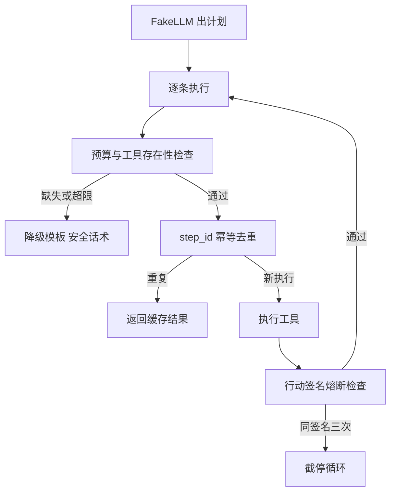

### Q1500 · 综合设计:可靠 Agent 运行时装配

> 难度:★★★☆ | 标签:Agent, 架构, 综合

**问**:把幂等、熔断、预算、降级拼成一个最小的可靠 Agent 运行时,主循环长什么样?

**答**:主循环四步:模型出计划,逐条执行工具,护栏逐步检查,最后组装答案。护栏层做三件事:调用前查预算与工具存在性,调用凭 step_id 幂等去重,行动签名连续三次相同即熔断截停。任何一环出错都不让坏结果流向用户:工具缺失或预算耗尽时走降级模板,返回已完成的痕迹与安全话术,并打降级标记。验证要覆盖三条正交路径,幂等重放不二次执行、熔断在第三步截停、坏工具触发降级,三条同时成立才说明各机制真的在协同而不是各自为政。生产化再加一层就是把这些组件换成持久化与分布式实现。

```python
# file: code/06_Agent与LLM及系统设计/q1500_agent_runtime.py
"""综合:可靠 Agent 运行时装配,把预算、幂等、循环熔断、降级模板拧成一个主循环。"""


class FakeLLM:
    """脚本化模型桩:按调用序号吐计划好的回复。"""

    def __init__(self, script):
        self.script = list(script)
        self.i = 0

    def reply(self):
        out = self.script[min(self.i, len(self.script) - 1)]
        self.i += 1
        return out


class MiniRuntime:
    """小运行时:预算三轴 + 工具幂等 + 死循环熔断 + 输出降级 组合演示。"""

    def __init__(self, tools, llm, max_tokens=400, max_calls=5):
        self.tools = tools
        self.llm = llm
        self.max_tokens, self.max_calls = max_tokens, max_calls
        self.spent_tokens = 0
        self.call_count = 0
        self.sig_history = []
        self.store = {}                    # step_id -> result 幂等表

    def call_tool(self, step_id, name, args):
        if name not in self.tools:
            return {"error": "no_such_tool"}
        key = step_id + "|" + name + "|" + str(sorted(args.items()))
        if key in self.store:
            return dict(self.store[key], replayed=True)
        if self.call_count >= self.max_calls:
            return {"error": "budget_exhausted"}
        self.call_count += 1
        out = self.tools[name](args)
        if not isinstance(out, dict):
            out = {"value": out}               # 非 dict 工具返回统一包装
        self.spent_tokens += len(str(out)) // 4
        self.store[key] = out
        return dict(out, replayed=False)

    def step(self, action, args, observation):
        """循环护栏:签名重复 3 次即熔断。"""
        sig = action + "|" + str(sorted(args.items()))
        self.sig_history.append(sig)
        return not (len(self.sig_history) >= 3 and
                    self.sig_history[-3:] == [sig] * 3)

    def run(self, goal):
        """主循环:计划→执行→产出;预算或熔断触发时走降级模板。"""
        plan = self.llm.reply()
        trace = []
        for step_id, (tool, args) in enumerate(plan):
            if not self.step(tool, args, None):
                break
            out = self.call_tool(f"s{step_id}", tool, args)
            trace.append((tool, out))
        if self.spent_tokens > self.max_tokens or any("error" in o for _, o in trace):
            return {"degrade": True, "answer": "已完成部分步骤,结果已暂存。",
                    "trace": [t for t, _ in trace]}
        return {"degrade": False, "answer": "任务完成 " + str(len(trace)) + " 步",
                "trace": [t for t, _ in trace]}


if __name__ == "__main__":
    tools = {"search": lambda a: {"hits": ["r1", "r2"], "tokens": 0},
             "open": lambda a: {"doc": "正文" * 30, "tokens": 0}}
    llm = FakeLLM([[("search", {"q": "x"}), ("open", {"id": "r1"})]])
    rt = MiniRuntime(tools, llm, max_tokens=400)
    result = rt.run("查资料写摘要")
    assert result["degrade"] is False and len(result["trace"]) == 2

    again = rt.call_tool("s0", "search", {"q": "x"})
    assert again["replayed"] is True, "同 step_id 重放不二次执行"

    rt2 = MiniRuntime(tools, FakeLLM([[("search", {"q": "loop"})]]), max_calls=5)
    for _ in range(4):
        rt2.call_tool("dup", "search", {"q": "loop"})
    assert rt2.step("search", {"q": "loop"}, None) is True
    assert rt2.step("search", {"q": "loop"}, None) is True
    assert rt2.step("search", {"q": "loop"}, None) is False, "同签名第三次必须熔断"

    rt3 = MiniRuntime({"ghost": lambda a: 1}, FakeLLM([[("ghost", {"a": 1}), ("search", {"q": 1})]]),
                      max_tokens=400)
    r3 = rt3.run("带坏工具")
    assert r3["degrade"] is True and "ghost" in r3["trace"], "工具缺失走降级模板"
    print("运行时装配通过:幂等重放 熔断截停 坏工具降级 三种可靠机制协同")
```

**追问**:
- 各机制的优先级? 答:预算与幂等是硬约束先检查,熔断是行为护栏次之,降级是兜底最后,顺序错了降级会掩盖预算泄漏;
- 和框架 LangGraph 的关系? 答:概念同构:节点即步骤,边即状态转移,checkpointer 即台账,面试能手写桩胜过只会调框架。


