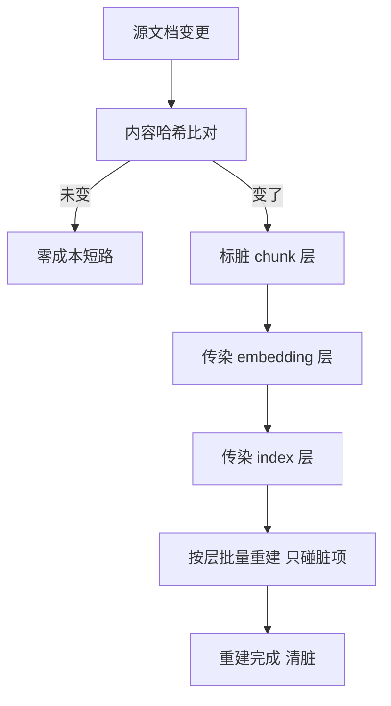

### Q1505 · 增量更新脏标记:分层传染与选择性重建

> 难度:★★★☆ | 标签:RAG, 增量, 索引

**问**:一篇文档改了两段,为什么要全量重建向量索引?

**答**:不需要,用分层脏标记把变更沿依赖图传染:源文档内容哈希变了,只标脏它派生的块;块标脏自动传染到它的向量与索引条目;重建按层从上到下批量处理,只碰脏项,处理完清脏。未变更的文档连标脏都不发生,内容哈希比对直接短路,这是零成本路径。实现要点是依赖边要显式注册,每条边携带目标层,避免串层传染;索引层的脏项用带前缀的 id,重建时剥前缀得到真实块。验证数字很有说服力:两块文档改动只产生两块粒度的重建,三次构建累计的调用数与增量完全吻合。

```python
# file: code/06_Agent与LLM及系统设计/q1505_dirty_flag.py
"""增量更新脏标记:内容哈希判脏,变更沿 源→块→向量→索引 分层传播,按层批量重建。"""
import hashlib


def chash(text):
    return hashlib.sha256("".join(text.split()).encode()).hexdigest()[:12]


class DirtyTracker:
    """分层脏标记:上游标脏自动沿显式声明的 下一层,下游id 传染,重建按层批量处理。"""

    LAYERS = ("source", "chunk", "embedding", "index")

    def __init__(self):
        self.dirty = {layer: set() for layer in self.LAYERS}
        self.children = {}                 # (layer, uid) -> [(next_layer, child_id)]

    def register(self, layer, uid, children):
        self.children[(layer, uid)] = list(children)

    def mark(self, layer, uid):
        """标脏并沿依赖向下传染,每条边携带目标层 避免串层。"""
        self.dirty[layer].add(uid)
        for nxt, cid in self.children.get((layer, uid), ()):
            self.mark(nxt, cid)

    def is_dirty(self, layer, uid):
        return uid in self.dirty[layer]

    def rebuild(self, layer, worker):
        """重建该层所有脏项:worker uid 完成实际工作;完成后清脏。"""
        done = []
        for uid in sorted(self.dirty[layer]):
            worker(uid)
            done.append(uid)
        self.dirty[layer] = set()
        return done


class Pipeline:
    """演示管线:源文档 → 块 → 向量 → 索引,各层持有内容哈希。"""

    def __init__(self):
        self.tracker = DirtyTracker()
        self.source_hash = {}
        self.chunk_hash = {}
        self.embedding_hash = {}
        self.index_built = set()
        self.calls = {"chunk": 0, "embedding": 0, "index": 0}

    def ingest(self, doc_id, text, chunks):
        new_h = chash(text)
        if self.source_hash.get(doc_id) == new_h:
            return False                    # 内容未变 不标脏
        self.source_hash[doc_id] = new_h
        self.tracker.register("source", doc_id, [("chunk", c) for c in chunks])
        for c in chunks:
            self.tracker.register("chunk", c, [("embedding", "emb-" + c),
                                               ("index", "idx-" + c)])
        self.tracker.mark("source", doc_id)
        return True

    def rebuild_all(self):
        def chunk_worker(uid):
            self.calls["chunk"] += 1
            self.chunk_hash[uid] = "chunked:" + uid
        def emb_worker(uid):
            self.calls["embedding"] += 1
            self.embedding_hash[uid] = "vec:" + uid
        def index_worker(uid):
            self.calls["index"] += 1
            self.index_built.add(uid[4:])   # 去掉 idx- 前缀得到块 id
        self.tracker.rebuild("source", lambda uid: None)   # 源层脏随切分完成而清
        self.tracker.rebuild("chunk", chunk_worker)
        self.tracker.rebuild("embedding", emb_worker)
        self.tracker.rebuild("index", index_worker)


if __name__ == "__main__":
    p = Pipeline()
    assert p.ingest("doc1", "退款政策全文 第一版", ["doc1-c1", "doc1-c2"]) is True
    p.rebuild_all()
    assert p.calls == {"chunk": 2, "embedding": 2, "index": 2}, "初次全量构建"
    assert not any(p.tracker.is_dirty(l, x) for l in p.tracker.LAYERS for x in
                   ["doc1", "doc1-c1", "emb-doc1-c1"]), "重建后全清脏"

    assert p.ingest("doc1", "退款政策全文 第一版", ["doc1-c1", "doc1-c2"]) is False, "内容未变零成本"

    assert p.ingest("doc1", "退款政策全文 第二版", ["doc1-c1", "doc1-c2"]) is True
    p.rebuild_all()
    assert p.calls == {"chunk": 4, "embedding": 4, "index": 4}, "只重建该文档下游 2 块"

    assert p.ingest("doc2", "发票指南", ["doc2-c1"]) is True
    p.rebuild_all()
    assert p.calls["chunk"] == 5 and p.calls["index"] == 5, "doc2 只增量 1 块"
    assert "doc1-c1" in p.index_built and "doc2-c1" in p.index_built
    print("脏标记通过:未变跳过 变更只传染下游 三次构建累计 块 5 向量 5 索引 5")
```

**追问**:
- 哈希比对的粒度? 答:源级粗判加块级细判,源哈希没变直接跳过,变了再按块哈希找差异,两级都命中才标脏;
- 重建期间读请求怎么办? 答:索引版本切换,旧版本继续服务,新版本构建完原子替换,参考蓝绿思路。


