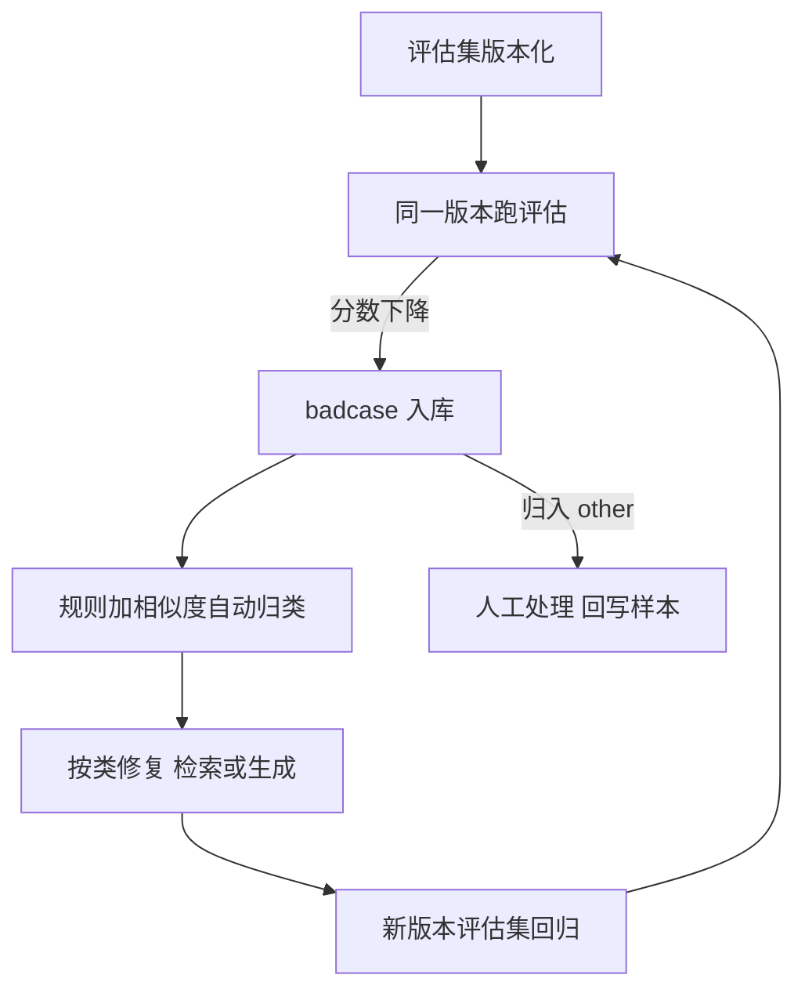

### Q1510 · 语料近重复检测:shingle 指纹与并查集

> 难度:★★★☆ | 标签:RAG, 去重, 数据治理

**问**:同一篇退款文档以三个略不同版本散落在语料里,检索结果全是它,怎么治理?

**答**:用 shingle 指纹做近重复检测:文本切 4 字 shingle 集合,两两算 Jaccard 相似度,超过阈值判定近重复,用并查集把传递相似的文档聚成组,组内按长度降序保留代表、其余标记删除。三个设计点:shingle 对局部改动不敏感,恰好容忍小改版本;并查集处理传递性,A 像 B、B 像 C 但 A 与 C 略低阈值的链式重复能聚到一起;删除前保留原文与组内映射,便于回滚。阈值抬高重复组会自然解散,演示里 0.6 抓住三版本组、0.99 下组消失,说明阈值要按容忍的编辑距离定。

```python
# file: code/06_Agent与LLM及系统设计/q1510_near_dup.py
"""语料近重复检测:4-gram shingle 指纹 + Jaccard 相似 + 并查集聚类,只留代表块。"""


def shingles(text, k=4):
    t = "".join(text.split())
    return {t[i:i + k] for i in range(len(t) - k + 1)}


def jaccard(a, b):
    return len(a & b) / max(1, len(a | b))


class UnionFind:
    def __init__(self):
        self.parent = {}

    def find(self, x):
        self.parent.setdefault(x, x)
        while self.parent[x] != x:
            self.parent[x] = self.parent[self.parent[x]]
            x = self.parent[x]
        return x

    def union(self, a, b):
        ra, rb = self.find(a), self.find(b)
        if ra != rb:
            self.parent[rb] = ra


class NearDupDetector:
    """近重复检测:两两 Jaccard 超阈值并入查集,输出重复组与建议保留项。"""

    def __init__(self, threshold=0.6):
        self.threshold = threshold

    def group(self, docs):
        """docs: [(id, text)] 返回重复组列表 每组按长度降序 保留第一。"""
        sigs = {did: shingles(t) for did, t in docs}
        uf = UnionFind()
        ids = [did for did, _ in docs]
        for i in range(len(ids)):
            for j in range(i + 1, len(ids)):
                a, b = ids[i], ids[j]
                if jaccard(sigs[a], sigs[b]) >= self.threshold:
                    uf.union(a, b)
        clusters = {}
        for did in ids:
            clusters.setdefault(uf.find(did), []).append(did)
        lengths = {did: len(t) for did, t in docs}
        out = []
        for members in clusters.values():
            members = sorted(members, key=lambda d: -lengths[d])
            if len(members) > 1:
                out.append({"keep": members[0], "dups": members[1:], "size": len(members)})
        return sorted(out, key=lambda g: -g["size"])

    def dedupe(self, docs):
        groups = self.group(docs)
        removed = {d for g in groups for d in g["dups"]}
        return [d for d, _ in docs if d not in removed], groups


if __name__ == "__main__":
    a = "退款需要在订单页提交申请 审核通过后 48 小时内原路退回到账"
    b = "退款需要在订单页提交申请 审核通过后 48 小时内原路退回到账"     # 完全重复
    c = "退款需要在订单页提交申请 审核通过后 72 小时内原路退回到账"     # 高度相似
    d = "会员积分每年年底统一清零 清零前可兑换优惠券"                    # 无关
    e = "发票在个人中心申请 电子发票 24 小时内开出"                     # 无关

    det = NearDupDetector(threshold=0.6)
    groups = det.group([("a", a), ("b", b), ("c", c), ("d", d), ("e", e)])
    assert len(groups) == 1, "a b c 应聚为一组 d e 独立"
    assert groups[0]["size"] == 3 and set(groups[0]["dups"]) == {"b", "c"}

    kept, g2 = det.dedupe([("a", a), ("b", b), ("c", c), ("d", d), ("e", e)])
    assert kept == ["a", "d", "e"], "只保留每组最长代表 a"
    assert jaccard(shingles(a), shingles(b)) == 1.0
    assert jaccard(shingles(a), shingles(d)) < 0.1

    det2 = NearDupDetector(threshold=0.99)
    assert det2.group([("a", a), ("c", c)]) == [], "阈值提高后 72 小时版本不再算重复"
    print("近重复检测通过:一组 3 文档 保留 a 删 b c 高阈值下组消失")
```

**追问**:
- 语料大了两两比较太贵怎么办? 答:用最小哈希加分桶先找候选对,只在候选内算精确 Jaccard,复杂度从平方降到近似线性;
- 去重会不会误删需要保留的版本? 答:组内保留策略按业务定,法律条款保留全部版本加版本元数据,营销文案只留最新。


