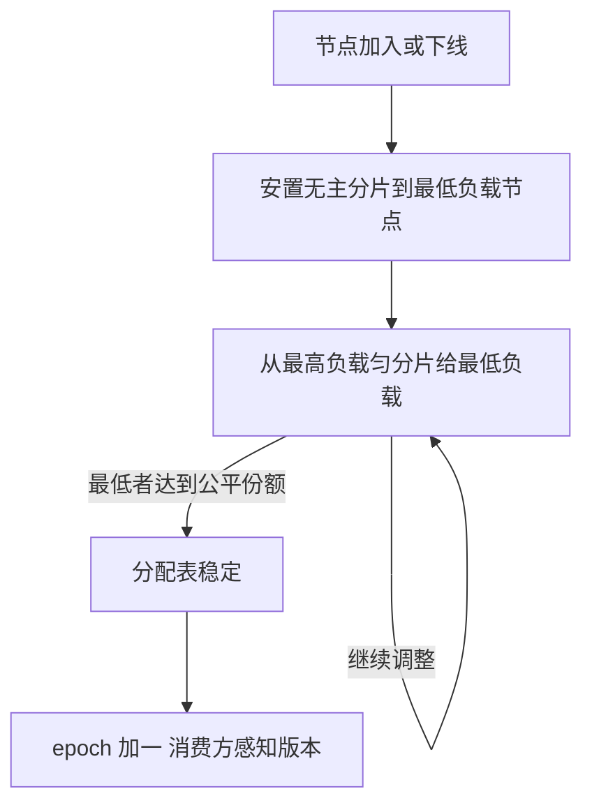

### Q1515 · 任务分片协调器:少迁移再均衡

> 难度:★★★★ | 标签:分布式, 分片, 协调

**问**:12 个分片跑在若干节点上,节点上下线时分片怎么重新分配才不折腾?

**答**:协调器维护分片到节点的分配表,再均衡走两步:先把无主分片安置到最低负载节点,这处理了节点下线留下的孤儿分片;再从最高负载节点匀分片给最低负载节点,直到最低者达到公平份额,这处理了节点加入的均摊。精髓是尽量保持现有归属:12 分片从 1 节点扩到 2 节点只迁移 6 个,再扩到 3 节点只迁移 4 个,下线 1 个节点只转交它持有的 4 个,每次变更 epoch 加一,消费方凭 epoch 感知版本。对比全量重算的取模方案,变更时全体重新洗牌的迁移量是不可接受的。

```python
# file: code/06_Agent与LLM及系统设计/q1515_shard_coordinator.py
"""任务分片协调器:分片分配表 + 节点上下线触发再均衡,迁移量最小且一一归属。"""


class ShardCoordinator:
    """分片协调器:保持现有归属 尽量少迁移;新节点从最高负载节点取满公平份额。"""

    def __init__(self, shards, nodes=None):
        self.shards = list(shards)
        self.nodes = list(nodes or [])
        self.assign = {}                   # shard -> node
        self.epoch = 0
        self.rebalance()

    def _fair_share(self):
        return -(-len(self.shards) // max(1, len(self.nodes)))   # 向上取整

    def load_of(self, node):
        return sum(1 for s, n in self.assign.items() if n == node)

    def rebalance(self):
        """两步:先安置无主分片到最低负载节点,再从最高负载节点匀给最低节点。"""
        moved = []
        if not self.nodes:
            self.assign = {}
            self.epoch += 1
            return moved
        fair = self._fair_share()
        for s in self.shards:              # 无主或归属已下线 分片优先安置
            if s not in self.assign or self.assign[s] not in self.nodes:
                target = min(self.nodes, key=self.load_of)
                self.assign[s] = target
                moved.append(s)
        while True:
            lo = min(self.nodes, key=self.load_of)
            hi = max(self.nodes, key=self.load_of)
            if self.load_of(lo) >= fair or lo == hi:
                break
            s = next(s for s, n in self.assign.items() if n == hi)
            self.assign[s] = lo
            moved.append(s)
        self.epoch += 1
        return moved

    def join(self, node):
        assert node not in self.nodes
        self.nodes.append(node)
        return self.rebalance()

    def leave(self, node):
        assert node in self.nodes
        self.nodes.remove(node)
        return self.rebalance()

    def owner(self, shard):
        return self.assign.get(shard)

    def balance_score(self):
        """均衡度 = 最大节点负载 - 最小节点负载,越小越均衡。"""
        if not self.nodes:
            return 0
        loads = [self.load_of(n) for n in self.nodes]
        return max(loads) - min(loads)


if __name__ == "__main__":
    shards = ["shard-%02d" % i for i in range(12)]
    coord = ShardCoordinator(shards, ["n1"])
    assert coord.balance_score() == 0 and coord.load_of("n1") == 12

    moved = coord.join("n2")
    assert len(moved) == 6, "两节点均摊 12 分片 迁移 6 个"
    assert coord.load_of("n1") == 6 and coord.load_of("n2") == 6

    moved3 = coord.join("n3")
    assert len(moved3) == 4, "三节点各 4 个 迁移 4 个"
    loads = sorted(coord.load_of(n) for n in coord.nodes)
    assert loads == [4, 4, 4]

    moved_out = coord.leave("n2")
    assert len(moved_out) == 4, "n2 的 4 个分片转交给存活节点"
    assert all(coord.owner(s) != "n2" for s in shards), "下线节点不再持有任何分片"
    assert sorted(coord.load_of(n) for n in coord.nodes) == [6, 6]

    empty = ShardCoordinator(shards, [])
    assert empty.owner("shard-00") is None and empty.balance_score() == 0
    assert coord.epoch == 4
    print("分片协调通过:12 分片 1→2 迁 6,2→3 迁 4,下线转交后 6 与 6 epoch=4")
```

**追问**:
- 分配表存哪谁定? 答:中心协调服务定表,节点订阅,表变更带 epoch 单调递增,消费方只认最新 epoch;
- 迁移中的分片谁服务? 答:双读过渡或按分片粒度摘流量,迁移完成切换,失败回滚到旧归属。


