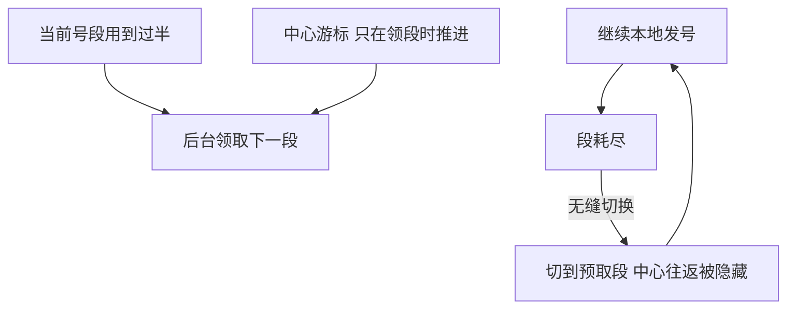

### Q1520 · 全局序号发号器:号段模式与双 buffer 预取

> 难度:★★★☆ | 标签:分布式, ID, 发号

**问**:消息表需要严格递增的序号,不能用雪花那种乱序 ID,怎么办?

**答**:号段模式:中心只维护一个游标,节点每次领一段连续区间,段内本地发号,零中心往返;段用尽再领下一段。单调性天然成立,代价是允许段间空洞,比如 A 领 1 到 10,B 领 11 到 20,A 后续从 21 继续,全局无重复但不连续,序号场景通常可接受。优化是双 buffer 预取:当前段用到过半就异步领下一段,耗尽时无缝切换,把中心的取号延迟藏起来。与雪花 ID 的取舍:雪花趋势递增但同毫秒内乱序,号段严格递增但依赖中心可用性,中心游标其实就是一条极简的原子计数器,可按序号库或独立服务实现。

```python
# file: code/06_Agent与LLM及系统设计/q1520_segment_allocator.py
"""全局序号发号器:号段模式批量领号 + 双 buffer 预取,单调递增可容忍号段空洞。"""
import threading


class SegmentAllocator:
    """号段发号器:每个节点一次领一段,号段内本地发号 零中心依赖。"""

    def __init__(self, step=10, center=None):
        self.step = step
        self.center = center or {"cursor": 0}   # 中心只存游标 领号时原子推进
        self.lock = threading.Lock()

    def fetch_segment(self):
        with self.lock:
            start = self.center["cursor"] + 1
            self.center["cursor"] += self.step
            return start, start + self.step - 1


class SequenceIssuer:
    """节点侧发号器:双 buffer——当前号段用完时无缝切到预取的下一段。"""

    def __init__(self, name, allocator):
        self.name = name
        self.allocator = allocator
        self.cur = None                      # (start, end, next_to_issue)
        self.pre = None
        self.lock = threading.Lock()
        self.issued = []

    def _load(self):
        seg = self.allocator.fetch_segment()
        return (seg[0], seg[1], seg[0])

    def next_id(self):
        with self.lock:
            if self.cur is None:
                self.cur = self._load()
            if self.pre is None:             # 用到一半就预取 隐藏中心往返延迟
                if self.cur[2] > (self.cur[0] + self.cur[1]) // 2:
                    self.pre = self._load()
            if self.cur[2] > self.cur[1]:    # 当前段耗尽 切换
                self.cur = self.pre if self.pre else self._load()
                self.pre = None
            sid = self.cur[2]
            self.cur = (self.cur[0], self.cur[1], sid + 1)
            self.issued.append(sid)
            return sid


if __name__ == "__main__":
    center = {"cursor": 0}
    alloc = SegmentAllocator(step=10, center=center)
    a = SequenceIssuer("node-a", alloc)
    b = SequenceIssuer("node-b", alloc)

    seq_a = [a.next_id() for _ in range(7)]
    assert seq_a == [1, 2, 3, 4, 5, 6, 7], "a 先领 1..10 号段"
    assert center["cursor"] == 20, "第 6 发已过半 a 预取了 11..20"

    seq_b = [b.next_id() for _ in range(3)]
    assert seq_b == [21, 22, 23], "b 领到的下一段是 21..30 互不重叠"

    seq_a2 = [a.next_id() for _ in range(5)]
    assert seq_a2 == [8, 9, 10, 11, 12], "a 用尽后无缝切到预取段 11..20"

    merged = sorted(seq_a + seq_b + seq_a2)
    assert len(merged) == len(set(merged)), "全局无重复"
    assert center["cursor"] == 30, "中心游标已推进三个号段"

    multi = SegmentAllocator(step=5)
    n1 = SequenceIssuer("x", multi)
    ids = [n1.next_id() for _ in range(12)]
    assert ids == list(range(1, 13)), "单节点独占时双 buffer 无缝衔接 无空洞"
    print("发号器通过:预取隐藏延迟 段间不重叠 全局无重复 cursor=30")
```

**追问**:
- 节点重启会丢号吗? 答:会,段内未用的号作废,这就是空洞来源之一,序号场景不回收;
- 中心挂了怎么办? 答:号段是缓冲,存量段继续发;中心恢复后凭持久化游标继续分配,游标本身要持久化不能凭空。


