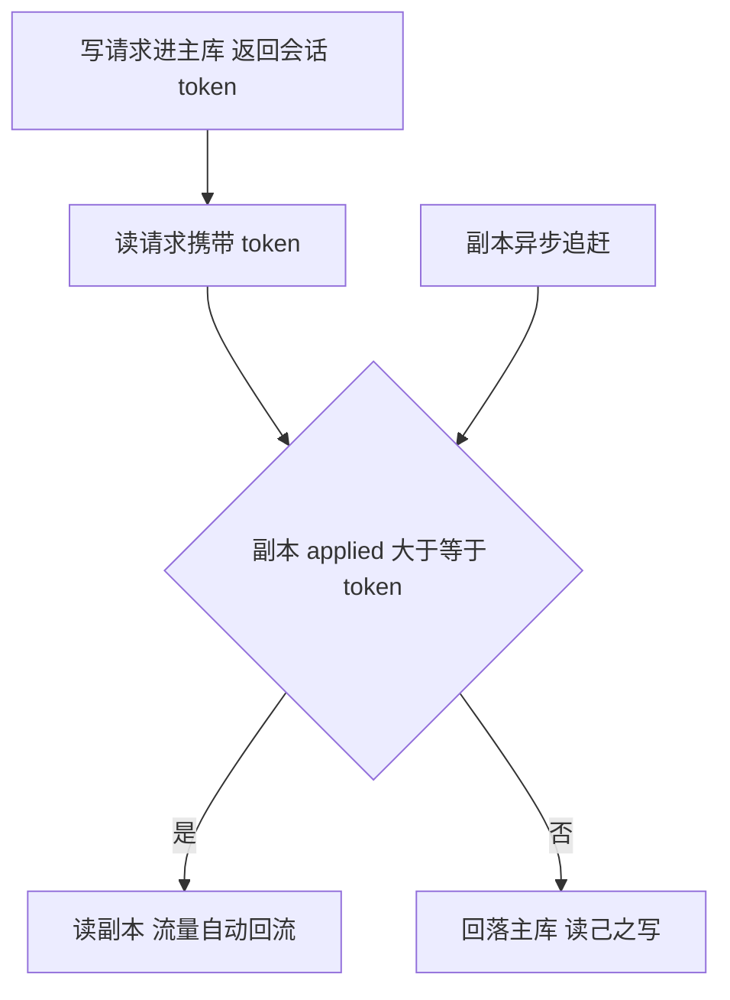

### Q1524 · 副本追赶与会话一致读:token 校验回落主库

> 难度:★★★★ | 标签:分布式, 一致性, 读写分离

**问**:读写分离后用户刚写完就读,读到旧值怎么办?

**答**:会话一致性读:写操作返回单调递增的会话 token,读请求带上它,路由层比对副本的 applied 序号,副本进度追上会话 token 才放行读副本,否则回落主库,这就是读己之写。注意 token 是会话级不是全局级,只保证当前用户看到自己的写,不同会话间允许短暂不一致,这把一致性成本限制在真正需要的范围。副本追赶异步进行,追上后同会话的后续读自然落回副本,流量自动回流。两个易错点:token 与副本的绑定要稳定,换副本要重新校验;缺键读也要走同样校验,否则删了又被旧副本读回来。

```python
# file: code/06_Agent与LLM及系统设计/q1524_replica_catchup.py
"""副本追赶与会话一致性读:记录会话最后写序号,副本未追到就回落主库,读己之写。"""


class Store:
    """主从存储桩:主写入带单调序号,副本异步应用并汇报进度。"""

    def __init__(self):
        self.seq = 0
        self.master = {}
        self.replicas = {"r1": {"applied": 0, "data": {}},
                         "r2": {"applied": 0, "data": {}}}

    def write(self, key, value):
        self.seq += 1
        self.master[key] = (self.seq, value)
        return self.seq

    def replicate(self, replica, up_to):
        r = self.replicas[replica]
        for k, (s, v) in self.master.items():
            if r["applied"] < s <= up_to:
                r["data"][k] = (s, v)
                r["applied"] = max(r["applied"], s)

    def read(self, key, session_token, allow_stale_ms=0, now=0.0, lag_limit=2):
        """会话一致性读:副本进度 ≥ 会话 token 才可读副本;否则回落主库。"""
        r = self.replicas.get(session_token.get("replica", "r1"))
        if r and r["applied"] >= session_token.get("last_write", 0):
            entry = r["data"].get(key)
            if entry:
                return {"value": entry[1], "from": "replica", "seq": entry[0]}
        entry = self.master.get(key)
        if not entry:
            return {"value": None, "from": "master", "seq": 0}
        return {"value": entry[1], "from": "master", "seq": entry[0]}


class Session:
    """会话:记录本会话最后一次写得到的 token。"""

    def __init__(self, replica="r1"):
        self.replica = replica
        self.last_write = 0

    def token(self):
        return {"replica": self.replica, "last_write": self.last_write}


if __name__ == "__main__":
    store = Store()
    sess = Session(replica="r1")

    s1 = store.write("color", "red")
    sess.last_write = s1
    # 副本还没应用 r1 applied=0 < 1 → 回落主库 读到自己的写
    r1 = store.read("color", sess.token())
    assert r1 == {"value": "red", "from": "master", "seq": 1}, "读己之写必须回落主库"

    store.replicate("r1", up_to=1)             # r1 追到 seq 1
    r2 = store.read("color", sess.token())
    assert r2["from"] == "replica" and r2["value"] == "red", "追平后可读副本"

    s2 = store.write("color", "blue")          # 新写 副本未应用
    sess.last_write = s2
    r3 = store.read("color", sess.token())
    assert r3["from"] == "master" and r3["value"] == "blue", "token 大于副本进度 回落主库"

    store.replicate("r2", up_to=2)             # 另一副本已追平
    sess2 = Session(replica="r2")
    sess2.last_write = s2
    r4 = store.read("color", sess2.token())
    assert r4["from"] == "replica" and r4["value"] == "blue"

    miss = store.read("ghost", sess2.token())
    assert miss == {"value": None, "from": "master", "seq": 0}
    print("会话一致读通过:r1 滞后回落主库 追平后读副本 r2 追平直读 缺键安全")
```

**追问**:
- 为什么不用全部分读主库? 答:主库写压力与读成本都更高,会话级校验是精确的一致性供给,按需付费;
- token 丢失怎么办? 答:降级为最终一致读并明确告知,或强制回落主库,按业务对一致性敏感度选。


