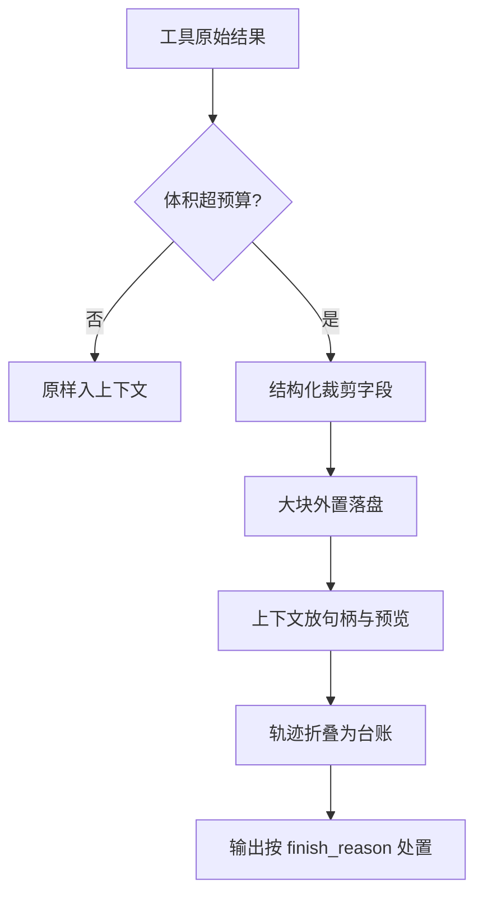

### Q1754 · 多工具结果合并去重:实体归并与来源标记

> 难度:★★★☆ | 标签:Agent, 结果融合, 去重

**问**:同时调了网页搜索和内部知识库,两边返回了重叠甚至矛盾的条目,怎么合成一份干净列表?

**答**:合并的核心是找规范键:同一实体的两个来源往往 URL 只差 query 参数或尾部斜杠,先做 URL 规范化再归并。归并时保留合并来源列表,让下游知道这条结果被几个渠道佐证;分数字段择优保留,标题跟最高分走,保证展示一致性。归并后条目数下降、每个条目携带 sources 数组,既是去重也是置信度信号——多来源一致的条目排序时可以加权。

```python
# file: code/06_Agent与LLM及系统设计/q1754_merge_tool_results.py
"""多工具结果合并去重:按规范键归并实体,保留来源标记,分数字段择优。"""


def norm_url(url):
    return url.split("?")[0].rstrip("/").lower()


class ResultMerger:
    def __init__(self):
        self.by_key = {}
        self.order = []

    def add(self, source, items):
        """items: [{url, title, score}],按规范化 url 归并,同实体多来源合并。"""
        for it in items:
            key = norm_url(it["url"])
            if key not in self.by_key:
                self.by_key[key] = {"title": it["title"], "score": it["score"],
                                    "sources": [source]}
                self.order.append(key)
                continue
            merged = self.by_key[key]
            if source not in merged["sources"]:
                merged["sources"].append(source)
            if it["score"] > merged["score"]:
                merged["score"] = it["score"]
                merged["title"] = it["title"]
        return len(items)

    def merged(self):
        return [{"url": k, **self.by_key[k]} for k in self.order]


if __name__ == "__main__":
    web = [{"url": "https://a.com/doc?id=1", "title": "A 文档", "score": 0.9},
           {"url": "https://b.com/page/", "title": "B 页面", "score": 0.7}]
    kb = [{"url": "https://a.com/doc?id=1&from=kb", "title": "A 文档(知识库)", "score": 0.8},
          {"url": "https://c.com/note", "title": "C 笔记", "score": 0.6}]

    m = ResultMerger()
    m.add("web", web)
    m.add("kb", kb)
    out = m.merged()
    assert len(out) == 3, "4 条原始结果去重为 3 个实体"
    a = [x for x in out if x["url"] == "https://a.com/doc"][0]
    assert a["sources"] == ["web", "kb"], "同实体来源必须合并标记"
    assert a["title"] == "A 文档" and a["score"] == 0.9, "分数择优,标题跟最优走"
    assert "https://b.com/page" in [x["url"] for x in out], "尾部斜杠被规范化"
    print("多工具合并通过:4 条去重为 3 条,来源标记合并,分数与标题择优保留")
```

**追问**:
- 规范键不对怎么办,比如两边给的不是 URL? 答:换实体键,如标题归一化哈希或数据库主键,归并器只要求提供一个可比较的 key 函数。
- 矛盾内容怎么处理? 答:分数字段择优,语义字段冲突留给上层做冲突标注,合并器只负责归并不负责裁决。


