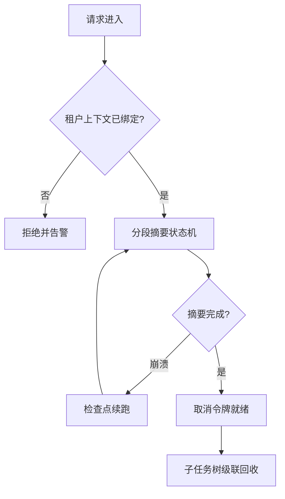

### Q1760 · Agent 会话串号防护:租户上下文绑定

> 难度:★★★☆ | 标签:Agent, 多租户, 安全

**问**:一个服务同时服务多个租户的会话,怎么保证 A 租户的 Agent 绝对读不到 B 租户的会话?

**答**:串号防护的核心是把租户身份绑进执行上下文而不是靠参数传递:所有会话读写都从当前上下文取租户,存储键是租户加会话号二元组,取数时强制校验上下文租户与记录归属一致。上下文缺失视为致命错误直接拒绝,绝不默认成某个租户,因为"默认"正是串号事故的头号来源;上下文进入退出要支持嵌套并自动恢复外层值,中间件层层包裹也不漏。这样即使某个工具实现忘了传 tenant 参数,底层存储仍然拒绝放行。

```python
# file: code/06_Agent与LLM及系统设计/q1760_tenant_binding.py
"""Agent 会话串号防护:租户身份绑定执行上下文,跨租户访问会话一律拒绝。"""
import threading


class TenantContext:
    """基于线程局部量的租户上下文,with 进入退出,嵌套自动恢复。"""

    _local = threading.local()

    @classmethod
    def current(cls):
        return getattr(cls._local, "tenant", None)

    def __init__(self, tenant):
        self.tenant = tenant
        self._prev = None

    def __enter__(self):
        self._prev = getattr(TenantContext._local, "tenant", None)
        TenantContext._local.tenant = self.tenant
        return self

    def __exit__(self, *exc):
        TenantContext._local.tenant = self._prev
        return False


class SessionStore:
    """会话存储:键为 租户加会话号,读写强制要求并校验当前上下文租户。"""

    def __init__(self):
        self.data = {}

    def _must_tenant(self):
        tenant = TenantContext.current()
        assert tenant, "会话读写必须在租户上下文内"
        return tenant

    def put(self, session_id, value):
        self.data[(self._must_tenant(), session_id)] = value

    def get(self, session_id):
        key = (self._must_tenant(), session_id)
        if key not in self.data:
            raise KeyError(session_id)
        return self.data[key]


if __name__ == "__main__":
    store = SessionStore()
    with TenantContext("tenant-a"):
        store.put("s1", {"cart": ["book"]})
    with TenantContext("tenant-b"):
        store.put("s1", {"cart": ["pen"]})

    with TenantContext("tenant-a"):
        assert store.get("s1")["cart"] == ["book"], "A 读到的必须是 A 的会话"
    with TenantContext("tenant-b"):
        assert store.get("s1")["cart"] == ["pen"], "同键不同租户互不可见"

    blocked = False
    with TenantContext("tenant-b"):
        try:
            with TenantContext(None):            # 模拟中间件漏配租户
                store.get("s1")
        except AssertionError:
            blocked = True
    assert blocked, "无租户上下文的访问必须被拒绝,绝不默认"

    with TenantContext("tenant-a"):
        missing = False
        try:
            store.get("s-not-exist")
        except KeyError:
            missing = True
        assert missing
    print("租户绑定通过:同会话号按租户隔离,漏配租户直接拒绝,杜绝串号")
```

**追问**:
- 异步框架里 threading.local 失效怎么办? 答:换 contextvars.ContextVar,它跟随任务协程传播,接口语义与本例一致。
- 为什么不在每个工具函数里加 tenant 参数? 答:参数靠人传总会漏,上下文绑定是结构性防线,参数只是入口的一部分。


