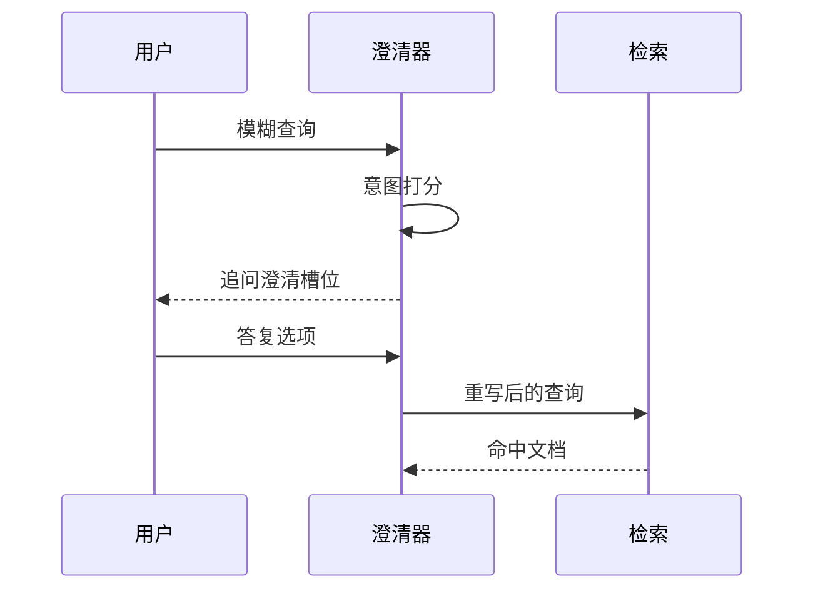

### Q1765 · 澄清槽位融合:多轮追问的查询重写

> 难度:★★☆☆ | 标签:RAG, 槽位, 对话状态

**问**:一次澄清不够,机票查询要城市日期舱位三个信息,多轮追问的状态怎么管理?

**答**:用槽位表驱动:每个槽位声明追问话术和是否必填,每轮用户输入先过槽位抽取,抽到的填进槽位表且已填槽不覆盖,防止用户改口的中间态互相踩。每轮结束检查必填槽,缺哪个就追问哪个的既定话术,必填槽齐了才把全部槽位拼成完整查询进入检索,可选槽有值就带上、没值不阻塞。这样多轮追问的进度全部落在槽位表里,任何一轮中断都能从表恢复,追问顺序由缺失槽决定而不是写死的流程。

```python
# file: code/06_Agent与LLM及系统设计/q1765_slot_filling.py
"""澄清槽位融合:多轮追问按槽位表逐项填空,必填槽齐了才重写完整查询。"""

SLOT_TABLE = {
    "city": {"ask": "请问查询哪个城市?", "required": True},
    "date": {"ask": "哪一天?", "required": True},
    "grade": {"ask": "经济舱还是商务舱?", "required": False},
}


def extract_slot(turn, known):
    """槽位抽取桩:按 key=value 前缀识别,已填槽不覆盖。"""
    for key in SLOT_TABLE:
        if key in known:
            continue
        for token in turn.split():
            if token.startswith(key + "="):
                return key, token.split("=", 1)[1]
    return None, None


class SlotFillingFlow:
    def __init__(self):
        self.slots = {}

    def feed(self, turn):
        key, val = extract_slot(turn, self.slots)
        if key:
            self.slots[key] = val
        missing = [k for k, v in SLOT_TABLE.items()
                   if v["required"] and k not in self.slots]
        if missing:
            return {"action": "clarify", "question": SLOT_TABLE[missing[0]]["ask"],
                    "missing": missing}
        return {"action": "search", "query": self.full_query()}

    def full_query(self):
        parts = ["机票", self.slots["city"], self.slots["date"]]
        if "grade" in self.slots:
            parts.append(self.slots["grade"])
        return " ".join(parts)


if __name__ == "__main__":
    flow = SlotFillingFlow()
    r1 = flow.feed("city=上海")
    assert r1["action"] == "clarify" and r1["question"] == SLOT_TABLE["date"]["ask"]
    assert r1["missing"] == ["date"]
    r2 = flow.feed("date=周五")
    assert r2 == {"action": "search", "query": "机票 上海 周五"}, "必填槽齐即检索"
    r3 = flow.feed("grade=商务舱")
    assert r3["query"] == "机票 上海 周五 商务舱", "可选槽有值就并入查询"

    flow.feed("city=北京")                        # 已填槽不覆盖
    assert flow.full_query() == "机票 上海 周五 商务舱"
    print("槽位融合通过:必填槽逐项追问,槽齐才检索,可选槽与已填槽规则明确")
```

**追问**:
- 用户想改已填的槽怎么办? 答:改口要走显式更新指令,槽位表支持带版本覆盖并留变更历史,而不是静默覆盖。
- 抽取失败怎么办? 答:抽取不到就重发当前缺失槽的追问,连续失败两轮降级到人工或通用检索。


