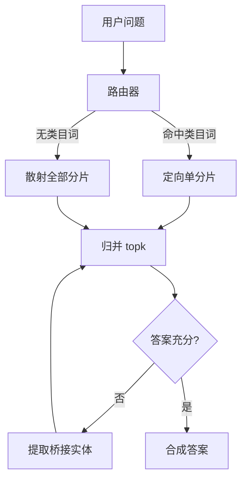

### Q1770 · 索引分片与路由:类目分片与散射聚合

> 难度:★★★★ | 标签:RAG, 分片, 路由

**问**:索引上了千万级文档,单索引检索又慢又不稳,怎么拆?

**答**:按稳定业务维度拆分片,常见是类目或租户,路由器两级策略:查询带类目词时定向到单个分片,只扫一小片数据,延迟与成本都低;识别不出类目就散射到全部分片各自召回 top-k,再在路由层归并出全局 top-k,正确性不受分片影响。分片数与文档落片在写入时决定,查询路由错分片比散射更糟,所以路由词表要保守,没把握就散射。散射聚合的可观测点是每片命中数与归并后排序,能直接暴露"某个分片长期拖慢全局"的热点。

```python
# file: code/06_Agent与LLM及系统设计/q1770_shard_routing.py
"""索引分片与路由:类目词定向单分片,无类目散射全部分片再归并全局 topk。"""
import hashlib
import math


def embed(text, dim=24):
    v = [0.0] * dim
    for tok in text.split():
        v[int(hashlib.md5(tok.encode()).hexdigest(), 16) % dim] += 1.0
    n = math.sqrt(sum(x * x for x in v)) or 1.0
    return [x / n for x in v]


def cosine(a, b):
    return sum(x * y for x, y in zip(a, b))


class Shard:
    def __init__(self, name):
        self.name = name
        self.items = []                          # (text, vec)

    def add(self, text):
        self.items.append((text, embed(text)))

    def search(self, query, topk):
        q = embed(query)
        ranked = sorted(((cosine(q, v), t) for t, v in self.items), reverse=True)
        return ranked[:topk]


class ShardedIndex:
    ROUTE_WORDS = {"售后": "shard-support", "销售": "shard-sales", "研发": "shard-eng"}

    def __init__(self):
        self.shards = {}
        self.routed, self.scattered = 0, 0

    def add_shard(self, name):
        self.shards[name] = Shard(name)

    def add_doc(self, category, text):
        assert category in self.shards, "文档必须落在已存在分片"
        self.shards[category].add(text)

    def search(self, query, topk=3):
        target = None
        for word, shard in self.ROUTE_WORDS.items():
            if word in query:
                target = shard
                break
        if target and target in self.shards:
            self.routed += 1                     # 定向:只扫一个分片
            return self.shards[target].search(query, topk)
        self.scattered += 1                      # 散射:全分片召回后归并
        merged = []
        for shard in self.shards.values():
            merged.extend(shard.search(query, topk))
        merged.sort(reverse=True)
        return merged[:topk]


if __name__ == "__main__":
    idx = ShardedIndex()
    for name in ("shard-support", "shard-sales", "shard-eng"):
        idx.add_shard(name)
    idx.add_doc("shard-support", "售后 退货 流程 说明")
    idx.add_doc("shard-support", "售后 保修 政策")
    idx.add_doc("shard-sales", "销售 报价 单 说明")
    idx.add_doc("shard-sales", "销售 渠道 政策")
    idx.add_doc("shard-eng", "研发 发布 流程")

    hits = idx.search("售后 退货 怎么 办")
    assert len(hits) == 2 and hits[0][1].startswith("售后 退货")
    assert all(t.startswith("售后") for _, t in hits), "定向查询绝不混入其他分片"
    assert idx.routed == 1 and idx.scattered == 0

    hits2 = idx.search("政策 怎么 规定")
    assert idx.scattered == 1 and len(hits2) == 3
    texts = [t for _, t in hits2]
    assert "售后 保修 政策" in texts and "销售 渠道 政策" in texts, "散射归并返回全局最优"
    print("分片路由通过:定向查只扫 1 分片,散射查归并 3 分片全局 topk")
```

**追问**:
- 分片键选类目还是租户? 答:看查询分布,查询天然带类目就按类目,查询常限定租户身份就按租户,原则是路由词命中率高的维度优先。
- 某个分片热点怎么办? 答:热点分片内部再拆副本做负载均衡,路由层对热点散射请求做并行化与超时隔离。


