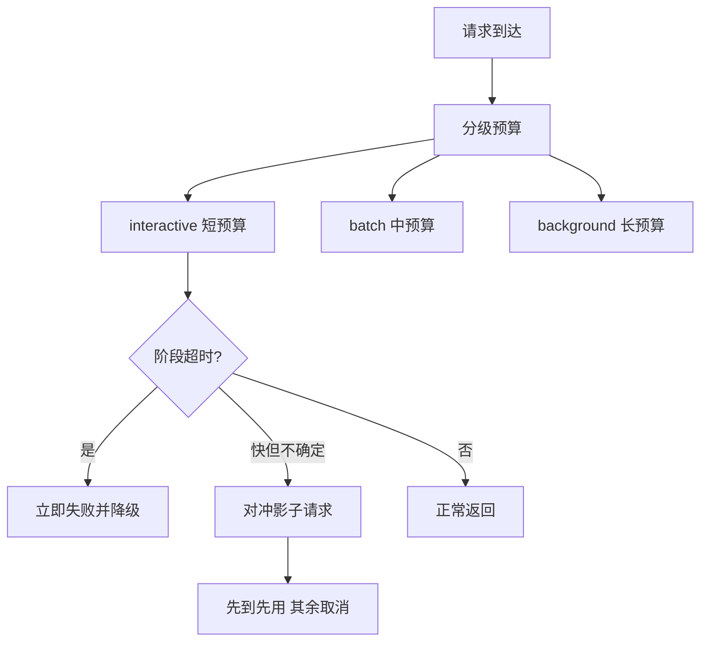

### Q1776 · 对冲请求:尾延迟的对冲重发

> 难度:★★★★ | 标签:LLM 运维, 尾延迟, 对冲

**问**:供应商偶尔慢得离谱,P99 延迟被少数长尾请求拖爆,怎么办?

**答**:对冲请求是对付尾延迟的经典手段:主请求发出后,若在对冲阈值内没有响应,就向备选通道影子重发一份,谁先返回用谁,其余全部取消。它把"等一个慢请求"变成"赛两个请求",多花的只是一份对冲后的重复算力,换来 P99 被显著压平;阈值要设得比 P50 高不少,否则对冲率过高成本翻倍,还要统计对冲率与取消数,对冲率异常上升往往预示上游在劣化。实现层面要点是竞速判定与取消必须原子,避免双写结果。

```python
# file: code/06_Agent与LLM及系统设计/q1776_hedged_request.py
"""对冲请求:主请求慢于对冲阈值时影子重发,先到先用其余取消,尾延迟被打掉。"""


class HedgedClient:
    """离散事件模拟:worker 为预设耗时列表,假时钟逐拍推进。"""

    def __init__(self, hedge_delay=1.0):
        self.hedge_delay = hedge_delay
        self.stats = {"hedged": 0, "cancelled": 0}

    def request(self, delays):
        launched = [{"delay": delays[0], "start": 0.0}]
        now = 0.0
        while True:
            now = round(now + 0.1, 2)
            if len(launched) < len(delays) and now >= self.hedge_delay:
                launched.append({"delay": delays[len(launched)], "start": now})
                self.stats["hedged"] += 1        # 对冲:影子请求上路
            done = [(now - l["start"], i) for i, l in enumerate(launched)
                    if now - l["start"] >= l["delay"]]
            if done:
                winner = min(done)               # 完成时刻最早者胜出
                self.stats["cancelled"] += len(launched) - 1
                return {"result": "resp", "at": now, "worker": winner[1]}


if __name__ == "__main__":
    c = HedgedClient(hedge_delay=1.0)
    r1 = c.request([0.3])
    assert r1 == {"result": "resp", "at": 0.3, "worker": 0}
    assert c.stats == {"hedged": 0, "cancelled": 0}, "主请求快,无需对冲"

    r2 = c.request([2.0, 0.5])
    assert r2["worker"] == 1 and r2["at"] == 1.5, "主慢:1.0 对冲,1.5 影子先回"
    assert c.stats["hedged"] == 1 and c.stats["cancelled"] == 1

    r3 = c.request([1.2, 1.5])
    assert r3["worker"] == 0 and r3["at"] == 1.2, "对冲已发但主请求先回"
    assert c.stats == {"hedged": 2, "cancelled": 2}, "在途对冲请求被取消"
    print("对冲请求通过:慢主请求被影子赛赢,快主请求取消在途对冲,尾延迟受控")
```

**追问**:
- 供应商支持对冲吗? 答:写类请求要防双写副作用,读请求随便对冲,写请求对冲必须配业务幂等键,这正好接回幂等发布器那套机制。
- 对冲率多少算异常? 答:基线对冲率加三个标准差告警,持续走高说明该降阈值或扩容,而不是继续靠对冲硬扛。


