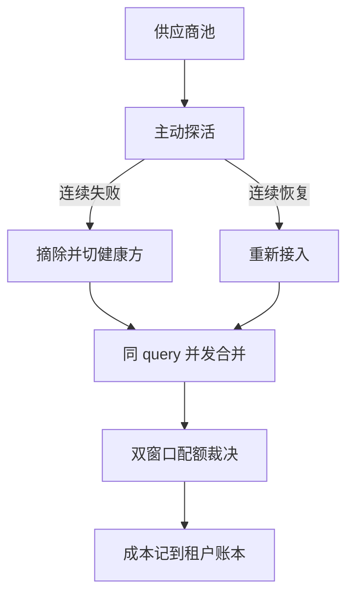

### Q1780 · 成本归因到租户:token 分账与账单聚合

> 难度:★★☆☆ | 标签:LLM 运维, 成本, 计量

**问**:模型成本月底对不上账,不知道哪个租户烧的钱,怎么把成本算清楚?

**答**:归因的本质是计量加聚合:每次调用在记账点记录租户、输入输出 token 数,按价目表即时算出行成本,写进流水;账单是流水的租户维度聚合,还有一道审计:所有租户分账之和必须等于总账,不等说明有调用漏记租户或记错租户。未登记租户的调用要当场拒绝而不是记到公共池,公共池是成本黑洞,出了差额没人认领。计价参数与流水分离,调价只影响增量,历史账单可复算。

```python
# file: code/06_Agent与LLM及系统设计/q1780_cost_attribution.py
"""成本归因到租户:每次调用记 token 流水,聚合成账单并校验分账总额守恒。"""

PRICE_IN = 0.002                                # 每千 token 输入价
PRICE_OUT = 0.006                               # 每千 token 输出价

KNOWN_TENANTS = {"tenant-a", "tenant-b", "tenant-c"}


class CostLedger:
    def __init__(self):
        self.rows = []

    def record(self, tenant, tokens_in, tokens_out):
        assert tenant in KNOWN_TENANTS, "未登记租户不允许记账,拒绝进公共池"
        cost = tokens_in / 1000.0 * PRICE_IN + tokens_out / 1000.0 * PRICE_OUT
        self.rows.append({"tenant": tenant, "tin": tokens_in, "tout": tokens_out,
                          "cost": round(cost, 6)})
        return cost

    def bill(self, tenant):
        rows = [r for r in self.rows if r["tenant"] == tenant]
        return {"calls": len(rows),
                "tokens": sum(r["tin"] + r["tout"] for r in rows),
                "cost": round(sum(r["cost"] for r in rows), 6)}

    def audit(self):
        """审计:分账之和必须等于总账,防止归因丢失。"""
        total = round(sum(r["cost"] for r in self.rows), 6)
        parts = round(sum(self.bill(t)["cost"] for t in KNOWN_TENANTS), 6)
        return {"total": total, "parts": parts, "balanced": total == parts}


if __name__ == "__main__":
    led = CostLedger()
    led.record("tenant-a", 1000, 500)            # 0.005
    led.record("tenant-a", 2000, 1000)           # 0.010
    led.record("tenant-b", 500, 1500)            # 0.010
    bill_a = led.bill("tenant-a")
    assert bill_a == {"calls": 2, "tokens": 4500, "cost": 0.015}
    assert led.bill("tenant-b")["cost"] == 0.01
    audit = led.audit()
    assert audit["balanced"] is True and audit["total"] == 0.025, "分账守恒"

    rejected = False
    try:
        led.record("tenant-x", 100, 100)
    except AssertionError:
        rejected = True
    assert rejected, "未登记租户记账必须被拒"
    print("成本归因通过:按租户流水记账 可聚合 总额守恒,未登记租户被拒")
```

**追问**:
- 记账点放哪? 答:放在网关响应侧,拿到 usage 后同步记账,失败的请求也要记已消耗的输入 token,漏记就是账差。
- 批处理任务怎么归因? 答:任务携带租户上下文一路传播到记账点,和会话串号防护用的是同一套上下文机制。


