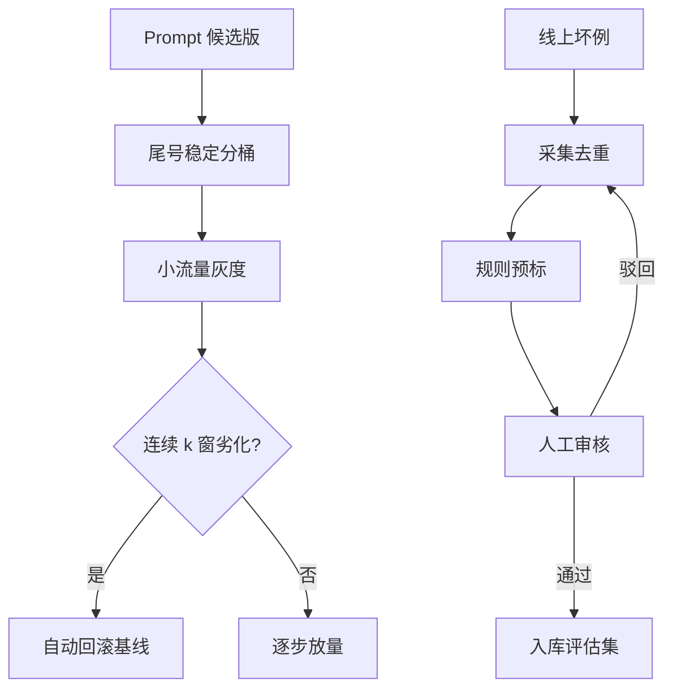

### Q1785 · 请求优先级调度:插队与饿死防护

> 难度:★★★★ | 标签:LLM 运维, 调度, 公平性

**问**:高优先级请求可以插队,但低优先级请求会不会永远排不上?怎么设计调度?

**答**:插队与防饿死要用老化机制统一:每个请求的有效优先级等于静态优先级加等待时间乘老化增益,高优请求凭静态分插队,低优请求等得越久有效分越高,最终必然被服务。增益为零就退化成纯插队,低优请求在持续高优到达下被饿死,这可以用同一模拟器验证;增益过大又会让高优失去意义,所以增益是个需要按到达率标定的参数。调度的可观测面是每个请求的等待时长分布,按优先级分层看 P99,饿死防护的目标就是低优层等待有上界。

```python
# file: code/06_Agent与LLM及系统设计/q1785_priority_scheduler.py
"""请求优先级调度:高优插队,等待老化防饿死,公平性可用模拟验证。"""


class AgingScheduler:
    def __init__(self, aging_gain=1.0):
        self.queue = []                          # [{id, pri, arrival}]
        self.now = 0
        self.served = []
        self.aging_gain = aging_gain

    def submit(self, req_id, pri):
        self.queue.append({"id": req_id, "pri": pri, "arrival": self.now})

    def effective(self, item):
        return item["pri"] + (self.now - item["arrival"]) * self.aging_gain

    def tick(self, capacity=1):
        """每拍按有效优先级服务 capacity 个,服务耗时 1 拍。"""
        picked = sorted(self.queue, key=lambda it: -self.effective(it))[:capacity]
        served_ids = []
        for it in picked:
            self.queue.remove(it)
            served_ids.append(it["id"])
            self.served.append({"id": it["id"], "pri": it["pri"],
                                "wait": self.now - it["arrival"]})
        self.now += 1
        return served_ids


if __name__ == "__main__":
    sched = AgingScheduler(aging_gain=2.0)
    sched.submit("L", 1)                         # 低优请求先到
    sched.submit("H1", 10)
    order = []
    for i in range(6):
        order += sched.tick()
        sched.submit("H%d" % (i + 2), 10)        # 高优请求持续到达
    assert order == ["H1", "H2", "H3", "H4", "H5", "L"], "老化让低优在 6 拍内被服务"
    assert sched.served[-1] == {"id": "L", "pri": 1, "wait": 5}, "低优等待有上界"

    starve = AgingScheduler(aging_gain=0.0)
    starve.submit("L", 1)
    starve.submit("H1", 10)
    got = []
    for i in range(8):
        got += starve.tick()
        starve.submit("H%d" % (i + 2), 10)
    assert "L" not in got, "无老化时低优被持续饿死"
    print("优先级调度通过:增益 2 时低优 6 拍内服务,增益 0 时可复现饿死")
```

**追问**:
- 增益怎么标定? 答:按高低优到达率比与低优可接受等待上限反解,让最坏等待恰好落在上限内,并随流量结构定期重标。
- 高优之间还分先后吗? 答:同优先级内部按到达序 FIFO,跨级才比较有效分,保证同级公平。


