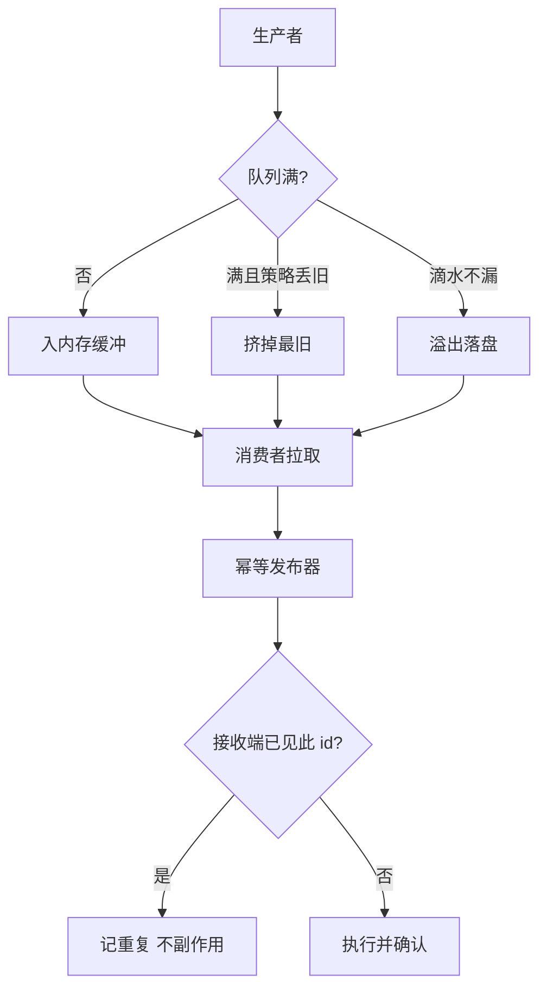

### Q1790 · 滑动日志近似:分桶计数省内存

> 难度:★★★☆ | 标签:系统设计, 限流, 内存优化

**问**:滑动日志要存每个事件的时间戳,高频接口内存爆炸,怎么近似?

**答**:把窗口切成固定数量的桶,每桶只记计数不记明细:判定时把窗口内各桶计数求和与上限比较,写入落在当前桶。内存从 O(事件数) 降到 O(桶数) 且恒定,桶越少越省内存但边界误差越大——桶边界处一个旧事件可能被多算最多一个桶跨度的时间。稀疏负载下分桶与精确判定通常完全一致,高频负载下差距也可控,这是用一点精度换一个数量级内存的标准交易。选桶数时按可接受误差倒推,一般五到十个桶足够。

```python
# file: code/06_Agent与LLM及系统设计/q1790_bucketed_sliding.py
"""滑动日志近似:窗口切桶计数,内存从 O 事件数 降到 O 桶数,误差有界。"""


class ExactSlidingLog:
    def __init__(self, limit, window):
        self.limit, self.window = limit, window
        self.events = []

    def allow(self, ts):
        self.events = [t for t in self.events if ts - t < self.window]
        if len(self.events) >= self.limit:
            return False
        self.events.append(ts)
        return True

    def memory(self):
        return len(self.events)


class BucketedSlidingLog:
    def __init__(self, limit, window, buckets=5):
        self.limit, self.window, self.buckets = limit, window, buckets
        self.bucket_span = window / buckets
        self.counts = {}                         # 桶序号 -> 计数

    def _bucket_of(self, ts):
        return int(ts // self.bucket_span)

    def allow(self, ts):
        cur = self._bucket_of(ts)
        oldest = cur - self.buckets + 1
        used = sum(n for b, n in self.counts.items() if b >= oldest)
        if used >= self.limit:
            return False
        self.counts[cur] = self.counts.get(cur, 0) + 1
        for b in [b for b in self.counts if b < oldest]:
            del self.counts[b]                   # 老桶顺手清掉
        return True

    def memory(self):
        return len(self.counts)


if __name__ == "__main__":
    ex, bk = ExactSlidingLog(3, 10.0), BucketedSlidingLog(3, 10.0, buckets=5)
    seq = [1.0, 2.0, 3.0, 4.0, 12.0, 12.5, 13.0, 14.0]
    exact_decisions = [ex.allow(t) for t in seq]
    bucket_decisions = [bk.allow(t) for t in seq]
    assert exact_decisions == [True, True, True, False, True, True, True, False]
    assert bucket_decisions == exact_decisions, "稀疏负载下分桶与精确决策一致"
    assert bk.memory() <= 5 and ex.memory() == 3

    ex2, bk2 = ExactSlidingLog(10 ** 6, 10.0), BucketedSlidingLog(10 ** 6, 10.0, buckets=5)
    for i in range(200):
        ex2.allow(i * 0.1)
        bk2.allow(i * 0.1)
    assert bk2.memory() <= 5, "高频下分桶内存恒为桶数"
    assert ex2.memory() > bk2.memory() * 10, "精确日志内存比分桶高一个数量级"
    print("分桶近似通过:决策与精确一致,内存从事件数级降到桶数级")
```

**追问**:
- 误差方向是什么? 答:偏向多放行,窗口边缘的旧桶可能被计入,限流场景宁可略宽不可误杀,方向是安全的。
- 什么场景不能用分桶? 答:需要精确审计每个事件,比如计费级限流,那就要回到精确日志加持久化。


