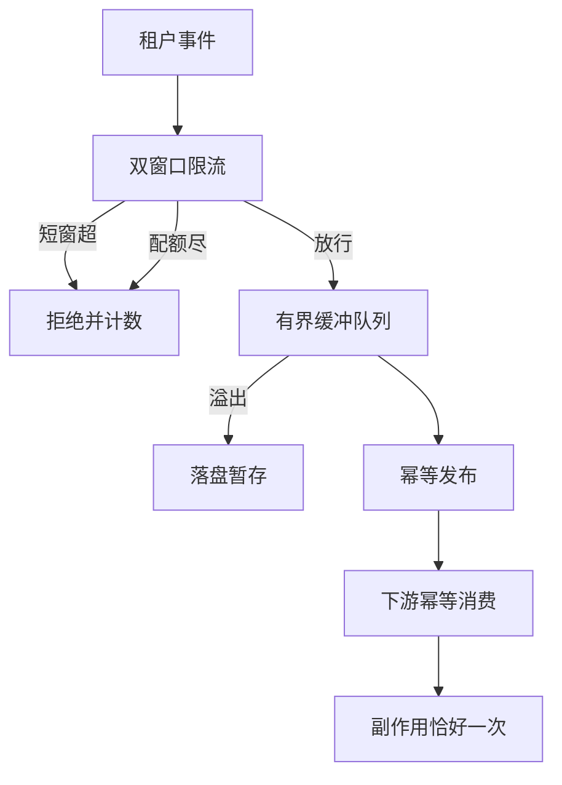

### Q1794 · 反熵对账:默克尔树差集同步

> 难度:★★★★★ | 标签:系统设计, 反熵, 默克尔树

**问**:两个副本的数据量上亿,怎么找出它们之间少的那几条,还不想全量传输?

**答**:反熵对账用默克尔树把"找差集"变成树上的对数级比对:叶子是每个键值对的哈希,两两向上聚合出根哈希;根相同则整树一致零传输,根不同则从根向下只走进哈希不一致的子树,直达叶子,得到精确差集。同步只传输差集键,同步后重建树二次对账,根一致且差异为零,传输量等于差集大小而不是全量。这依赖两副本键空间对齐——同一批键的不同取值对得上叶子;键集合本身不同的场景要先做键清单对齐。对账可周期跑也可变更触发,是副本最终一致的常态保障。

```python
# file: code/06_Agent与LLM及系统设计/q1794_anti_entropy.py
"""反熵对账:默克尔树逐层比对,根相同零传输,根不同下钻到差集最小同步。"""
import hashlib


def h(s):
    return hashlib.md5(s.encode()).hexdigest()


class MerkleTree:
    """叶子为 键加值 的哈希,两两向上聚合;奇数个叶子复制末位补齐。"""

    def __init__(self, items):
        self.keys = sorted(items)
        leaves = [h(k + "|" + items[k]) for k in self.keys]
        self.levels = [leaves]
        cur = leaves
        while len(cur) > 1:
            if len(cur) % 2 == 1:
                cur = cur + [cur[-1]]
            cur = [h(cur[i] + cur[i + 1]) for i in range(0, len(cur), 2)]
            self.levels.append(cur)

    def root(self):
        return self.levels[-1][0]

    def differing(self, other):
        """从根向下找叶子差异:每层只下钻哈希不同的子树。"""
        diffs = []
        self._walk(other, len(self.levels) - 1, 0, diffs)
        return sorted(diffs)

    def _walk(self, other, level, idx, diffs):
        if self.levels[level][idx] == other.levels[level][idx]:
            return                               # 子树一致:整棵跳过
        if level == 0:
            if idx < len(self.keys):
                diffs.append(self.keys[idx])
            return
        for child in (2 * idx, 2 * idx + 1):
            self._walk(other, level - 1, child, diffs)


if __name__ == "__main__":
    va = {"k%d" % i: "v%d" % i for i in range(1, 9)}
    vb = dict(va)
    vb["k3"], vb["k6"] = "stale3", "stale6"      # 两键取值分叉

    ta, tb = MerkleTree(va), MerkleTree(vb)
    assert ta.root() != tb.root(), "取值不同根必不同"
    assert ta.differing(tb) == ["k3", "k6"], "只下钻差异子树,精确到最小差集"

    transferred = 0
    for k in ta.differing(tb):
        vb[k] = va[k]
        transferred += 1
    tb2 = MerkleTree(vb)
    assert tb2.root() == ta.root(), "同步后根一致"
    assert ta.differing(tb2) == [], "二次对账零差异零传输"
    assert transferred == 2, "8 键对账只需传 2 个差异键"

    assert ta.differing(MerkleTree(dict(va))) == [], "同根子树整棵跳过"
    print("反熵对账通过:根不同下钻差集,仅同步 2 键,同步后根一致零传输")
```

**追问**:
- 键集合不同怎么办? 答:先按键哈希分桶对清单,再对共有键做值对账,多轮收敛;工业实现如 Dynamo 按键范围建树分程对账。
- 为什么用 md5 不用更强哈希? 答:对账哈希只要抗碰撞足够即可,演示用 md5,生产常用 sha1 以上或 xxhash 加长度,关键是两端算法一致。


