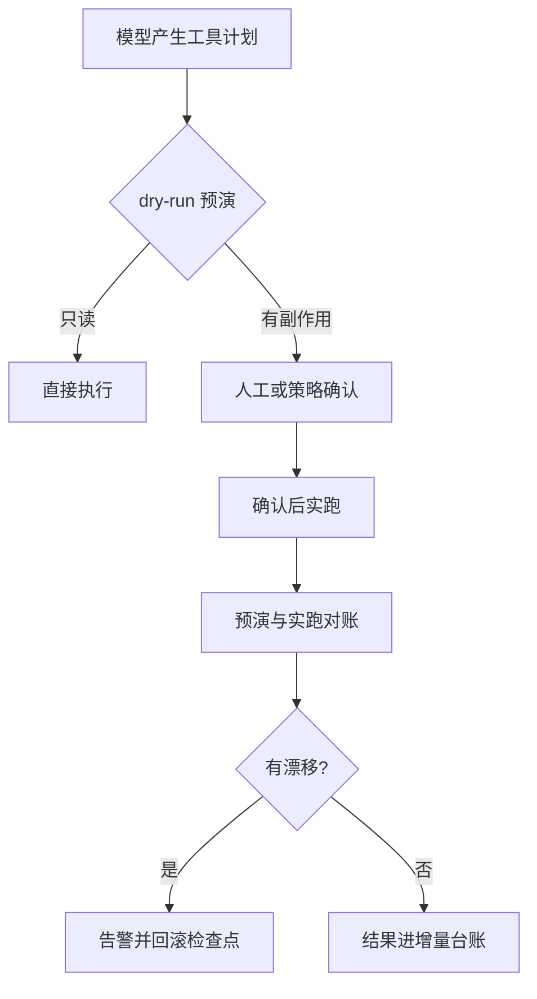

### Q2025 · 多轮工具结果的增量摘要:滚动事实台账

> 难度:★★★☆ | 标签:Agent, 上下文, 摘要

**问**:Agent 一轮查十次工具,原始结果把上下文塞满了,怎么让第十轮还记得第一轮查到了什么?

**答**:把工具结果从逐条堆进上下文改成增量合并进台账。台账以实体为键,每条新结果只做三件事:查询次数累加、取值择最新、来源去重追加,再记最近活跃轮次;上下文里渲染的永远是这份紧凑台账而不是原始 JSON。渲染按预算裁剪,最近活跃的实体优先保留,被挤出的实体数如实上报,模型能感知信息不完整并主动补查。原始结果照常落制品库,台账只承担记忆的当前视图这一职责。

```python
# file: code/06_Agent与LLM及系统设计/q2025_result_ledger.py
"""多轮工具结果的增量摘要:原始结果滚动合并为事实台账,上下文只保留台账。"""


class ResultLedger:
    def __init__(self):
        self.facts = {}

    def absorb(self, turn, tool, result):
        """把一条工具结果增量合并进台账:次数累加 值择新 来源去重。"""
        for entity, value in result.items():
            f = self.facts.setdefault(entity, {"seen": 0, "value": None,
                                               "tools": [], "last_turn": 0})
            f["seen"] += 1
            f["value"] = value
            if tool not in f["tools"]:
                f["tools"].append(tool)
            f["last_turn"] = turn

    def render(self, budget):
        """渲染为紧凑台账,超预算时按最近活跃优先保留,返回挤掉的实体数。"""
        items = sorted(self.facts.items(), key=lambda kv: -kv[1]["last_turn"])
        lines, used = [], 0
        for name, f in items:
            line = "%s: 值=%s 查了%d次 来源=%s 最近=T%d" % (
                name, f["value"], f["seen"], "+".join(f["tools"]), f["last_turn"])
            if used + len(line) > budget:
                break
            lines.append(line)
            used += len(line)
        return "\n".join(lines), len(items) - len(lines)


if __name__ == "__main__":
    ledger = ResultLedger()
    ledger.absorb(1, "web_search", {"订单状态": "已发货"})
    ledger.absorb(3, "db_query", {"订单状态": "已发货", "物流单号": "SF123"})
    ledger.absorb(5, "web_search", {"订单状态": "已签收"})

    f = ledger.facts["订单状态"]
    assert f["seen"] == 3 and f["value"] == "已签收", "值必须择最新一次"
    assert f["tools"] == ["web_search", "db_query"], "来源去重但保留出现顺序"
    f2 = ledger.facts["物流单号"]
    assert f2["seen"] == 1 and f2["last_turn"] == 3

    text, dropped = ledger.render(budget=60)
    assert "已签收" in text and "订单状态" in text, "最近活跃的实体优先保留"
    assert dropped >= 1, "预算不够时必须有实体被挤出且数量如实上报"
    small, dropped2 = ledger.render(budget=24)
    assert dropped2 > dropped or len(small.splitlines()) == 1, "预算越小挤掉越多"
    print("增量台账通过:3 次查询合并为 2 条事实,值择新 来源去重 预算裁剪")
```

**追问**:
- 值冲突了怎么办? 答:台账只记最新值不裁决,冲突标注交给上层,配合来源投票做消歧
- 实体键怎么定? 答:注册工具时声明结果里哪个字段是实体键,没有键的结果整条进台账附录区


