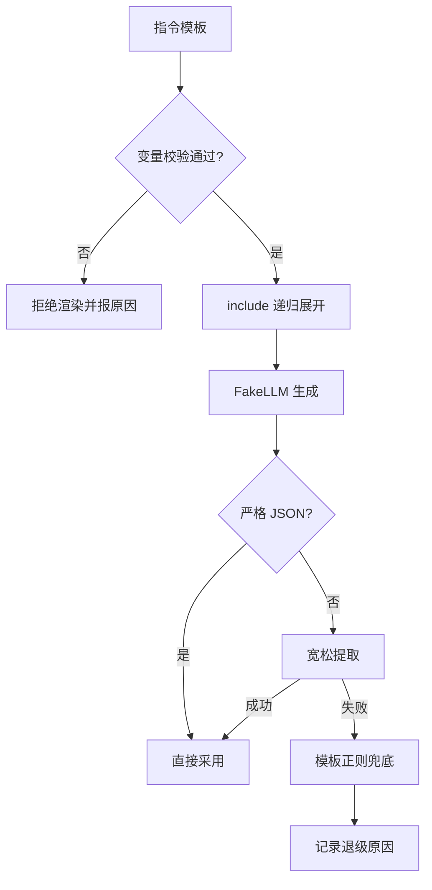

### Q2031 · 输出格式退级链:严格 JSON 到宽松提取到模板

> 难度:★★★☆ | 标签:LLM, 结构化输出, 退级

**问**:模型说好回 JSON,实际一半是代码围栏一半是散文,解析层怎么保证服务不被一条脏输出打挂?

**答**:解析做成退级链,逐级放宽,每级留下触发原因。第一级严格 json.loads,干净输出零损失;第二级宽松提取,剥代码围栏、定位首个平衡大括号块、修掉尾逗号,专治模型想回 JSON 但手抖;第三级模板兜底,按字段正则抓取,抓不到填默认值,保证调用永不报废。返回值带 level 与 reason 字段,退级率是解析层的核心指标——宽松级占比升高说明模型或提示在漂移,要修因而不是修果。

```python
# file: code/06_Agent与LLM及系统设计/q2031_output_fallback.py
"""输出格式退级链:严格 JSON → 宽松提取 → 模板兜底,逐级记录触发原因。"""
import json
import re


class FakeLLM:
    """桩:按脚本吐出预定输出,不联网。"""

    def __init__(self, script):
        self.script = list(script)

    def chat(self, _messages):
        return self.script.pop(0)


def strict_parse(text):
    return json.loads(text)


def lenient_parse(text):
    """宽松级:剥代码围栏,提取首个平衡大括号块,容忍尾逗号。"""
    fence_pat = "`" * 3 + r"(?:json)?\s*(.*?)" + "`" * 3
    fence = re.search(fence_pat, text, re.S)
    if fence:
        text = fence.group(1)
    start = text.find("{")
    if start < 0:
        raise ValueError("找不到 JSON 主体")
    depth = 0
    for i in range(start, len(text)):
        if text[i] == "{":
            depth += 1
        elif text[i] == "}":
            depth -= 1
            if depth == 0:
                candidate = re.sub(r",\s*([}\]])", r"\1", text[start:i + 1])
                return json.loads(candidate)
    raise ValueError("大括号不闭合")


def template_parse(text, fields):
    """模板级:正则逐字段抓,抓不到填默认值,绝不让整次调用报废。"""
    out = {}
    for name in sorted(fields):
        pattern, default = fields[name]
        m = re.search(pattern, text)
        out[name] = m.group(1) if m else default
    return out


def parse_with_chain(text, fields):
    try:
        return {"data": strict_parse(text), "level": "strict", "reason": None}
    except Exception as e1:
        try:
            return {"data": lenient_parse(text), "level": "lenient", "reason": str(e1)}
        except Exception as e2:
            return {"data": template_parse(text, fields),
                    "level": "template", "reason": str(e2)}


if __name__ == "__main__":
    FIELDS = {"amount": (r"金额[:：]\s*(\d+)", "0"),
              "city": (r"城市[:：]\s*(\S+)", "未知")}
    llm = FakeLLM([
        '{"amount": 42, "city": "杭州"}',                      # 干净 JSON
        '好的,结果如下:\n' + "`" * 3 + 'json\n{"amount": 42,}\n' + "`" * 3 + '\n请查收',  # 围栏加尾逗号
        '人工看了下,金额: 42 元,城市: 北京',                     # 自由文本
        '抱歉,我没算出来',                                     # 全兜底
    ])

    r1 = parse_with_chain(llm.chat([]), FIELDS)
    assert r1["level"] == "strict" and r1["data"] == {"amount": 42, "city": "杭州"}

    r2 = parse_with_chain(llm.chat([]), FIELDS)
    assert r2["level"] == "lenient" and r2["data"]["amount"] == 42
    assert r2["reason"], "退级必须留下严格级失败的原因"

    r3 = parse_with_chain(llm.chat([]), FIELDS)
    assert r3["level"] == "template"
    assert r3["data"] == {"amount": "42", "city": "北京"}

    r4 = parse_with_chain(llm.chat([]), FIELDS)
    assert r4["level"] == "template" and r4["data"] == {"amount": "0", "city": "未知"}
    print("退级链通过:strict→lenient→template 三级各就位,每级留触发原因")
```

**追问**:
- 模板级抓出来的数据可信吗? 答:降级数据必须打标,template 级结果只用于展示或人工复核,不进自动化决策
- 为什么不在提示词里要求就够? 答:提示词降低概率但不为零,解析层兜底是必须的纵深防御


