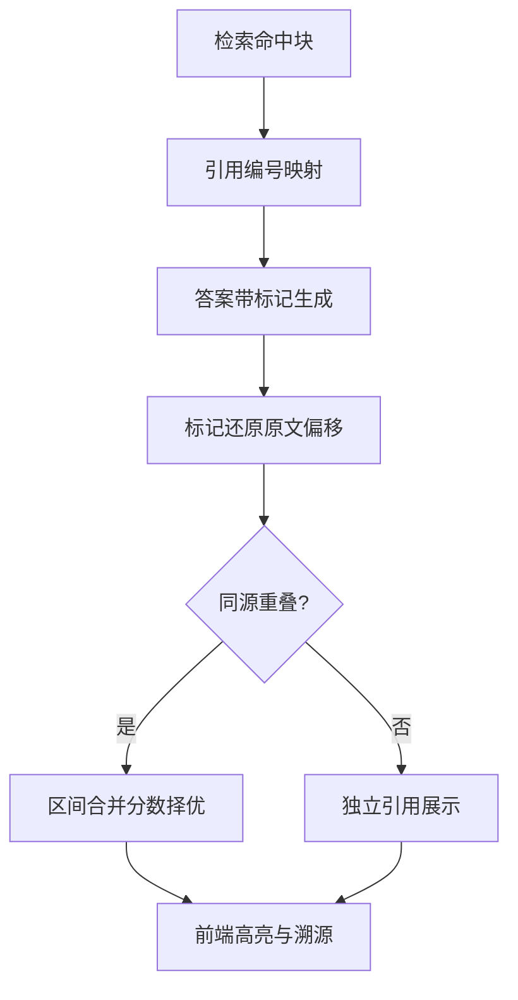

### Q2037 · 同源引用折叠:重叠区间合并与分数择优

> 难度:★★★☆ | 标签:RAG, 引用, 去重

**问**:一次检索召回了六块,四块来自同一篇文档还互相重叠,答案里挂六个引用合适吗?

**答**:不合适,要做同源折叠。按文档聚合后对区间排序合并:重叠的区间并成一段,首尾相接的也吸收,完全被包含的直接吞掉;分数取块内最高,来源计数如实保留,报告这一篇贡献了四块。折叠的价值是把引用列表从块级噪音收敛为来源级事实,用户看到两条来源而不是六条碎片,信任感和可读性都上升。折叠是纯几何操作,确定性可单测,不引入任何语义判断。

```python
# file: code/06_Agent与LLM及系统设计/q2037_citation_merge.py
"""同源引用折叠:同一文档的重叠或相邻片段合并为区间,分数取最高,引用列表去重。"""


def merge_ranges(ranges):
    """ranges: [(start, end)] 合并重叠与相邻区间,返回不重叠的升序区间。"""
    out = []
    for s, e in sorted(ranges):
        if out and s <= out[-1][1]:
            out[-1][1] = max(out[-1][1], e)
        else:
            out.append([s, e])
    return [tuple(r) for r in out]


def fold_citations(hits):
    """hits: [{doc, start, end, score}] 按文档聚合,区间合并,分数取最高。"""
    by_doc = {}
    for h in hits:
        by_doc.setdefault(h["doc"], []).append(h)
    folded = []
    for doc in sorted(by_doc):
        items = by_doc[doc]
        folded.append({"doc": doc,
                       "ranges": merge_ranges([(h["start"], h["end"]) for h in items]),
                       "score": max(h["score"] for h in items),
                       "chunks": len(items)})
    folded.sort(key=lambda f: -f["score"])
    return folded


if __name__ == "__main__":
    hits = [
        {"doc": "d1", "start": 0, "end": 15, "score": 0.9},
        {"doc": "d1", "start": 10, "end": 25, "score": 0.8},   # 与上一条重叠
        {"doc": "d1", "start": 25, "end": 30, "score": 0.7},   # 与合并后相邻
        {"doc": "d1", "start": 40, "end": 50, "score": 0.6},   # 独立区间
        {"doc": "d2", "start": 5, "end": 12, "score": 0.95},
        {"doc": "d2", "start": 6, "end": 11, "score": 0.5},    # 完全被含
    ]
    folded = fold_citations(hits)
    assert folded[0]["doc"] == "d2" and folded[0]["score"] == 0.95
    assert folded[0]["ranges"] == [(5, 12)] and folded[0]["chunks"] == 2

    d1 = folded[1]
    assert d1["ranges"] == [(0, 30), (40, 50)], "重叠加相邻应合到 0-30"
    assert d1["score"] == 0.9, "分数取块内最高而不是合并序"
    assert d1["chunks"] == 4

    assert len(folded) == 2, "6 个引用块折叠为 2 条来源"
    empty = fold_citations([])
    assert empty == []
    print("同源折叠通过:6 块折叠为 2 源,区间归并 相邻吸收 分数择优")
```

**追问**:
- 分数为什么取最高? 答:同源多块证明的是这篇文档相关,相关性取最强证据,均分会稀释排序信号
- 不相邻的区间合吗? 答:留一个可配的间隙阈值,间隙小于阈值就桥接,超过就保持独立,默认从严不合


