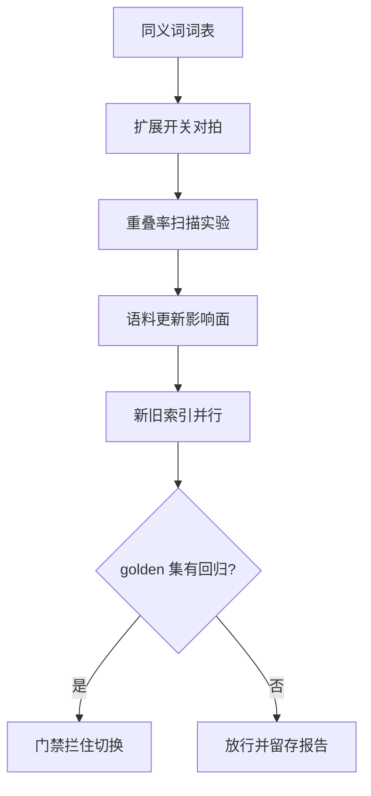

### Q2043 · 新旧索引对拍门禁:查询级 diff 与切换决策

> 难度:★★★☆ | 标签:RAG, 索引, 发布

**问**:索引重建完了,你怎么敢把流量切过去?

**答**:不敢直接切,先对拍。新旧索引并行服务同一批 golden 查询,按查询级 diff 分类:结果完全一致的计入 same,不一致的再看新结果——期望文档还在但文案变了算 changed,期望文档消失算 regressed。切换门禁是硬规则:有 regressed 就拦住,changed 要逐条确认是预期改进。演示里三同一变更,放行;把退货文档改成不含检索词的文案,门禁立刻报回归拦下。对拍报告留档,切换决策从信心变成证据。

```python
# file: code/06_Agent与LLM及系统设计/q2043_index_canary.py
"""新旧索引对拍:同一批 golden 查询打两个索引版本,出查询级 diff 并给切换门禁。"""

VOCAB = ["退货", "退款", "包邮", "运费", "物流", "签收", "发票", "保修"]


def extract(text):
    return set(w for w in VOCAB if w in text)


def build_index(docs):
    """docs: [(doc_id, text)]"""
    return [{"id": d, "text": t, "words": extract(t)} for d, t in docs]


def search(index, query, k=1):
    qw = extract(query)
    scored = sorted(((len(qw & d["words"]), d["id"]) for d in index),
                    key=lambda x: (-x[0], x[1]))
    return [i for s, i in scored[:k] if s > 0]


def canary(golden, old_index, new_index):
    """golden: [(query, expect_id)] 对拍产出 diff 报告与切换门禁。"""
    report = {"same": 0, "changed": [], "regressed": []}
    for query, expect in golden:
        ro = search(old_index, query)
        rn = search(new_index, query)
        if ro == rn:
            report["same"] += 1
            continue
        if expect in ro and expect not in rn:
            report["regressed"].append(query)
        else:
            report["changed"].append(query)
    report["switch_allowed"] = not report["regressed"]
    return report


if __name__ == "__main__":
    old_docs = [("d1", "商品签收后可无理由退货"), ("d2", "满 99 元包邮"),
                ("d3", "发货后可查物流单号")]
    # 新版:d1 文案更新 d4 新增,检索词覆盖不变
    new_docs = [("d1", "商品签收后十五天内可无理由退货"), ("d2", "满 99 元包邮"),
                ("d3", "发货后可查物流单号"), ("d4", "电子发票支持自助开具")]
    old_idx = build_index(old_docs)
    new_idx = build_index(new_docs)
    golden = [("退货政策", "d1"), ("邮费标准", "d2"),
              ("物流跟踪", "d3"), ("发票怎么开", "d4")]

    report = canary(golden, old_idx, new_idx)
    assert report["same"] == 3, report
    assert report["changed"] == ["发票怎么开"], "新语料让原本空手的新索引有了命中"
    assert report["switch_allowed"] is True, "无回归放行切换"

    # 制造真回归:新版把退货文档改成不含任何检索词的文案
    bad_docs = [("d1", "十五天质量保障服务"), ("d2", "满 99 元包邮"),
                ("d3", "发货后可查物流单号"), ("d4", "电子发票支持自助开具")]
    bad_idx = build_index(bad_docs)
    bad_report = canary(golden, old_idx, bad_idx)
    assert bad_report["regressed"] == ["退货政策"], bad_report
    assert bad_report["switch_allowed"] is False, "有回归必须卡住切换"
    print("索引对拍通过:4 查询 3 同 1 变更放行,真回归场景门禁拦住切换")
```

**追问**:
- golden 之外的线上查询怎么办? 答:切流前抽线上真实查询做影子对拍,golden 管底线,影子管长尾
- changed 很多怎么办? 答:按类目归因,批量确认走抽检审批,大量 changed 本身就是信号,说明分块或语料动了大结构


