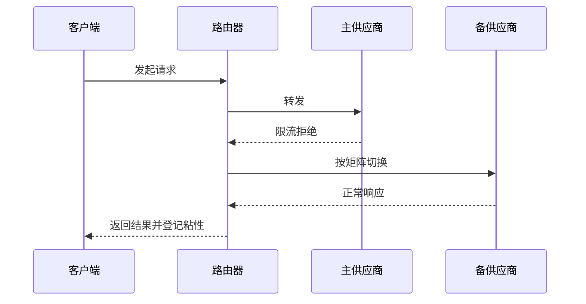

### Q2048 · 供应商故障切换矩阵:故障类型到处置动作

> 难度:★★★★ | 标签:LLM运维, 故障切换, 配置

**问**:供应商一会限流一会超时一会鉴权失败,你们的重试逻辑是不是全堆在一个 if-else 里?

**答**:把处置规则从代码搬进矩阵:故障类型到动作的配置表。限流立刻换路不加剧拥塞;服务错误与超时先原地重试再换路;鉴权错误直接终止,换个供应商鉴权一样失败;内容过滤降级走兜底模型。路由器查表决策,决策只依赖故障类、已试次数、供应商链位置三个量,纯函数可穷举测试;链尾无路可换时显式报耗尽而不是原地打转。矩阵还要配审计:动作必须合法、鉴权必须 abort、限流禁止原地重试,配置错了演练先炸。未收录的故障按服务错误兜底,新故障类型上线先兜底再补表。

```python
# file: code/06_Agent与LLM及系统设计/q2048_failover_matrix.py
"""供应商故障切换矩阵:故障类型到处置动作的配置表,演练验证矩阵覆盖完整。"""

MATRIX = {
    "rate_limited":   {"action": "failover", "retry_same": 0},
    "server_error":   {"action": "retry_then_failover", "retry_same": 2},
    "timeout":        {"action": "retry_then_failover", "retry_same": 1},
    "auth_error":     {"action": "abort", "retry_same": 0},
    "content_filter": {"action": "degrade", "retry_same": 0},
}
LEGAL = {"retry_same", "failover", "retry_then_failover", "abort", "degrade"}


def decide(failure, attempt, chain, position):
    """按矩阵给路由决策,未收录故障按 server_error 兜底。"""
    rule = MATRIX.get(failure, MATRIX["server_error"])
    if rule["action"] == "abort":
        return "abort", None
    if rule["action"] == "degrade":
        return "degrade", chain[position]
    if attempt < rule["retry_same"]:
        return "retry_same", chain[position]
    nxt = position + 1
    if nxt >= len(chain):
        return "exhausted", None
    return "failover", chain[nxt]


def audit_matrix():
    """演练:每个故障类动作合法,且特定故障的处置符合硬约束。"""
    problems = []
    for cls, rule in sorted(MATRIX.items()):
        if rule["action"] not in LEGAL:
            problems.append("故障类 %s 动作非法" % cls)
        if rule["retry_same"] < 0:
            problems.append("故障类 %s 重试次数为负" % cls)
    if MATRIX["auth_error"]["action"] != "abort":
        problems.append("鉴权故障换供应商也会失败,必须 abort")
    if MATRIX["rate_limited"]["retry_same"] > 0:
        problems.append("限流应立刻换路而不是原地重试加剧拥塞")
    return problems


if __name__ == "__main__":
    chain = ["primary", "backup_a", "backup_b"]
    assert decide("rate_limited", 0, chain, 0) == ("failover", "backup_a")
    assert decide("server_error", 0, chain, 0) == ("retry_same", "primary")
    assert decide("server_error", 1, chain, 0) == ("retry_same", "primary")
    assert decide("server_error", 2, chain, 0) == ("failover", "backup_a")
    assert decide("timeout", 0, chain, 1) == ("retry_same", "backup_a")
    assert decide("timeout", 1, chain, 1) == ("failover", "backup_b")
    assert decide("auth_error", 0, chain, 0) == ("abort", None)
    assert decide("content_filter", 0, chain, 1) == ("degrade", "backup_a")
    assert decide("rate_limited", 0, chain, 2) == ("exhausted", None), "末位供应商无路可换"

    assert decide("brand_new_fault", 0, chain, 0)[0] == "retry_same", "未收录故障按兜底处置"

    assert audit_matrix() == [], audit_matrix()
    print("切换矩阵通过:五类故障处置各就位,链尾兜底 演练审计零问题")
```

**追问**:
- 矩阵存哪? 答:配置中心,变更走评审与演练,和代码同权发布,回滚也是一键
- 内容过滤降级给什么模型? 答:小模型加安全前缀重写,降级是可用性换质量,必须打标告知用户


