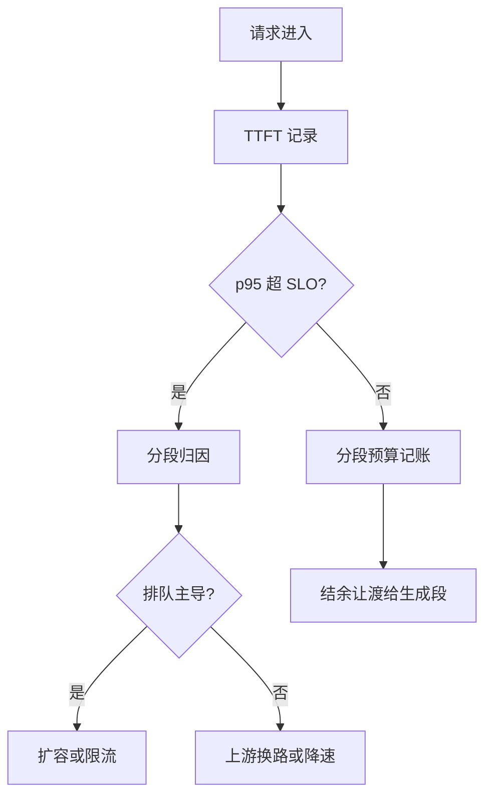

### Q2053 · 分段预算的动态再分配:结余让渡与封顶保底

> 难度:★★★★ | 标签:LLM运维, 超时, 预算

**问**:连接和排队经常提前完成,省下的时间能不能让生成多写几个字?

**答**:能,做动态再分配:前两段实际耗时低于计划份额的结余,让渡给生成段;让渡有两道约束——封顶,生成段最多拿总额的八成,防止单段独吞预算;保底,再挤也留一成给生成,防止前段劣化把生成挤死。再分配后总承诺要复核:正常路径下结余只是挪位,总额不变;前段已超支的场景,承诺值如实反映超支加保底,不假装预算还在。演示里结余 980 毫秒让渡,生成段从 1000 涨到 1600 触及封顶;超支场景保底 200 生效。

```python
# file: code/06_Agent与LLM及系统设计/q2053_budget_rollover.py
"""分段预算的动态再分配:前段提前完成结余让渡给生成段,封顶保底防独吞。"""


def reallocate(total_ms, used):
    """used: {connect, queue} 前两段实际耗时,重算生成段可用预算。"""
    plan = {"connect": total_ms * 0.2, "queue": total_ms * 0.3,
            "generate": total_ms * 0.5}
    surplus = (plan["connect"] - used["connect"]) + (plan["queue"] - used["queue"])
    gen = plan["generate"] + surplus
    gen = min(gen, total_ms * 0.8)      # 封顶:生成段不得吃掉全部预算
    gen = max(gen, total_ms * 0.1)      # 保底:再挤也要留生成空间
    consumed = used["connect"] + used["queue"]
    return {"generate": int(gen), "consumed": int(consumed),
            "total_committed": int(consumed + gen), "total": total_ms}


if __name__ == "__main__":
    total = 2000

    # 小幅提前完成:结余 400 全部让渡,不触封顶
    r1 = reallocate(total, {"connect": 200, "queue": 400})
    assert r1["generate"] == 1400, r1        # 1000 + 200 + 200
    assert r1["total_committed"] == 2000, "让渡只是挪位,总承诺不变"

    # 正常完成:份额不变
    r2 = reallocate(total, {"connect": 400, "queue": 600})
    assert r2["generate"] == 1000

    # 严重超支:生成段被挤压但保底 200
    r3 = reallocate(total, {"connect": 900, "queue": 1500})
    assert r3["generate"] == 200, r3         # 1000 - 500 - 900 = -400 触保底
    assert r3["total_committed"] == 2600, "已超支 600 加保底 200,承诺如实为 2600"

    # 结余巨大:封顶生效,生成段最多拿 0.8 倍总额
    r4 = reallocate(total, {"connect": 10, "queue": 10})
    assert r4["generate"] == 1600, r4        # 1000 + 980 = 1980 封顶 1600
    assert r4["generate"] <= total * 0.8
    assert r4["total_committed"] <= total
    print("再分配通过:结余让渡 上限 0.8 总额,超支保底 0.1,总承诺不失控")
```

**追问**:
- 封顶比例怎么定? 答:按业务对生成时长的依赖定,创作类可放宽,交互类收紧,进配置
- 让渡会不会掩盖前段劣化? 答:不会,结余量本身进监控,持续大结余说明份额计划过时,该重新标定


