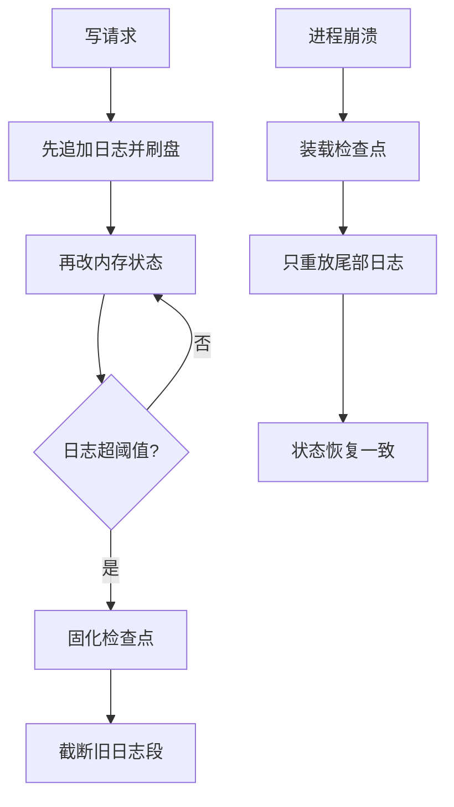

### Q2058 · WAL 检查点与截断:恢复只重放尾部

> 难度:★★★★ | 标签:分布式, WAL, 检查点

**问**:WAL 重放要是一直从头来,启动不得几分钟?怎么让恢复只碰尾部?

**答**:做检查点:把当前状态固化落盘,记录检查点 LSN,然后截断该 LSN 之前的日志段。恢复路径变成装载检查点加只重放尾部,重放量从全量收敛为检查点之后的增量;演示里 50 条日志做检查点后清零,追加 6 条,崩溃恢复只重放 6 条,状态与活数据完全一致。检查点频率是权衡:太勤,固化写放大;太懒,恢复重放太长。截断的前提是检查点已持久化,顺序不能反,否则截掉的是唯一真相。

```python
# file: code/06_Agent与LLM及系统设计/q2058_wal_checkpoint.py
"""WAL 检查点与截断:定期固化状态,截掉旧日志,恢复只需检查点加尾部重放。"""


class WALWithCheckpoint:
    def __init__(self):
        self.log = []
        self.checkpoint = {}
        self.ckpt_lsn = 0
        self.next_lsn = 1

    def append(self, op, key, value=None):
        rec = {"lsn": self.next_lsn, "op": op, "key": key, "value": value}
        self.next_lsn += 1
        self.log.append(rec)
        return rec["lsn"]

    def state_now(self):
        st = dict(self.checkpoint)
        for rec in self.log:
            if rec["op"] == "set":
                st[rec["key"]] = rec["value"]
            elif rec["op"] == "del":
                st.pop(rec["key"], None)
        return st

    def checkpoint_now(self):
        """固化当前状态,截掉检查点之前的日志段。"""
        self.checkpoint = self.state_now()
        self.ckpt_lsn = self.next_lsn - 1
        self.log = [r for r in self.log if r["lsn"] > self.ckpt_lsn]
        return self.ckpt_lsn

    def recover(self):
        """崩溃恢复:装载检查点,重放尾部日志。"""
        st = dict(self.checkpoint)
        replayed = 0
        for rec in self.log:
            if rec["lsn"] <= self.ckpt_lsn:
                continue
            if rec["op"] == "set":
                st[rec["key"]] = rec["value"]
            elif rec["op"] == "del":
                st.pop(rec["key"], None)
            replayed += 1
        return st, replayed


if __name__ == "__main__":
    db = WALWithCheckpoint()
    for i in range(50):
        db.append("set", "k%d" % (i % 10), i)
    db.checkpoint_now()
    ckpt_size = len(db.log)
    assert ckpt_size == 0 and db.ckpt_lsn == 50, "截断后日志只剩尾部空段"

    for i in range(5):
        db.append("set", "hot", i)
    db.append("del", "k0")

    live = db.state_now()
    assert live["hot"] == 4 and "k0" not in live and live["k1"] == 41

    recovered, replayed = db.recover()
    assert recovered == live, "检查点加尾部重放必须等于活状态"
    assert replayed == 6, "只重放了检查点之后的 6 条"
    assert db.next_lsn - 1 - db.ckpt_lsn == 6

    # 再做一次检查点:日志再次收敛
    db.checkpoint_now()
    assert len(db.log) == 0 and db.checkpoint == live
    st, r = db.recover()
    assert st == live and r == 0
    print("检查点通过:固化截断后恢复只重放 6 条,二次检查点后重放为 0")
```

**追问**:
- 检查点做一半崩溃了怎么办? 答:检查点自身带版本与校验和,半成品不生效,回退到上一个完整检查点加全量重放
- 检查点会不会阻塞写入? 答:用写时复制或影子拷贝,固化期间新写入照常追加,固化完成后原子切换指针


