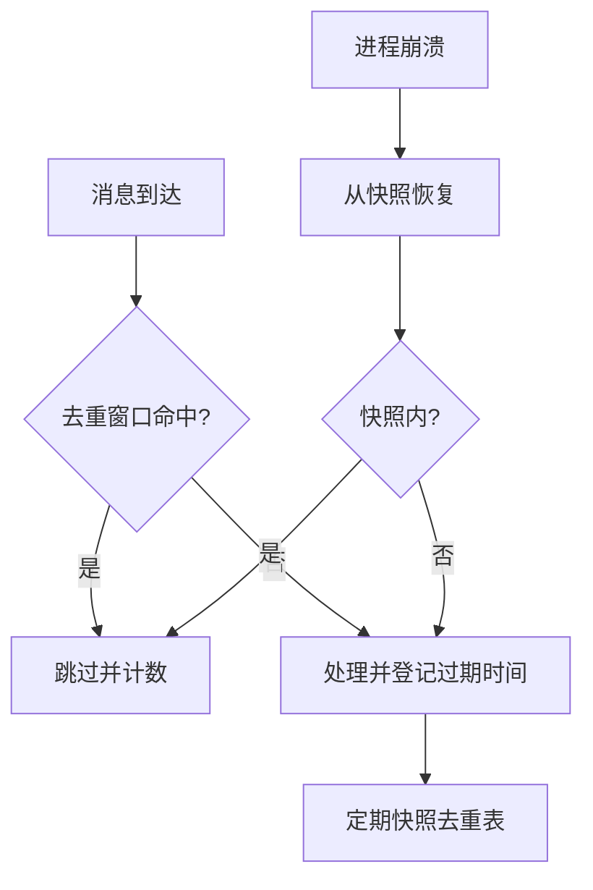

### Q2063 · 去重窗口的崩溃恢复:快照缺口与重放边界

> 难度:★★★☆ | 标签:分布式, 幂等, 可靠性

**问**:去重表在内存里,消费者一崩,窗口内的重复消息又全部重放一遍,怎么办?

**答**:去重表也要持久化:定期把窗口快照落盘,崩溃后从快照恢复,恢复时顺手清掉已过期的条目。恢复语义要诚实:快照里的消息,窗口内重复照常被挡;快照之后才处理的消息不在快照里,重复投递会被再处理一次——这是 at-least-once 的固有缺口,快照频率越高缺口越小,但永远不会是零,所以下游幂等永远是兜底。另一个边界:快照自己也过 TTL,过期快照恢复出空窗,宁可重放不可误挡。演示里三个消息,快照前后的重放边界被精确断言。

```python
# file: code/06_Agent与LLM及系统设计/q2063_dedup_recovery.py
"""去重窗口的崩溃恢复:定期快照去重表,重启后窗口内重复仍被挡,快照后的会重放。"""
import json


class PersistentDedup:
    def __init__(self, ttl):
        self.ttl = ttl
        self.table = {}          # msg_id -> expire_at
        self.snapshot = {}
        self.processed = []

    def process(self, msg_id, now):
        self._evict(now)
        if msg_id in self.table:
            return False         # 去重命中,不重复处理
        self.table[msg_id] = now + self.ttl
        self.processed.append(msg_id)
        return True

    def snapshot_now(self, now):
        self._evict(now)
        self.snapshot = dict(self.table)
        return json.dumps(sorted(self.snapshot.items()))

    def crash_and_recover(self, now):
        """模拟崩溃:活表全丢,从最近快照恢复,并清掉已过期的快照项。"""
        self.table = dict(self.snapshot)
        self._evict(now)
        return len(self.table)

    def _evict(self, now):
        for k in [k for k, e in self.table.items() if e <= now]:
            del self.table[k]


if __name__ == "__main__":
    pd = PersistentDedup(ttl=100)
    assert pd.process("m1", 0) is True
    assert pd.process("m2", 10) is True
    assert pd.process("m1", 20) is False, "崩溃前去重正常工作"
    pd.snapshot_now(20)                  # 快照时点:T=20,含 m1 m2

    # 崩溃后恢复:m1 m2 仍在窗口内,重复投递照样被挡
    assert pd.crash_and_recover(30) == 2
    assert pd.process("m1", 30) is False, "快照恢复后窗口内重复仍被挡"

    # 快照后才处理的 m3 不在快照里:恢复后重复投递会被再处理一次
    assert pd.process("m3", 40) is True
    pd.crash_and_recover(50)
    assert pd.process("m3", 50) is True, "快照缺口的 m3 会被重放,下游必须幂等"
    assert pd.processed.count("m3") == 2

    # 快照本身也过 TTL:恢复后窗口全空
    pd2 = PersistentDedup(ttl=50)
    pd2.process("x", 0)
    pd2.snapshot_now(0)
    pd2.crash_and_recover(100)
    assert pd2.table == {}, "过期快照恢复出空窗,宁重放不误挡"
    print("崩溃恢复通过:快照内重复照挡,快照缺口重放一次,TTL 过后窗口归零")
```

**追问**:
- 快照频率怎么定? 答:按可容忍的重放量定,比如每千条或每十秒,两者取先到
- 快照和消息处理的顺序? 答:先处理后快照,最坏多处理一次;先快照后处理,最坏漏挡一次,前者是正确选择


