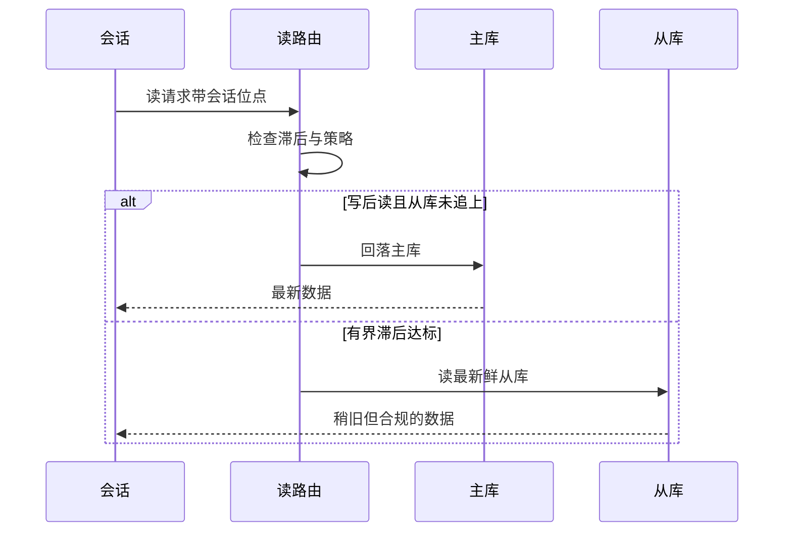

### Q2065 · 副本滞后读策略:写后读 有界滞后与兜底回主

> 难度:★★★☆ | 标签:分布式, 复制, 一致性

**问**:主从架构里从库滞后五秒,用户刚下单就查订单查不到,读请求到底该怎么路由?

**答**:读策略按诉求三选一。写后读:会话带着最近写入的位点,只有已追上该位点的从库可读,追不上回主库,保证用户永远看见自己的写入;有界滞后:设定可容忍的最大滞后,达标从库里挑最新鲜的,无人达标回主库兜底;不设约束:永远挑当前滞后最小的从库,报表类场景常用。三策略共用一条铁律:宁可回主库多扛一点,不可脏读用户数据。演示里滞后两秒的 r1 达标胜出、五秒的 r2 被排除,全超限时安全回落主库。

```python
# file: code/06_Agent与LLM及系统设计/q2065_replica_lag.py
"""副本滞后读策略:写后读走主或有据从库,有界滞后挑最新鲜,超限兜底回主。"""


class ReadRouter:
    def __init__(self, lag):
        self.lag = dict(lag)          # 副本 -> 滞后秒数

    def pick_read_your_writes(self, session_lsn, replica_applied):
        """会话刚写过:只读已追上该写入的从库,没有就回主库。"""
        if replica_applied is not None and replica_applied >= session_lsn:
            return "r1"
        return "primary"

    def pick_bounded_staleness(self, max_lag):
        """有界滞后:挑满足上限里最新鲜的从库,无人达标回主库。"""
        ok = [(r, l) for r, l in self.lag.items() if r != "primary" and l <= max_lag]
        if not ok:
            return "primary"
        return min(ok, key=lambda x: x[1])[0]

    def pick_freshest(self):
        """不设硬约束:挑当前滞后最小的从库,无从库时回主库。"""
        reps = {r: l for r, l in self.lag.items() if r != "primary"}
        if not reps:
            return "primary"
        return min(reps, key=lambda r: reps[r])


if __name__ == "__main__":
    router = ReadRouter({"primary": 0, "r1": 2, "r2": 5})

    # 写后读:从库还没追上会话最近写入 -> 必须回主库
    assert router.pick_read_your_writes(session_lsn=100, replica_applied=98) == "primary"
    assert router.pick_read_your_writes(session_lsn=100, replica_applied=100) == "r1"
    assert router.pick_read_your_writes(100, None) == "primary"

    # 有界滞后:max_lag=3 时 r2 的 5 秒滞后不合格,r1 胜出
    assert router.pick_bounded_staleness(3) == "r1"
    assert router.pick_bounded_staleness(1) == "primary", "全都超限只能回主库"
    assert router.pick_bounded_staleness(10) == "r1", "达标里挑最新鲜的"

    # 无硬约束:永远给滞后最小的从库
    assert router.pick_freshest() == "r1"

    laggy = ReadRouter({"primary": 0, "r1": 30, "r2": 45})
    assert laggy.pick_bounded_staleness(5) == "primary"
    assert laggy.pick_freshest() == "r1"

    # 只有主库可用:所有策略都安全回落,不抛异常
    solo = ReadRouter({"primary": 0})
    assert solo.pick_bounded_staleness(3) == "primary"
    assert solo.pick_freshest() == "primary"
    assert solo.pick_read_your_writes(1, None) == "primary"
    print("滞后读策略通过:写后读凭 LSN 回主,有界滞后挑新鲜,超限兜底不脏读")
```

**追问**:
- 位点怎么传? 答:写路径返回事务位点存进会话,读路径带上位点与从库已应用位点比对,这是会话一致读的标准做法
- 从库滞后本身怎么监控? 答:心跳表周期写入比对应用位点,滞后分位进告警,滞后是常态时要考虑读写分离架构本身失效


