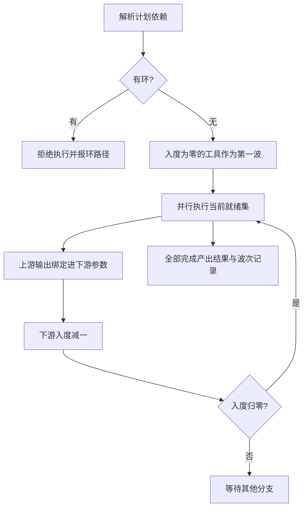

### Q2291 · 工具 DAG 的就绪驱动执行:输出绑定与波次实测

> 难度:★★★★ | 标签:Agent, 工具编排, 并发

**问**:Agent 计划出的工具调用构成一张依赖图,除了按层拓扑排序,还有什么更快的调度方式?上游结果怎么传给下游?

**答**:比固定分层更灵活的是就绪驱动:每完成一个工具,就把依赖它的下游入度减一,减到零立即进入下一波就绪集,不需要等整层结束。执行前必须做环检测,DFS 遇到在栈节点即报环拒绝,绝不让执行器空转挂死。数据传递靠绑定约定:下游参数名声明为 from_上游名,执行器在下游启动时把上游结果注入参数,这就是"数据依赖"的落地形式。波次记录顺手免费产出:波数越少并行度越高,可以直接拿去汇报加速比。相比分层轮询,就绪驱动在长尾工具场景少等一人。



```python
# file: code/06_Agent与LLM及系统设计/q2291_tool_dag_ready.py
"""就绪驱动的工具 DAG 执行:上游完成即解锁下游,输出绑定进下游参数,统计并行波次数。"""
from collections import defaultdict


def check_cycle(deps):
    state = {}

    def visit(n):
        if state.get(n) == 2:
            return
        if state.get(n) == 1:
            raise ValueError("依赖环经过 %s" % n)
        state[n] = 1
        for d in deps[n]:
            visit(d)
        state[n] = 2
    for n in deps:
        visit(n)


def run_dag(tools, deps, inputs):
    check_cycle(deps)
    indeg = {n: len(d) for n, d in deps.items()}
    dependents = defaultdict(list)
    for n, ups in deps.items():
        for u in ups:
            dependents[u].append(n)
    results, order, waves = {}, [], []
    ready = sorted(n for n, k in indeg.items() if k == 0)
    while ready:
        waves.append(list(ready))
        nxt = []
        for name in ready:
            kwargs = dict(inputs.get(name, {}))
            for u in deps[name]:
                kwargs["from_" + u] = results[u]
            results[name] = tools[name](**kwargs)
            order.append(name)
            for down in dependents[name]:
                indeg[down] -= 1
                if indeg[down] == 0:
                    nxt.append(down)
        ready = sorted(nxt)
    return order, results, waves


if __name__ == "__main__":
    log = []
    tools = {
        "search": lambda q: log.append("search") or {"docs": 3},
        "rank": lambda from_search=None: log.append("rank") or {"top": from_search["docs"]},
        "fetch": lambda from_search=None: log.append("fetch") or {"full": from_search["docs"]},
        "answer": lambda from_rank=None, from_fetch=None: log.append("answer") or {"n": from_rank["top"] + from_fetch["full"]},
    }
    deps = {"search": [], "rank": ["search"], "fetch": ["search"], "answer": ["rank", "fetch"]}
    order, results, waves = run_dag(tools, deps, {"search": {"q": "退货"}})
    assert order.index("search") < order.index("rank") < order.index("answer")
    assert order.index("search") < order.index("fetch") < order.index("answer")
    assert len(waves) == 3 and sorted(waves[1]) == ["fetch", "rank"], "第二波应并行两个工具"
    assert results["answer"] == {"n": 6}, "上游输出正确绑定进下游"
    assert log[0] == "search" and log[-1] == "answer"

    try:
        run_dag(tools, {"a": ["b"], "b": ["a"]}, {})
        raise SystemExit("环检测失效")
    except ValueError:
        pass
    print("就绪驱动 DAG 通过:环拒绝 波次并行 上游输出绑定下游")
```

**追问**:
- 某个工具失败时下游怎么办? 答:下游永远等不到入度归零,标记 skipped 而非 failed,聚合报告才能区分"没跑"与"跑挂"
- 绑定名冲突了怎么办? 答:计划校验阶段检查 from_ 参数名与工具签名的交集,冲突即拒绝,不能到运行时才发现
