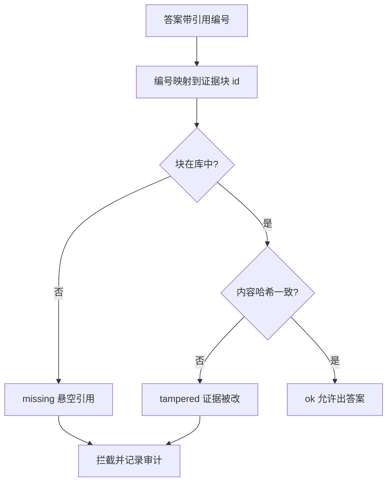

### Q2296 · 证据块的完整性校验:内容哈希与断链检测

> 难度:★★☆☆ | 标签:RAG, 引用, 完整性

**问**:RAG 答案里挂着引用编号,但语料每天在更新,怎么保证答案发出时引用的证据还在、还没被改?

**答**:出答案前跑一遍完整性校验,查三件事:存在性——引用的块 id 必须还在库里,语料重建后 id 失效就是悬空引用;一致性——每块入库时存内容哈希,出答案时重算比对,块内容被改过立即暴露,防止"引用说的是 A 现在库里是 B"的静默漂移;断链——答案文本里的 [n] 编号必须全部能映射到块 id,映射缺号说明生成或后处理环节丢了引用。三查结果分类 missing、tampered、ok,任何一项非空就拦截或降级,审计日志记下拦截原因。没有这道闸,引用就从溯源证据退化成了装饰。



```python
# file: code/06_Agent与LLM及系统设计/q2296_evidence_integrity.py
"""证据完整性校验:引用必须在库 内容哈希必须一致,检测证据被改 被删 链路断开。"""
import hashlib, re


def digest(text):
    return hashlib.sha256(text.encode("utf-8")).hexdigest()[:16]


class EvidenceStore:
    def __init__(self):
        self.blocks = {}

    def add(self, bid, text, source):
        self.blocks[bid] = {"text": text, "hash": digest(text), "source": source}

    def verify_citations(self, cited_ids):
        report = {"ok": [], "missing": [], "tampered": []}
        for cid in cited_ids:
            blk = self.blocks.get(cid)
            if blk is None:
                report["missing"].append(cid)
            elif digest(blk["text"]) != blk["hash"]:
                report["tampered"].append(cid)
            else:
                report["ok"].append(cid)
        report["pass"] = not report["missing"] and not report["tampered"]
        return report


def check_answer_refs(answer, id_map):
    used = set(int(m) for m in re.findall(r"\[(\d+)\]", answer))
    return sorted(n for n in used if n not in id_map)


if __name__ == "__main__":
    store = EvidenceStore()
    store.add("b1", "退货窗口 30 天", "policy.pdf#p1")
    store.add("b2", "退款 3 个工作日到账", "faq.html#q5")
    rep = store.verify_citations(["b1", "b2"])
    assert rep["pass"] and set(rep["ok"]) == {"b1", "b2"}
    store.blocks["b2"]["text"] = "退款 30 天到账"
    rep = store.verify_citations(["b1", "b2"])
    assert not rep["pass"] and rep["tampered"] == ["b2"], "内容被改哈希对不上"
    rep = store.verify_citations(["b1", "b9"])
    assert rep["missing"] == ["b9"], "引用了不存在的块"
    assert check_answer_refs("见[1]与[3]。", {1: "b1"}) == [3], "答案引用编号断链"
    print("证据完整性通过:存在性 内容哈希 篡改检测 断链编号")
```

**追问**:
- 语料合法更新后哈希必然对不上怎么办? 答:更新走重嵌入流程时同步刷新块哈希,校验只拦"未走流程的改动"
- 流式输出怎么拦? 答:引用块在首 token 前先校验,校验不过直接走拒答模板,而不是流到一半撤回
