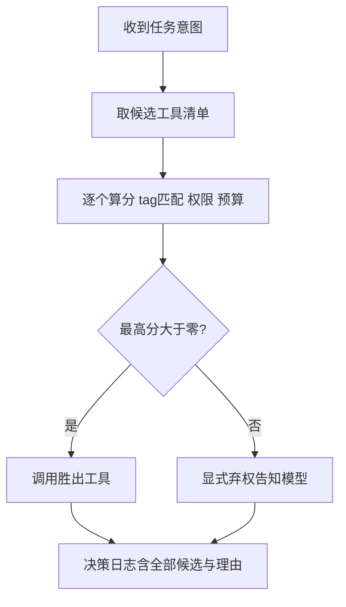

### Q2302 · 工具选择的决策留痕:候选评分与可解释日志

> 难度:★★★☆ | 标签:Agent, 可观测性, 可解释

**问**:Agent 明明有查订单的工具,却总去调客户资料库,用户等得着急,怎么定位和复盘这类选错工具的问题?

**答**:给工具选择加一层显式评分与留痕:每个候选按 tag 匹配度、权限、预算余量打分,无权限是大额负分,超预算也扣分但不隐藏;胜出者执行,落选者连同扣分理由全部进决策日志。日志回答三个问题:当时有哪些候选、各自为什么得这个分、为什么没选它。无任何候选得分大于零时显式弃权,把"我不知道该用什么工具"反馈给模型或人工,而不是硬选一个最不坏的。有了留痕,选错工具从玄学变成数据问题:复盘能看到权限配错、标签缺失还是评分权重不合理,改哪一项立竿见影。



```python
# file: code/06_Agent与LLM及系统设计/q2302_tool_decision_trace.py
"""工具选择留痕:候选工具按相关度 权限 成本打分,胜出与落选都进决策日志。"""


def score_candidates(cands, query_tags, budget_left):
    scored = []
    for c in cands:
        overlap = len(set(c["tags"]) & set(query_tags))
        s = overlap * 3.0
        if not c["allowed"]:
            s -= 100.0
        if c["avg_cost"] > budget_left:
            s -= 20.0
        scored.append({"tool": c["name"], "score": round(s, 2),
                       "reason": "tag匹配%d 权限%s 预算%s" % (
                           overlap, "有" if c["allowed"] else "无",
                           "够" if c["avg_cost"] <= budget_left else "超")})
    scored.sort(key=lambda d: d["score"], reverse=True)
    return scored


def decide(cands, query_tags, budget_left):
    trace = score_candidates(cands, query_tags, budget_left)
    winner = trace[0]["tool"] if trace and trace[0]["score"] > 0 else None
    return {"winner": winner, "trace": trace}


if __name__ == "__main__":
    cands = [
        {"name": "order_api", "tags": ["order", "refund"], "allowed": True, "avg_cost": 0.02},
        {"name": "crm_lookup", "tags": ["customer"], "allowed": True, "avg_cost": 0.01},
        {"name": "raw_delete", "tags": ["order", "refund"], "allowed": False, "avg_cost": 0.0},
    ]
    d = decide(cands, ["refund", "order"], budget_left=0.05)
    assert d["winner"] == "order_api"
    assert [t["tool"] for t in d["trace"]] == ["order_api", "crm_lookup", "raw_delete"]
    assert d["trace"][2]["score"] < 0 and "无" in d["trace"][2]["reason"], "无权限候选垫底但留痕"
    d2 = decide(cands, ["weather"], budget_left=0.01)
    assert d2["winner"] is None, "无相关候选时显式说不知道 而不是硬选"
    assert all(t["score"] <= 0 for t in d2["trace"])
    d3 = decide(cands, ["refund", "order"], budget_left=0.005)
    assert "超" in d3["trace"][0]["reason"], "超预算也要扣分留痕"
    print("决策留痕通过:候选评分 胜出落选全留痕 无候选显式弃权")
```

**追问**:
- 权重怎么定? 答:先用等权跑线上 badcase 回放,按"哪些 case 因此修好"调,不拍脑袋
- 日志量太大怎么办? 答:落选候选只存分数与理由码,完整参数只在抽样与失败请求上保留
