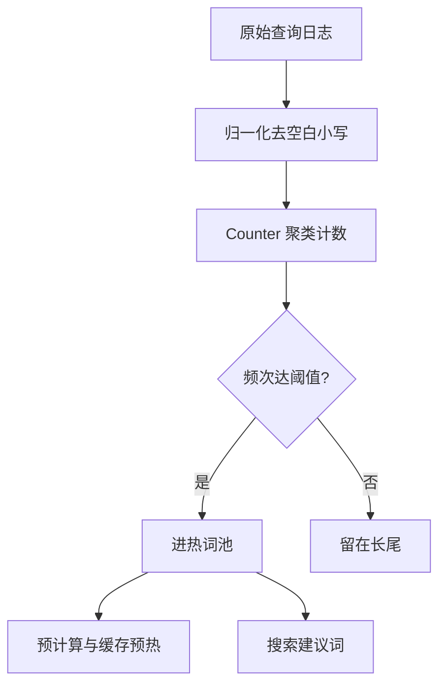

### Q2308 · 查询聚类与热词池:高频聚合与预计算

> 难度:★★☆☆ | 标签:RAG, 缓存, 运营

**问**:一天几十万条查询,大量是"退货政策"换个空格写法,怎么识别热点并利用它?

**答**:先归一化再聚类:去首尾空白、压内部空白、统一小写,"退货 政策"与"退货政策"聚成同一键,Counter 计数后按阈值筛出热词。热词池有两个出口:预计算出口,对高频查询提前跑检索与生成、结果进缓存,高峰期这些查询直接命中,把昂贵的实时链路省掉;建议出口,作为搜索联想词露出,引导用户用规范表述,进一步抬高命中率。阈值定多高要看流量分布,通常取覆盖头部两成流量的最小集合。热词池要定期重算,查询分布随运营活动漂移,昨天的热点今天可能过期。



```python
# file: code/06_Agent与LLM及系统设计/q2308_hot_query_pool.py
"""查询热词池:归一化聚类高频查询,超过阈值进热池,预热缓存与推荐词双输出。"""
import re
from collections import Counter


def norm_query(q):
    return re.sub(r"\s+", "", q.strip().lower())


def cluster_queries(logs, threshold=3):
    counts = Counter(norm_query(q) for q in logs)
    hot = {q: c for q, c in counts.items() if c >= threshold}
    return counts, hot


def build_pool(hot, top_n=5):
    ranked = sorted(hot.items(), key=lambda kv: (-kv[1], kv[0]))[:top_n]
    return {"prefetch": [q for q, _ in ranked],
            "suggest": sorted(q for q, _ in ranked)}


if __name__ == "__main__":
    logs = ["退货 政策", "退货政策", "退货政策", "退款进度", "退款 进度", "发票开具"]
    counts, hot = cluster_queries(logs, threshold=2)
    assert counts["退货政策"] == 3, "空白变体聚到同一键"
    assert set(hot) == {"退货政策", "退款进度"}
    assert "发票开具" not in hot, "低频查询不入热池"
    pool = build_pool(hot)
    assert pool["prefetch"][0] == "退货政策", "按频次排预计算池"
    assert pool["suggest"] == sorted(pool["prefetch"])
    print("热词池通过:归一聚类 阈值筛选 预热与建议双输出")
```

**追问**:
- 与语义缓存的分工? 答:热词池处理"归一化后同串"的显式热点,语义缓存兜长尾的"意思相近",两者命中层次不同
- 热词被攻击刷量怎么办? 答:按租户与来源 IP 做频次去偏,单一来源贡献的计数打折或剔除
