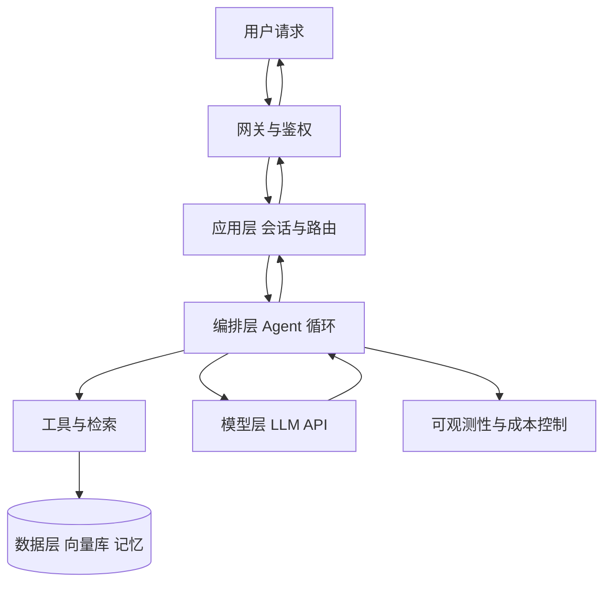

### Q231 · LLM 应用的基本架构是怎样的

> 难度:★★ | 标签:Agent, 架构

**问**:一个典型的 LLM 应用由哪些层组成?和传统后端服务的差别在哪?

**答**:典型架构分为四层:应用层(路由、会话、业务逻辑)、编排层(Agent 循环、Prompt 组装、工具调用)、模型层(LLM API 或自部署推理服务)、数据层(向量库、记忆存储、知识库)。与传统后端最大的差别是核心逻辑由"概率生成"承担,因此必须额外考虑:不确定性输出的校验与重试、成本与延迟控制、可观测性追踪、上下文管理。



```python
# file: code/06_Agent与LLM及系统设计/q231_basic_arch.py
"""用一次最小化调用演示 LLM 应用四层结构:应用层组装消息、模型层返回、编排层处理。"""


class FakeLLM:
    """模拟模型层,替代真实 API。"""

    def chat(self, messages: list[dict]) -> str:
        last = messages[-1]["content"]
        return f"[模型回复] 已收到消息:{last}"


class Application:
    """应用层 + 编排层:会话维护、Prompt 组装、调用模型。"""

    def __init__(self, llm):
        self.llm = llm
        self.history: list[dict] = [{"role": "system", "content": "你是一个助手"}]

    def handle(self, user_input: str) -> str:
        self.history.append({"role": "user", "content": user_input})
        answer = self.llm.chat(self.history)
        self.history.append({"role": "assistant", "content": answer})
        return answer


if __name__ == "__main__":
    app = Application(FakeLLM())
    print(app.handle("你好,介绍一下你自己"))
    print(f"会话消息数:{len(app.history)}")
```

**追问**:
- 为什么 LLM 应用要强调可观测性?因为输出不可控、链路更长(检索+生成),排查问题必须能还原当时的 prompt、检索内容和耗时。
- 概率生成承担核心逻辑,校验怎么做?——结构化输出 schema 校验 + 业务规则断言 + 失败重试;把「模型输出」当不可信输入是设计起点。
- 成本与延迟的控制点在哪几层?——模型分级路由、上下文瘦身、缓存、输出约束;以及架构层能短路就不进循环。
- 四层里哪层最容易出故障?——数据层(检索质量)与编排层(循环失控);模型层故障反而少见且多为账号限流类。
