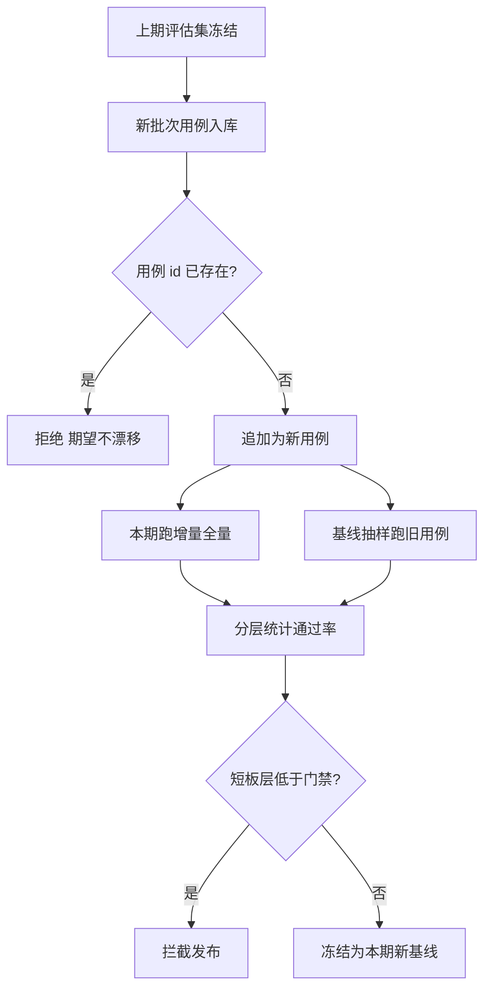

### Q2313 · 评估分层报告:难度分桶与短板定位

> 难度:★★★☆ | 标签:RAG, 评估, 质量门禁

**问**:整体通过率 67%,这个数字能指导优化吗?发布决策该看什么?

**答**:整体通过率会掩盖结构问题:hard 层全挂而 easy 层全对,均值依然体面。分层报告按难度与类目交叉分桶,每桶算通过率与失败数,低于门禁的桶列为短板层直接给出。发布决策看的是短板:任何一层低于门禁就拦截,整体分只用于趋势观察。这个设计还逼着团队把评估集建成有结构的——没有难度与类目标注就分不了桶,倒逼标注规范(呼应 Q1163)。短板层是优化路线图:hard/tool 挂了就补工具调用的 hard case 与能力,而不是全网撒网调 prompt。



```python
# file: code/06_Agent与LLM及系统设计/q2313_stratified_report.py
"""评估分层报告:用例带难度与类目标签,分桶统计通过率,短板层一目了然。"""
def stratified_report(results, gate=0.8):
    buckets = {}
    for r in results:
        key = (r["diff"], r["cat"])
        b = buckets.setdefault(key, {"n": 0, "pass": 0})
        b["n"] += 1
        b["pass"] += 1 if r["pass"] else 0
    rows = []
    for (diff, cat), b in sorted(buckets.items()):
        rate = b["pass"] / b["n"]
        rows.append({"diff": diff, "cat": cat, "n": b["n"],
                     "rate": round(rate, 2), "fail": b["n"] - b["pass"]})
    overall = sum(1 for r in results if r["pass"]) / len(results) if results else 0.0
    weak = [r for r in rows if r["rate"] < gate]
    return {"overall": round(overall, 2), "rows": rows, "weak": weak,
            "gate": gate, "verdict": "fail" if weak else "pass"}


if __name__ == "__main__":
    data = [
        {"id": "c1", "diff": "easy", "cat": "faq", "pass": True},
        {"id": "c2", "diff": "easy", "cat": "faq", "pass": True},
        {"id": "c3", "diff": "hard", "cat": "tool", "pass": False},
        {"id": "c4", "diff": "hard", "cat": "tool", "pass": False},
        {"id": "c5", "diff": "hard", "cat": "faq", "pass": True},
        {"id": "c6", "diff": "mid", "cat": "rag", "pass": True},
    ]
    rep = stratified_report(data, gate=0.8)
    assert rep["overall"] == 0.67
    assert rep["verdict"] == "fail", "hard/tool 层通过率 0 应卡门禁"
    assert rep["weak"] == [{"diff": "hard", "cat": "tool", "n": 2, "rate": 0.0, "fail": 2}]
    fixed = [dict(d, **{"pass": True}) if d["id"] in ("c3", "c4") else d for d in data]
    rep2 = stratified_report(fixed, gate=0.8)
    assert rep2["verdict"] == "pass" and rep2["weak"] == [], "短板修复后门禁放行"
    print("分层报告通过:分桶通过率 短板定位 门禁联动")
```

**追问**:
- 分桶太细每桶样本太少怎么办? 答:设最小样本数,不足的桶合并上报或标记 insufficient 不参与门禁
- 门禁值怎么定? 答:从现状出发定在略高于当前水平,滚动收紧,一步到位的高门禁只会催生造假
