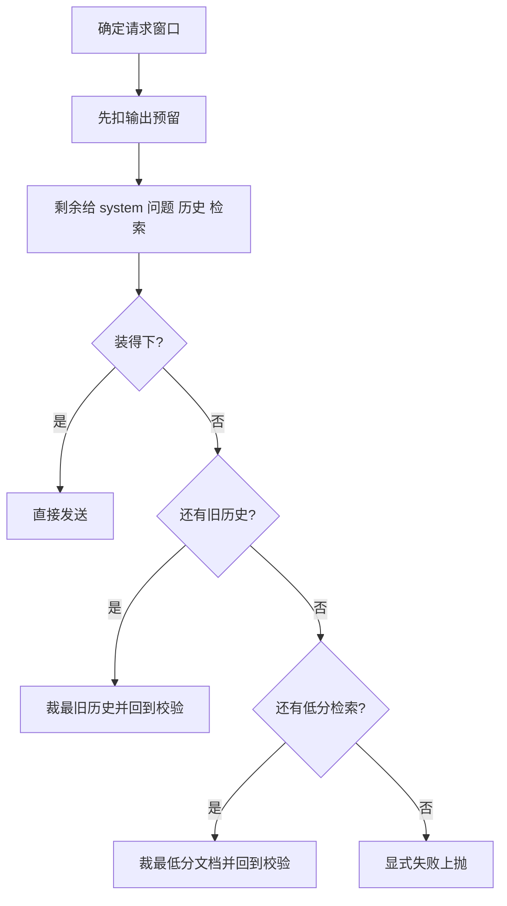

### Q2319 · 请求级 Token 预算:输出预留与裁剪顺序

> 难度:★★★☆ | 标签:LLM 运维, Token, 成本

**问**:Q1170 分配了上下文各段配额,单个请求总 token 超窗的最后一道闸怎么设计?裁剪先裁谁?

**答**:请求级预算的顺序是:先从窗口里扣掉输出预留 max_tokens,输出是不可裁的刚性需求,预留不足会导致答案被 finish_reason=length 截断,比丢历史更伤。剩余预算给 system、问题、历史、检索,system 与当前问题永不裁——它们定义本次请求的目的。裁剪顺序:先裁最旧历史(信息密度最低、指代价值随轮次衰减),历史裁完还不够再裁低分检索文档(按分数从低到高),检索也裁完仍超窗就显式失败上抛,绝不静默发送注定被 API 拒绝的请求。裁剪决策记录 dropped 计数,与最终 usage 对账,能回答"这次请求为什么丢了上下文"。



```python
# file: code/06_Agent与LLM及系统设计/q2319_request_token_budget.py
"""请求级 token 预算:先给输出留 max_tokens,再按 历史最旧 检索最低分 顺序裁剪,system 与问题不动。"""
def est(text):
    return max(1, len(text) // 2)


def fit_request(system, question, history, retrieval, max_output=256, window=1024):
    budget = window - max_output

    def total(hs, rs):
        return est(system) + est(question) + sum(est(h[1] if isinstance(h, tuple) else h) for h in hs) + sum(est(r["text"]) for r in rs)

    keep_hist, keep_ret = list(history), list(retrieval)
    dropped = {"history": 0, "retrieval": 0}
    while total(keep_hist, keep_ret) > budget:
        if keep_hist:
            keep_hist.pop(0)
            dropped["history"] += 1
        elif keep_ret:
            worst = min(range(len(keep_ret)), key=lambda i: keep_ret[i]["score"])
            keep_ret.pop(worst)
            dropped["retrieval"] += 1
        else:
            break
    return {"history": keep_hist, "retrieval": keep_ret, "dropped": dropped,
            "fits": total(keep_hist, keep_ret) <= budget,
            "used": total(keep_hist, keep_ret), "budget": budget}


if __name__ == "__main__":
    history = [("user", "第一问" + "字" * 200), ("assistant", "答" * 200),
               ("user", "第二问" + "字" * 200), ("assistant", "答" * 200)]
    retrieval = [{"text": "高分文档" + "案" * 196, "score": 0.9},
                 {"text": "低分文档" + "案" * 196, "score": 0.2}]
    r = fit_request("你是客服", "退货怎么办", history, retrieval, max_output=256, window=600)
    assert r["fits"], "裁剪后必须装进窗口"
    assert r["dropped"]["history"] > 0 and r["dropped"]["retrieval"] == 0, "先裁最旧历史"
    assert r["history"] == history[3:], "保留的是较新历史"
    r2 = fit_request("你是客服", "退货怎么办", [], retrieval, max_output=900, window=1024)
    assert r2["dropped"]["history"] == 0 and r2["dropped"]["retrieval"] >= 1, "没历史可裁就裁低分检索"
    assert r2["retrieval"][0]["score"] == 0.9, "高分文档幸存"
    r3 = fit_request("系统" + "超" * 2500, "问", [], [], max_output=0, window=1024)
    assert not r3["fits"], "system 加问题本身超窗 只能显式失败"
    print("请求级预算通过:输出预留 先裁旧史 再裁低分 不足则上抛")
```

**追问**:
- 输出预留设多少? 答:按业务答案长度 p95 加余量,摘要类任务几百 token,代码生成类要给足,预留不足是截断事故的头号原因
- 裁剪要不要通知模型? 答:被裁上下文用一行摘要占位告知"早期对话已省略",模型对信息缺口的预期更准
