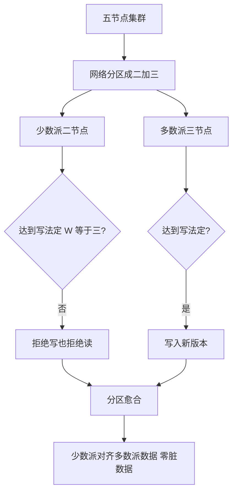

### Q2325 · 脑裂下的法定人数写入:少数派拒绝与零脏数据

> 难度:★★★★★ | 标签:分布式, 脑裂, 一致性

**问**:五节点集群分区成 2 加 3,少数派那两个节点会怎样?愈合后要不要清洗脏数据?

**答**:法定人数机制的漂亮之处在于脏数据根本不会产生。写需要凑齐 W=3 个副本确认:少数派只有 2 个存活节点,写请求在提交阶段就失败,少数派连一个新版本都写不进去;读同理要求 R=3,少数派连旧值都不外泄,防止客户端基于旧值做决策。多数派 3 节点凑齐法定人数,照常读写,服务不中断。愈合时少数派与多数派状态对齐,因为少数派从未写成功,不存在冲突版本需要仲裁——这正是 Q1517 的 epoch 机制要防的"双主各写"被写法定在源头掐灭。代价是少数派完全不可用,这是 CP 的选择,可用性由多数派侧承担。



```python
# file: code/06_Agent与LLM及系统设计/q2325_quorum_write.py
"""法定人数写入:N=5 W=3 R=3,分区后少数派两节点凑不齐 W 全部拒绝写,愈合后无脏数据。"""
class QuorumCluster:
    def __init__(self, nodes=5, w=3, r=3):
        self.w, self.r = w, r
        self.alive = set(range(nodes))
        self.data = {}

    def write(self, key, val, ver):
        if len(self.alive) < self.w:
            return {"ok": False, "reason": "存活 %d 不足写法定 %d" % (len(self.alive), self.w)}
        self.data[key] = {"val": val, "ver": ver}
        return {"ok": True, "ver": ver}

    def read(self, key):
        if len(self.alive) < self.r:
            return {"ok": False, "reason": "存活副本不足读法定"}
        rec = self.data.get(key)
        if rec is None:
            return {"ok": False, "reason": "not found"}
        return {"ok": True, "val": rec["val"], "ver": rec["ver"]}

    def partition(self, alive_subset):
        self.alive = set(alive_subset)

    def heal(self, majority_state):
        self.data = dict(majority_state)
        self.alive = set(range(5))


if __name__ == "__main__":
    c = QuorumCluster()
    r0 = c.write("plan", "v1", 1)
    assert r0["ok"], "全员存活写成功"
    c.partition({0, 1})
    rw = c.write("plan", "v1-minor", 2)
    assert not rw["ok"] and "不足写法定" in rw["reason"], "少数派凑不齐 W 拒绝写"
    assert not c.read("plan")["ok"], "少数派连读也不给 防旧值外泄"
    c.partition({2, 3, 4})
    assert c.write("plan", "v2", 2)["ok"], "多数派照常服务"
    majority_state = dict(c.data)
    c.heal(majority_state)
    got = c.read("plan")
    assert got["val"] == "v2" and got["ver"] == 2, "愈合后全网只有多数派的版本"
    assert "v1-minor" not in str(c.data), "少数派从未写成 不存在脏数据"
    print("法定人数通过:少数派拒写拒读 多数派可用 愈合零脏数据")
```

**追问**:
- W 与 R 怎么权衡? 答:W 越大写可用性越差读越新,R 越大读可用性越差一致性越强,常见 W=R=多数派
- 法定人数能防所有脑裂吗? 答:能防数据分叉,防不了"客户端绕过集群直连旧主"这类旁路,存储侧还要 fencing
