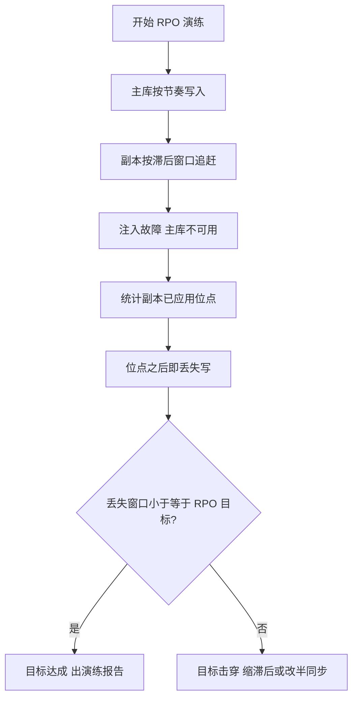

### Q2330 · 跨区复制的 RPO 演练核算:丢失窗口实测

> 难度:★★★★ | 标签:分布式, 容灾, 复制

**问**:Q1519 讲了 RPO 是复制滞后的量化,但承诺给业务的"RPO 小于 500 毫秒"怎么证明兑现?

**答**:靠演练实测,不靠架构图。演练台复现完整链路:主库按固定节奏写 binlog,副本按滞后窗口异步追赶,然后注入故障切主。切主瞬间统计副本已应用位点,位点之后的写就是真实丢失,丢失窗口等于最新写时间戳减最早丢失写时间戳,拿实测值对赌 RPO 目标。滞后 300 毫秒丢 200 毫秒窗口达标;滞后放大到 700 毫秒窗口击穿 500 毫秒承诺,演练直接判不合格,整改方向是压滞后或改半同步。演练的价值在把 RPO 从 SLA 文档的形容词变成可复测的数字,并且暴露"平时 lag 300、故障前流量尖峰 lag 飙到 900"这类真实分布问题。



```python
# file: code/06_Agent与LLM及系统设计/q2330_rpo_drill.py
"""RPO 演练:主机房秒级写 连副本异步追,故障时刻切主,实测丢失条数对照 RPO 目标。"""
class DrillRig:
    def __init__(self, rpo_target_ms=500):
        self.rpo_target = rpo_target_ms
        self.wal = []
        self.replica_seq = 0
        self.now = 0

    def primary_write(self, key, val):
        self.now += 100
        self.wal.append({"ts": self.now, "key": key, "val": val})
        return len(self.wal)

    def replica_catch_up(self, lag_ms=300):
        horizon = self.now - lag_ms
        while self.replica_seq < len(self.wal) and self.wal[self.replica_seq]["ts"] <= horizon:
            self.replica_seq += 1

    def failover(self):
        lost = self.wal[self.replica_seq:]
        return {"lost_count": len(lost),
                "lost_window_ms": (self.now - lost[0]["ts"]) if lost else 0,
                "within_rpo": (self.now - lost[0]["ts"]) <= self.rpo_target if lost else True}


if __name__ == "__main__":
    rig = DrillRig(rpo_target_ms=500)
    for i in range(10):
        rig.primary_write("k%d" % i, i)
    rig.replica_catch_up(lag_ms=300)
    r = rig.failover()
    assert r["lost_count"] == 3 and r["lost_window_ms"] == 200 and r["within_rpo"], "滞后 300ms 丢 3 条 200ms 窗口"
    rig2 = DrillRig(rpo_target_ms=500)
    for i in range(10):
        rig2.primary_write("k%d" % i, i)
    rig2.replica_catch_up(lag_ms=700)
    r2 = rig2.failover()
    assert r2["lost_count"] == 7 and r2["lost_window_ms"] == 600 and not r2["within_rpo"], "滞后 700ms 突破 RPO 目标"
    rig3 = DrillRig(rpo_target_ms=500)
    for i in range(4):
        rig3.primary_write("k%d" % i, i)
    rig3.replica_catch_up(lag_ms=50)
    r3 = rig3.failover()
    assert r3["lost_count"] <= 1, "低滞后几乎零丢失"
    print("RPO 演练通过:丢失条数与窗口实测 目标对赌成立")
```

**追问**:
- 丢掉的写业务侧怎么补? 答:对账系统拿上游流水回放补录(呼应 Q1227),演练同时验证补录链路
- RPO 达标但 RTO 很长行不行? 答:看业务,数据不丢但两小时不可用对交易类业务同样致命,RPO 与 RTO 必须一起承诺
