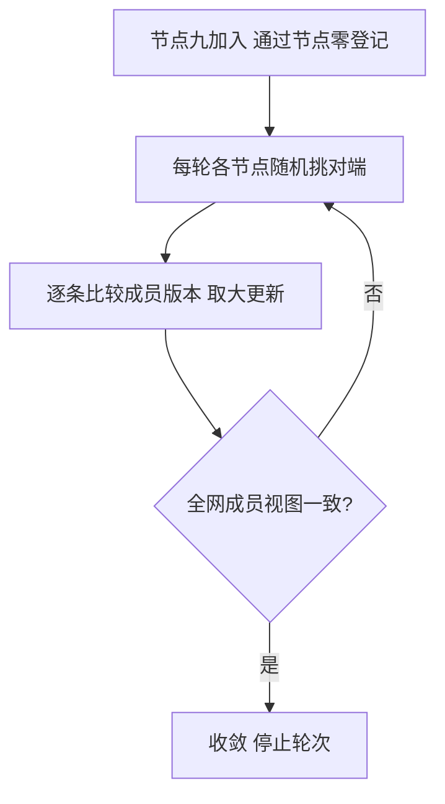

### Q2335 · Gossip 成员同步:版本化列表与轮次收敛

> 难度:★★★★ | 标签:分布式, Gossip, 成员管理

**问**:集群十几个节点,新节点加入后,不用中心注册表怎么让全网尽快知道?

**答**:Gossip 协议:每轮每个节点随机挑一个对端,交换成员列表,逐条按版本号取大更新——版本号单调,旧信息永远赢不了新信息。新节点加入时由任意已知节点登记进自己的成员表并递增版本,之后每轮 gossip 像传染病一样扩散,几十个节点内个位数轮次全网收敛。gossip 的美在于无中心:任何节点都能登记与传播,单点故障不影响成员视图传播;最终一致,收敛前各节点视图暂时不同是接受的代价。工程配套:成员条目带心跳时间与怀疑状态,长期无心跳的成员先标记 suspect 再摘除,防抖动;随机选对端要加权,保证新信息快速触达而不是总在熟节点间打转。



```python
# file: code/06_Agent与LLM及系统设计/q2335_gossip_membership.py
"""Gossip 成员同步:节点随机互拉成员表 按版本号取新,轮次内全网收敛。"""
import random


def build(n):
    return {i: {"ver": 0, "members": {i: 0}} for i in range(n)}


def gossip_round(nodes, rng):
    changed = 0
    for i in list(nodes):
        j = rng.choice([x for x in nodes if x != i])
        mine, theirs = nodes[i], nodes[j]
        updated = False
        for m, v in theirs["members"].items():
            if v > mine["members"].get(m, -1):
                mine["members"][m] = v
                updated = True
        if updated:
            mine["ver"] += 1
            changed += 1
    return changed


def join(nodes, nid, new_node):
    nodes[nid]["members"][new_node] = nodes[nid]["ver"] + 1


def converged(nodes):
    members = [frozenset(n["members"]) for n in nodes.values()]
    return len(set(members)) == 1


if __name__ == "__main__":
    nodes = build(5)
    rng = random.Random(42)
    join(nodes, 0, 9)
    rounds = 0
    while not converged(nodes) and rounds < 20:
        gossip_round(nodes, rng)
        rounds += 1
    assert converged(nodes), "gossip 轮次内全网收敛"
    assert rounds <= 10, "5 节点应在个位数轮收敛 实测 %d" % rounds
    for i in range(5):
        assert 9 in nodes[i]["members"], "新成员视图同步到每个节点"
    info = [nodes[i]["members"][9] for i in range(5)]
    assert len(set(info)) == 1, "成员条目版本全网一致"
    print("gossip 收敛通过:轮次 %d 全员视图一致" % rounds)
```

**追问**:
- 节点退出的消息怎么传? 答:与加入对称,退出也带版本号传播;异常失联则靠心跳超时触发 suspect 再全网红
- gossip 和共识协议什么关系? 答:gossip 传播最终一致的成员与状态,选主、提交这类强一致决策仍要共识或租约,两者互补
